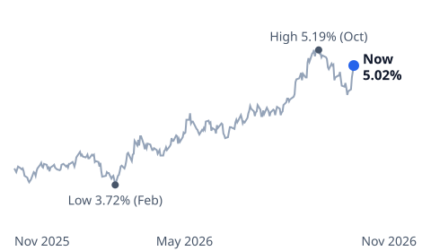

# mkviz-engine

[](https://doi.org/10.5281/zenodo.24025690)

The calculation engine and chart data behind [MKViz](https://mkviz.com), a blog that explains money news with long-run official data.

Every number in an MKViz article that comes from our own calculation is produced by this engine, and every chart's data is published here so anyone can check it.



**Latest articles**

- [Bond Fund Calculator: Every Loss Since 1969 and Its Recovery](https://mkviz.com/bond-fund-calculator/) · [data](data/bond-fund-calculator/)
- [Mortgage Rates History Since 1971: Is a 7% Rate High?](https://mkviz.com/mortgage-rates-history/) · [data](data/mortgage-rates-history/)
- [Bond Funds and Rising Yields: How Long Until You Break Even?](https://mkviz.com/bond-funds/) · [data](data/bond-funds/)
- [Black Friday Deals: Is November Really the Cheapest Month?](https://mkviz.com/black-friday-deals/) · [data](data/black-friday-deals/)
- [October Inflation Rate: The Number BLS Couldn't Publish](https://mkviz.com/october-inflation-rate/) · [data](data/october-inflation-rate/)

## What's here

- `engine/` — a small Rust program that reads official time series (FRED, BLS, EIA, World Bank, Census) and answers "how did this go in the past?": drawdowns and recoveries, where today ranks in history, bull and bear phases, event studies, seasonality, policy-rate cycles, stretches above a line, mortgage payments and more. It also draws the charts as SVG.
- `data/<article>/` — for each article, the data behind each chart (`.csv`), the exact engine settings that drew it (`.json`), the chart itself (`.svg`) and a README with the command that redraws it.
- `data/series/` — the official input series those charts were drawn from, as downloaded (public-domain US government data; World Bank data under CC BY 4.0).
- `METHODS.md` — what each calculation does and why.

## Run it

```
cd engine
cargo build --release
./target/release/mkviz-engine drawdowns ../data/series/fred_NASDAQCOM.csv --threshold 0.10
./target/release/mkviz-engine position ../data/series/fred_MSPUS.csv --afford ../data/series/fred_MORTGAGE30US.csv,../data/series/fred_MEHOINUSA646N.csv
```

Each result is JSON with a one-line `method` and a `provenance` block (engine version, input file, rows, date range, options). To redraw a chart, pass the `params` from its `.json` file back to `figure <frame>`.

Some charts use market prices from non-official sources; for those we publish the chart data but not the raw price series.

## License

Code: MIT. Chart data: free to reuse; please credit "MKViz" and link to the article.
