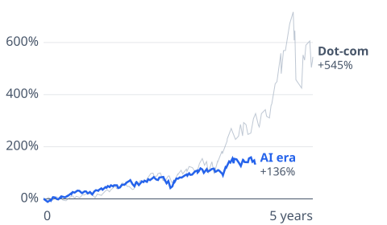
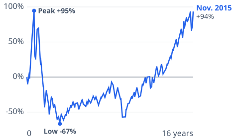
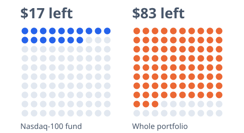

# [ai-stocks](https://mkviz.com/ai-stocks/)

Run from the repository root after `cd engine && cargo build --release && cd ..`.

## ai-vs-dotcom

Data: [ai-vs-dotcom.csv](ai-vs-dotcom.csv) · settings: [ai-vs-dotcom.json](ai-vs-dotcom.json)



```
./engine/target/release/mkviz-engine figure paths data/series/fred_NASDAQ100.csv --dates 1995-08-09,2022-11-30 --days 1825 --labels 'Dot-com,AI era' --title 'The Nasdaq-100 after Netscape'\''s IPO in 1995 and after ChatGPT'\''s launch in 2022' --out ai-vs-dotcom.svg
```

## ai-dotcom-aftermath

Data: [ai-dotcom-aftermath.csv](ai-dotcom-aftermath.csv) · settings: [ai-dotcom-aftermath.json](ai-dotcom-aftermath.json)



```
./engine/target/release/mkviz-engine figure paths data/series/fred_NASDAQ100.csv --dates 1999-07-14 --days 5950 --labels 'Nov. 2015' --title 'From this point in 1999, the Nasdaq-100 nearly doubled, lost 83%, then took until 2015 to get back' --out ai-dotcom-aftermath.svg
```

## ai-crash-pictogram

Data: [ai-crash-pictogram.csv](ai-crash-pictogram.csv) · settings: [ai-crash-pictogram.json](ai-crash-pictogram.json)



```
./engine/target/release/mkviz-engine figure pictogram data/series/fred_CPIAUCSL.csv --groups 'Nasdaq-100 fund:17:100:$17 left,Whole portfolio:83:100:$83 left' --title 'Out of every 100 dollars before a dot-com-size crash: what'\''s left in the fund, and in a portfolio where the fund is one-fifth' --out ai-crash-pictogram.svg
```
