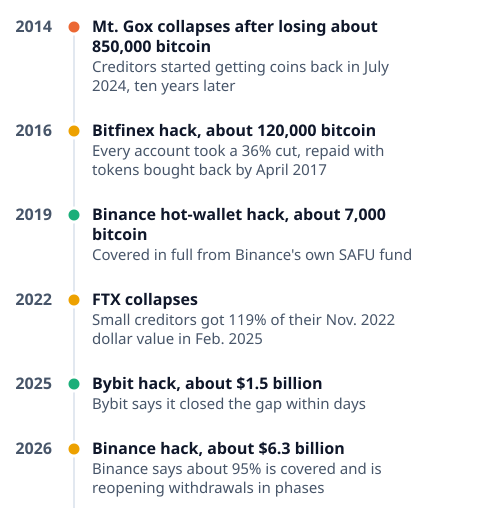

# [binance-hack](https://mkviz.com/binance-hack/)

Run from the repository root after `cd engine && cargo build --release && cd ..`.

## exchange-hacks-timeline

Data: [exchange-hacks-timeline.csv](exchange-hacks-timeline.csv) · settings: [exchange-hacks-timeline.json](exchange-hacks-timeline.json)



```
./engine/target/release/mkviz-engine figure timeline data/series/fred_CPIAUCSL.csv --items '2014|Mt. Gox collapses after losing about 850,000 bitcoin|Creditors started getting coins back in July 2024, ten years later|bad;2016|Bitfinex hack, about 120,000 bitcoin|Every account took a 36% cut, repaid with tokens bought back by April 2017|mixed;2019|Binance hot-wallet hack, about 7,000 bitcoin|Covered in full from Binance'\''s own SAFU fund|good;2022|FTX collapses|Small creditors got 119% of their Nov. 2022 dollar value in Feb. 2025|mixed;2025|Bybit hack, about $1.5 billion|Bybit says it closed the gap within days|good;2026|Binance hack, about $6.3 billion|Binance says about 95% is covered and is reopening withdrawals in phases|mixed' --title 'What happened to customers'\'' money after six big crypto exchange failures' --out exchange-hacks-timeline.svg
```
