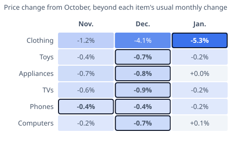

# [Black Friday Deals: Is November Really the Cheapest Month?](https://mkviz.com/black-friday-deals/)

## Research note

**Question.** Are prices really lowest around Black Friday? For the things people buy in the holiday season, which month is cheapest once each item's normal price trend is set aside?

**Short answer.** At the median, December was a little cheaper than November relative to October for toys, appliances, TVs and computers; phones bottomed in November by a hair; clothing fell every year into December and was lower again in January in 21 of 30 years. Year by year, December beat November in about half to two-thirds of years for most items, so the gap is small. For electronics the steady monthly decline (TVs about 1.1% a month since 1995, 0.75% in the last decade) is about as large as the holiday dip; computers have fallen much more slowly since about 2016.

### Data
- Consumer Price Index for All Urban Consumers (CPI-U), U.S. city average, not seasonally adjusted, BLS. Apparel (CUUR0000SAA), toys (CUUR0000SERE01), major appliances (CUUR0000SEHK), televisions (CUUR0000SERA01), smartphones (CUUR0000SEEE04), computers and peripherals (CUUR0000SEEE01), all items (CUUR0000SA0).
- Monthly, 1995 (1997 for the three newer series) to October 2026; all items since 1957. October 2025 is missing (no survey during the 2025 shutdown); months whose 13-month window crosses it are skipped.

### Method
1. **Remove the trend.** Each month's index is divided by a centered 2x12 moving average (the classical ratio-to-moving-average decomposition). What is left is that month's seasonal position, so an item that falls every month, such as televisions, is not counted as "cheaper in December" just because December comes after October.
2. **Compare with October.** For each year, the change from October to each of the next four months is (1 + month's seasonal position) / (1 + October's) - 1. We report the median across years and the share of years it was negative.
3. **Usual monthly change** is the average month-to-month change of the unadjusted index over the whole period, for context.

Reproduce from the repository root:
```
./engine/target/release/mkviz-engine seasonal data/series/bls_CUUR0000SAA.csv --detrend --base 10 --ahead 4
./engine/target/release/mkviz-engine seasonal data/series/bls_CUUR0000SERE01.csv --detrend --base 10 --ahead 4
./engine/target/release/mkviz-engine seasonal data/series/bls_CUUR0000SEHK.csv --detrend --base 10 --ahead 4
./engine/target/release/mkviz-engine seasonal data/series/bls_CUUR0000SERA01.csv --detrend --base 10 --ahead 4
./engine/target/release/mkviz-engine seasonal data/series/bls_CUUR0000SEEE04.csv --detrend --base 10 --ahead 4
./engine/target/release/mkviz-engine seasonal data/series/bls_CUUR0000SEEE01.csv --detrend --base 10 --ahead 4
./engine/target/release/mkviz-engine seasonal data/series/bls_CUUR0000SA0.csv --detrend --base 10 --ahead 4
```

### Results
Median change from October, net of each item's trend:

| Item (BLS series) | Usual change per month | Nov. | Dec. | Jan. | Feb. | Years |
|---|---|---|---|---|---|---|
| Clothing (apparel) (CUUR0000SAA) | +0.04% | -1.2% (100% of years lower) | -4.1% (100% of years lower) | -5.3% (100% of years lower) | -3.2% (90% of years lower) | 30 |
| Toys (CUUR0000SERE01) | -0.36% | -0.4% (70% of years lower) | -0.7% (83% of years lower) | -0.2% (53% of years lower) | +0.5% (23% of years lower) | 30 |
| Major appliances (CUUR0000SEHK) | -0.04% | -0.7% (81% of years lower) | -0.8% (85% of years lower) | +0.0% (44% of years lower) | +0.2% (41% of years lower) | 27 |
| Televisions (CUUR0000SERA01) | -1.10% | -0.6% (63% of years lower) | -0.9% (60% of years lower) | -0.2% (53% of years lower) | +0.1% (43% of years lower) | 30 |
| Smartphones (CUUR0000SEEE04) | -0.79% | -0.4% (63% of years lower) | -0.4% (63% of years lower) | -0.2% (56% of years lower) | +0.6% (30% of years lower) | 27 |
| Computers and peripherals (CUUR0000SEEE01) | -0.96% | -0.2% (63% of years lower) | -0.7% (56% of years lower) | +0.1% (48% of years lower) | +0.4% (44% of years lower) | 27 |
| All items (CUUR0000SA0) | +0.30% | -0.2% (84% of years lower) | -0.4% (88% of years lower) | -0.3% (85% of years lower) | -0.2% (78% of years lower) | 68 |

### Year by year
- Years December was below November, net of trend: toys 19 of 30, appliances 16 of 27, TVs 16 of 30, phones 14 of 27, computers 14 of 27, clothing 30 of 30.
- Clothing: January below December in 21 of 30 years. Appliances: January below December in 2 of 27; toys 8 of 30.
- Share of months the unadjusted index fell, full period (last ten years): TVs 84% (69%), phones 78% (76%), computers 76% (52%).

### What the data can and cannot say
- The CPI is a monthly average. BLS collects prices "during the course of the entire month," in three pricing periods of about ten days each, so a one-day doorbuster on the Friday after Thanksgiving is only partly reflected, and limited-quantity deals may not be at all. These results describe the season's typical prices, not the best single deal.
- Categories are broad national averages; a given model or store can differ.
- Some electronics indexes are quality-adjusted (BLS lists hedonic adjustment for phones and cost-based adjustment for computers; none for televisions), which affects their trend more than their seasonal pattern.
- About 16% of CPI price quotes (excluding rent) came from online outlets as of 2023, according to BLS.

### Sources
- BLS, CPI data: https://www.bls.gov/cpi/data.htm
- BLS, Handbook of Methods, CPI concepts (collection across the month): https://www.bls.gov/opub/hom/cpi/concepts.htm
- BLS, CPI questions and answers (pricing periods, online outlets): https://www.bls.gov/cpi/questions-and-answers.htm
- BLS, Quality adjustment in the CPI (methods by item): https://www.bls.gov/cpi/quality-adjustment/home.htm

### Builds on and leads to
- Builds on [the October 2026 inflation note](https://github.com/CertainAmount/mkviz-engine/tree/main/data/october-inflation-rate), which found that unadjusted prices tend to peak in October and ease in November; this note splits that pattern by item and removes trends.
- Open: add more holiday categories (jewelry, sporting goods, video games) as BLS series allow; test whether the December dip has shifted as online shopping grew.

### Cite
MKViz (2026). *Black Friday prices: which month is cheapest, by item.* https://mkviz.com/black-friday-deals/ ; code and data: https://github.com/CertainAmount/mkviz-engine/tree/main/data/black-friday-deals

## Charts

Run from the repository root after `cd engine && cargo build --release && cd ..`.

## holiday-price-season

Data: [holiday-price-season.csv](holiday-price-season.csv) · settings: [holiday-price-season.json](holiday-price-season.json)



```
./engine/target/release/mkviz-engine figure season data/series/bls_CUUR0000SA0.csv --ahead 3 --base 10 --cols Nov.,Dec.,Jan. --note 'Price change from October, beyond each item'\''s usual monthly change' --rows Clothing:data/series/bls_CUUR0000SAA.csv,Toys:data/series/bls_CUUR0000SERE01.csv,Appliances:data/series/bls_CUUR0000SEHK.csv,TVs:data/series/bls_CUUR0000SERA01.csv,Phones:data/series/bls_CUUR0000SEEE04.csv,Computers:data/series/bls_CUUR0000SEEE01.csv --title 'Which month is cheapest, by item' --out holiday-price-season.svg
```
