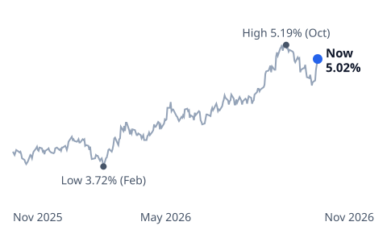
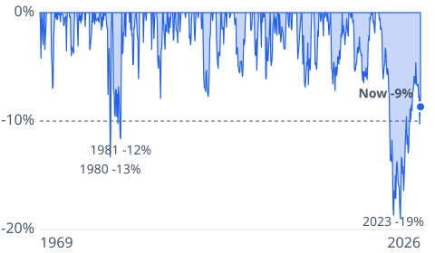
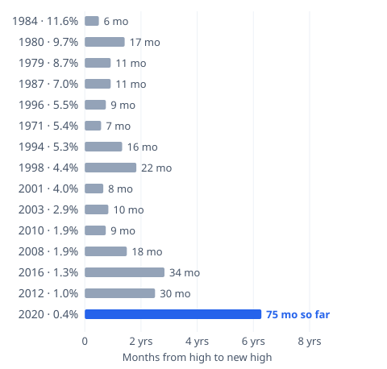

# [Bond Fund Calculator: Every Loss Since 1969 and Its Recovery](https://mkviz.com/bond-fund-calculator/)

## Research note

**Question.** How deep have bond fund losses been since 1969, how long did each take to earn back, and where does the loss that began in 2020 stand?

**Short answer.** A fund holding 7-year Treasury notes, with interest reinvested, fell 15 times by 5% or more since July 1969. The 14 that ended took a median of 11 months from high to new high, and none took longer than 34. The loss that began in July 2020 reached 19.0% by October 2023 and, 75 months after the high, the fund is still 8.7% below it.

### Data
- 7-year Treasury constant-maturity yield, daily since July 1, 1969 (Federal Reserve H.15 via FRED: DGS7), through Nov. 12, 2026.

### Method
- A bond fund's total return is rebuilt from the yield, month by month (constant-maturity method after Swinkels 2019, who treats the bond as a par bond with a duration-convexity approximation; we reprice it in full). At each month-end the fund buys a 7-year note at par with a coupon equal to that day's yield. One month later it prices that note at the new month-end yield with 7 years less one month left (semiannual compounding) and adds one month of interest. The index starts at 100 in July 1969.
- A drawdown is every stretch when the index closes at least 5% below its prior high, followed to its lowest month-end and to the first month-end at a new high. Recovery time is high to new high.
- "If yields hold" is the years a fund 8.7% below its high needs to get back at today's yield: ln(1 / (1 − loss)) / ln(1 + yield).
- No fees, taxes or credit risk: the result is a Treasury-only fund. A typical core bond fund also holds mortgage and corporate bonds and has a duration near six years, close to this 7-year note's.

```
mkviz-engine drawdowns data/macro/fred_DGS7.csv --bond-return 7 --threshold 0.05
mkviz-engine figure underwater data/macro/fred_DGS7.csv --bond-return 7 --lines 0.10 --out bond-fund-underwater.svg
mkviz-engine figure recent data/macro/fred_DGS7.csv --weeks 252 --suffix % --out bond-yield-recent.svg
mkviz-engine figure recover data/macro/fred_DGS7.csv --bond-return 7 --rates data/macro/fred_DGS7.csv --threshold 0.05 --out bond-fund-recovery.svg
mkviz-engine export data/macro/fred_DGS7.csv --bond-return 7 --out bond.json
```

### Results

| High | Low | Depth | New high | Months, high to new high |
|---|---|---|---|---|
| March 1971 | June 1971 | 7% | Oct. 1971 | 7 |
| June 1979 | Feb. 1980 | 13% | May 1980 | 11 |
| June 1980 | Sept. 1981 | 12% | Nov. 1981 | 17 |
| Jan. 1984 | May 1984 | 6% | July 1984 | 6 |
| Feb. 1987 | Sept. 1987 | 8% | Jan. 1988 | 11 |
| Jan. 1994 | Nov. 1994 | 8% | May 1995 | 16 |
| Jan. 1996 | May 1996 | 5% | Oct. 1996 | 9 |
| Sept. 1998 | Jan. 2000 | 6% | July 2000 | 22 |
| Oct. 2001 | March 2002 | 5% | June 2002 | 8 |
| May 2003 | July 2003 | 6% | March 2004 | 10 |
| Dec. 2008 | June 2009 | 7% | June 2010 | 18 |
| Oct. 2010 | March 2011 | 5% | July 2011 | 9 |
| July 2012 | Dec. 2013 | 7% | Jan. 2015 | 30 |
| July 2016 | April 2018 | 7% | May 2019 | 34 |
| July 2020 | Oct. 2023 | 19.0% | not yet | 75 so far |

Only three drawdowns went past 10%: 1979-80 (13.3%), 1980-81 (11.6%) and the current one.

The 7-year yield was 0.39% at the July 2020 high and 5.02% on Nov. 12, 2026 (3.86% a year earlier; past-year range 3.72% to 5.19%). Over the past 12 months the fund returned -3.0%. If the yield held at today's level, the fund would regain its 2020 high in about 1.9 years.

### Past test
Losses that started at yields near 9% to 10% around 1980 were made up by interest in under two years; the two that started near 1% in 2012 and 2016 took close to three. The 2020 high came at a yield under half a percent: the fund had almost no interest cushion when yields rose more than four points. That is why this drawdown is both the deepest and the longest in the record. The three longest recoveries (2012, 2016, 2020) all started with the 7-year yield below 1.5%; the link is loose above that (the 1998 loss, starting at 4.4%, took 22 months). The method was checked on two fixed cases in the engine tests: with a flat yield the fund grows by exactly a month's interest, and a one-point rise in a 7-year yield costs close to the note's duration.

### Limits
- Treasury notes only: no credit spreads, fees or taxes. Real funds also trade bonds of mixed maturities.
- Month-end rebalancing: losses inside a month are not shown. The latest point is the latest daily yield (Nov. 12), not a month-end.
- The "if yields hold" figure assumes the yield stays put; it will not.

### Sources
- Federal Reserve via FRED, Market Yield on U.S. Treasury Securities at 7-Year Constant Maturity (DGS7): https://fred.stlouisfed.org/series/DGS7
- Laurens Swinkels, *Treasury Bond Return Data Starting in 1962*, Data 4(3), 91, 2019: https://www.mdpi.com/2306-5729/4/3/91

### Builds on and leads to
- Builds on [the bond fund break-even note](https://mkviz.com/bond-funds/), which shows how long a single rise in yields takes to earn back by fund duration.
- Open: add a 2-year and a 20-year fund to compare short and long funds through the same years.

### Cite
MKViz (2026). *Bond fund calculator: every Treasury bond fund loss since 1969.* https://mkviz.com/bond-fund-calculator/ ; code and data: https://github.com/CertainAmount/mkviz-engine/tree/main/data/bond-fund-calculator

## Charts

Run from the repository root after `cd engine && cargo build --release && cd ..`.

## bond-yield-recent

Data: [bond-yield-recent.csv](bond-yield-recent.csv) · settings: [bond-yield-recent.json](bond-yield-recent.json)



```
./engine/target/release/mkviz-engine figure recent data/series/fred_DGS7.csv --suffix '%' --title '7-year Treasury yield, past year (daily)' --weeks 252 --out bond-yield-recent.svg
```

## bond-fund-underwater

Data: [bond-fund-underwater.csv](bond-fund-underwater.csv) · settings: [bond-fund-underwater.json](bond-fund-underwater.json)



```
./engine/target/release/mkviz-engine figure underwater data/series/fred_DGS7.csv --bond-return 7 --lines 0.10 --title 'How far a 7-year Treasury bond fund sat below its last high, monthly since 1969, interest reinvested' --out bond-fund-underwater.svg
```

## bond-fund-recovery

Data: [bond-fund-recovery.csv](bond-fund-recovery.csv) · settings: [bond-fund-recovery.json](bond-fund-recovery.json)



```
./engine/target/release/mkviz-engine figure recover data/series/fred_DGS7.csv --bond-return 7 --rates data/series/fred_DGS7.csv --threshold 0.05 --title 'Every 5%-plus loss in a 7-year Treasury bond fund since 1969: the yield when it started and months to a new high' --out bond-fund-recovery.svg
```
