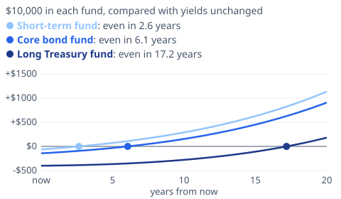

# [Bond Funds and Rising Yields: How Long Until You Break Even?](https://mkviz.com/bond-funds/)

## Research note

**Question.** When Treasury yields jump, how much does a bond fund lose right away, and how long does the higher yield take to make that loss back?

**Short answer.** A fund loses about its duration times the rise in yields at once, then earns the higher yield; on simple math it catches up with the path where yields stayed put after about as many years as its duration. For this week's rise of about 0.25 point in the 10-year yield, a fund with the duration of the iShares Core U.S. Aggregate Bond ETF (5.72 years) lost about 1.4% and breaks even in about 6.1 years.

### Data
- 10-year Treasury yield: 4.88% on Nov. 9, 2026 (Federal Reserve H.15 via FRED, DGS10) and 5.13% on Nov. 12 (CNBC; the bond market was closed Nov. 11). This fall's high was 5.31% on Oct. 5.
- iShares Core U.S. Aggregate Bond ETF (AGG), as of Nov. 11, 2026: effective duration 5.72 years, average yield to maturity 5.33% (issuer page).
- 2022: the 10-year yield went from 1.52% at the end of 2021 to 3.88% at the end of 2022.

### Method
- Immediate change = -duration x rise (FINRA's rule of thumb), no convexity.
- After the rise, the fund compounds at the old yield plus the rise; the comparison path compounds at the old yield. Break-even is when the two meet.
- Simplifications: the fund's yield moves with the market at once; yields then stay put; no reinvestment or credit effects. The old yield is set at the ETF's yield to maturity less the rise (5.08%).

```
./engine/target/release/mkviz-engine bond --duration 5.72 --yield 5.08 --jump 0.25 --years 20
./engine/target/release/mkviz-engine bond --duration 2.5 --yield 5.08 --jump 0.25 --years 20
./engine/target/release/mkviz-engine bond --duration 16 --yield 5.08 --jump 0.25 --years 20
./engine/target/release/mkviz-engine bond --duration 5.72 --yield 1.52 --jump 2.36 --years 10
```

### Results

| Fund (duration) | Loss on the jump | Break-even |
|---|---|---|
| Short-term (2.5 years) | 0.6% | 2.6 years |
| Core (5.72 years) | 1.4% | 6.1 years |
| Long Treasury (16 years) | 4.0% | 17.2 years |
| Core, 2022's 2.36-point rise | 13.5% | 6.3 years |

Durations of 2.5 and 16 years are illustrative of short-term and long Treasury funds; check a fund's own duration on its issuer page.

### Limits
- The losses are rule-of-thumb estimates; AGG's actual net asset value fell 0.59% on Nov. 12 alone (iShares).
- Yields rarely stay put; a further rise pushes break-even out, a fall pulls it in.
- Money market funds have almost no duration: their value doesn't drop, but their yields follow short-term rates and the Fed, not the 10-year.
- The rule of thumb ignores convexity, which slightly softens losses on large moves.

### Sources
- CNBC, Treasury yields Nov. 12, 2026: https://www.cnbc.com/2026/11/12/us-treasurys-bonds-yields.html
- FRED, 10-year Treasury (DGS10): https://fred.stlouisfed.org/series/DGS10
- iShares, Core U.S. Aggregate Bond ETF: https://www.ishares.com/us/products/239458/ishares-core-total-us-bond-market-etf
- FINRA, Bonds, interest rate hikes and duration: https://www.finra.org/investors/insights/bonds-interest-rate-hikes-duration

### Builds on and leads to
- Builds on [the mortgage-rate note](https://mkviz.com/mortgage-rates-treasury-gap/), which tracks the same 10-year yield as the base of mortgage rates.
- Open: test the break-even rule on actual bond fund total returns since 1990; add a reader tool where you enter your fund's duration and the rate move.

### Cite
MKViz (2026). *Bond funds after a yield jump: loss now, break-even later.* https://mkviz.com/bond-funds/ ; code and data: https://github.com/CertainAmount/mkviz-engine/tree/main/data/bond-funds

## Charts

Run from the repository root after `cd engine && cargo build --release && cd ..`.

## bond-fund-breakeven

Data: [bond-fund-breakeven.csv](bond-fund-breakeven.csv) · settings: [bond-fund-breakeven.json](bond-fund-breakeven.json)



```
./engine/target/release/mkviz-engine figure breakeven data/series/fred_DGS10.csv --funds 'Short-term fund:2.5,Core bond fund:5.72,Long Treasury fund:16' --jump 0.25 --note '$10,000 in each fund, compared with yields unchanged' --title 'Bond funds after this week'\''s jump in yields' --years 20 --yield 5.08 --out bond-fund-breakeven.svg
```
