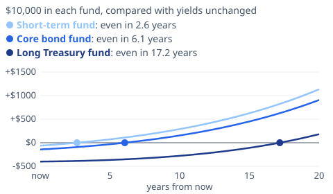
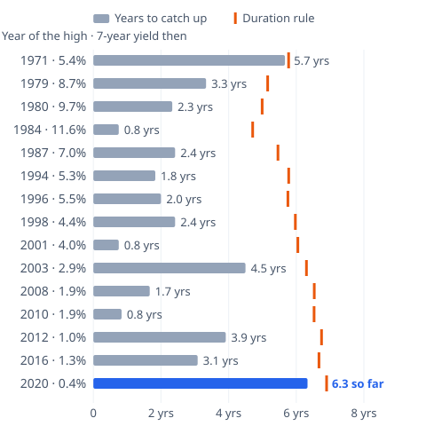

# [Bond Funds and Rising Yields: How Long Until You Break Even?](https://mkviz.com/bond-funds/)

## Research note

**Question.** When Treasury yields jump, how much does a bond fund lose right away, how long does the higher yield take to make that loss back, and does that rule of thumb hold in the record since 1969?

**Short answer.** A fund loses about its duration times the rise in yields at once, then earns the higher yield; on simple math it catches up with the path where yields stayed put after about as many years as its duration. For this week's rise of about 0.25 point in the 10-year yield, a fund with the duration of the iShares Core U.S. Aggregate Bond ETF (5.72 years) lost about 1.4% and breaks even in about 6.1 years.

**History test (added Nov. 15, 2026).** The rule assumes yields stay at their new level. In the record they rarely did: a fund of 7-year Treasury notes fell 5% or more and later recovered 14 times since July 1969, and in all 14 it caught up with the path it would have taken had yields stayed at the high's level sooner than the note's duration, in a median of 2.4 years against a median duration of 5.9 years. The loss that began in July 2020 is still 11% behind that path after 6.3 years.

### Data
- 7-year Treasury constant-maturity yield, daily since July 1, 1969 (Federal Reserve H.15 via FRED: DGS7), through Nov. 12, 2026, rebuilt into a monthly total-return index as in [the bond fund calculator note](https://mkviz.com/bond-fund-calculator/).
- 10-year Treasury yield: 4.88% on Nov. 9, 2026 (Federal Reserve H.15 via FRED, DGS10) and 5.13% on Nov. 12 (CNBC; the bond market was closed Nov. 11). This fall's high was 5.31% on Oct. 5.
- iShares Core U.S. Aggregate Bond ETF (AGG), as of Nov. 11, 2026: effective duration 5.72 years, average yield to maturity 5.33% (issuer page).
- 2022: the 10-year yield went from 1.52% at the end of 2021 to 3.88% at the end of 2022.

### Method
- Immediate change = -duration x rise (FINRA's rule of thumb), no convexity.
- After the rise, the fund compounds at the old yield plus the rise; the comparison path compounds at the old yield. Break-even is when the two meet.
- Simplifications: the fund's yield moves with the market at once; yields then stay put; no reinvestment or credit effects. The old yield is set at the ETF's yield to maturity less the rise (5.08%).

```
./engine/target/release/mkviz-engine bond --duration 5.72 --yield 5.08 --jump 0.25 --years 20
./engine/target/release/mkviz-engine bond --duration 2.5 --yield 5.08 --jump 0.25 --years 20
./engine/target/release/mkviz-engine bond --duration 16 --yield 5.08 --jump 0.25 --years 20
./engine/target/release/mkviz-engine bond --duration 5.72 --yield 1.52 --jump 2.36 --years 10
mkviz-engine catchup data/macro/fred_DGS7.csv --bond-return 7 --rates data/macro/fred_DGS7.csv --threshold 0.05
mkviz-engine figure catchup data/macro/fred_DGS7.csv --bond-return 7 --rates data/macro/fred_DGS7.csv --threshold 0.05 --out bond-fund-catchup.svg
```

- History test: for every drawdown of 5% or more in the 7-year Treasury fund index, the no-change path grows from the high at that month's 7-year yield (semiannual compounding). Catch-up is the first later month-end the actual index is at or above that path. It is compared with the modified duration of a 7-year par note at the same yield, (1 - (1 + y/2)^-14) / y.

### Results

| Fund (duration) | Loss on the jump | Break-even |
|---|---|---|
| Short-term (2.5 years) | 0.6% | 2.6 years |
| Core (5.72 years) | 1.4% | 6.1 years |
| Long Treasury (16 years) | 4.0% | 17.2 years |
| Core, 2022's 2.36-point rise | 13.5% | 6.3 years |

History test, every 7-year Treasury fund loss of 5% or more:

| High | Yield at the high | Duration (years) | Months to a new high | Years to catch up with the no-change path |
|---|---|---|---|---|
| March 1971 | 5.4% | 5.8 | 7 | 5.7 |
| June 1979 | 8.7% | 5.2 | 11 | 3.3 |
| June 1980 | 9.7% | 5.0 | 17 | 2.3 |
| Jan. 1984 | 11.6% | 4.7 | 6 | 0.8 |
| Feb. 1987 | 7.0% | 5.5 | 11 | 2.4 |
| Jan. 1994 | 5.3% | 5.8 | 16 | 1.8 |
| Jan. 1996 | 5.5% | 5.8 | 9 | 2.0 |
| Sept. 1998 | 4.4% | 6.0 | 22 | 2.4 |
| Oct. 2001 | 4.0% | 6.0 | 8 | 0.8 |
| May 2003 | 2.9% | 6.3 | 10 | 4.5 |
| Dec. 2008 | 1.9% | 6.5 | 18 | 1.7 |
| Oct. 2010 | 1.9% | 6.5 | 9 | 0.8 |
| July 2012 | 1.0% | 6.7 | 30 | 3.9 |
| July 2016 | 1.3% | 6.7 | 34 | 3.1 |
| July 2020 | 0.4% | 6.9 | not yet | 6.3 so far, 11% behind |

Median months to a new high: 11. Median years to catch up: 2.4. Every completed case caught up before its duration ran out; the closest was 1971.

Durations of 2.5 and 16 years are illustrative of short-term and long Treasury funds; check a fund's own duration on its issuer page.

### Past test
The rule-of-thumb break-even assumes yields stay at the new level. The history test shows it as the slow case: yields that jumped usually eased within a few years, and falling yields add price gains on top of the extra interest. Only one threshold (5%) was tested for the history table; the 7-year fund ignores fees, credit spreads and the mix of maturities in real funds.

### Limits
- The losses are rule-of-thumb estimates; AGG's actual net asset value fell 0.59% on Nov. 12 alone (iShares).
- Yields rarely stay put; a further rise pushes break-even out, a fall pulls it in.
- Money market funds have almost no duration: their value doesn't drop, but their yields follow short-term rates and the Fed, not the 10-year.
- The rule of thumb ignores convexity, which slightly softens losses on large moves.

### Sources
- CNBC, Treasury yields Nov. 12, 2026: https://www.cnbc.com/2026/11/12/us-treasurys-bonds-yields.html
- FRED, 10-year Treasury (DGS10): https://fred.stlouisfed.org/series/DGS10
- iShares, Core U.S. Aggregate Bond ETF: https://www.ishares.com/us/products/239458/ishares-core-total-us-bond-market-etf
- FINRA, Bonds, interest rate hikes and duration: https://www.finra.org/investors/insights/bonds-interest-rate-hikes-duration

### Builds on and leads to
- Builds on [the mortgage-rate note](https://mkviz.com/mortgage-rates-treasury-gap/), which tracks the same 10-year yield as the base of mortgage rates.
- Done Nov. 15, 2026: the break-even rule tested on every Treasury fund loss since 1969 (history test above).
- Open: a reader tool where you enter your fund's duration and the rate move; repeat the test for a 2-year and a 20-year fund.

### Cite
MKViz (2026). *Bond funds after a yield jump: loss now, break-even later.* https://mkviz.com/bond-funds/ ; code and data: https://github.com/CertainAmount/mkviz-engine/tree/main/data/bond-funds

## Charts

Run from the repository root after `cd engine && cargo build --release && cd ..`.

## bond-fund-breakeven

Data: [bond-fund-breakeven.csv](bond-fund-breakeven.csv) · settings: [bond-fund-breakeven.json](bond-fund-breakeven.json)



```
./engine/target/release/mkviz-engine figure breakeven data/series/fred_DGS10.csv --funds 'Short-term fund:2.5,Core bond fund:5.72,Long Treasury fund:16' --jump 0.25 --note '$10,000 in each fund, compared with yields unchanged' --title 'Bond funds after this week'\''s jump in yields' --years 20 --yield 5.08 --out bond-fund-breakeven.svg
```

## bond-fund-catchup

Data: [bond-fund-catchup.csv](bond-fund-catchup.csv) · settings: [bond-fund-catchup.json](bond-fund-catchup.json)



```
./engine/target/release/mkviz-engine figure catchup data/series/fred_DGS7.csv --bond-return 7 --rates data/series/fred_DGS7.csv --threshold 0.05 --out bond-fund-catchup.svg
```
