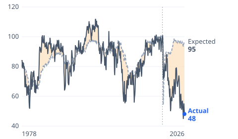

# [Consumer Sentiment Index: Why It's Far Lower Than the Data Says](https://mkviz.com/consumer-sentiment/)

Run from the repository root after `cd engine && cargo build --release && cd ..`.

## sentiment-gap

Data: [sentiment-gap.csv](sentiment-gap.csv) · settings: [sentiment-gap.json](sentiment-gap.json)



```
./engine/target/release/mkviz-engine figure fit data/series/fred_UMCSENT.csv --change ,12 --from 1978-01-01 --labels Actual,Expected --title 'Sentiment is far below what jobs and prices would predict' --train-from 1978-01 --train-to 2019-12 --x data/series/fred_UNRATE.csv,data/series/fred_CPIAUCSL.csv --out sentiment-gap.svg
```
