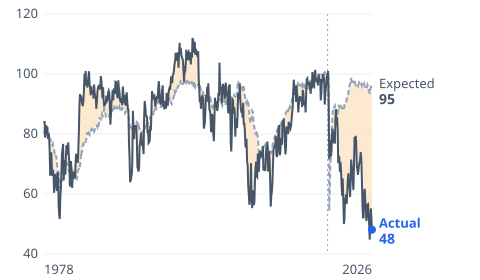

# [Consumer Sentiment Index Near a Record Low. Spending Isn't](https://mkviz.com/consumer-sentiment/)

## Research note

**Question.** The University of Michigan consumer sentiment index is near its record low. How far is that from what jobs and prices usually go with, and has the gloom shown up in what Americans actually buy?

**Short answer.** Unemployment and 12-month inflation explained about half of sentiment's swings from 1978 to 2019 (R² 0.51). For September 2026 they predict about 94.6; the reading was 48.1, a shortfall of 46.5 points, against a worst of 32.4 before 2020 (November 2008). The widest shortfall on record was 48.6 points in May 2026. In the two earlier stretches when sentiment ran 15 points or more below the formula (1990-91, 2008-09), real consumer spending was flat or falling (median 12-month change +0.5% and -0.9%). In the stretch since August 2021 it kept growing: median +2.6%, never below +1.1%; +2.5% in the latest month.

### Definitions
- Sentiment: University of Michigan index of consumer sentiment (FRED UMCSENT), monthly, 1966 Q1 = 100.
- Formula: least squares of sentiment on the unemployment rate (UNRATE) and the 12-month change in CPI (CPIAUCSL), trained on January 1978 to December 2019; every month since 1978 gets the value those two usually went with (expected). October 2025 CPI is filled (engine `--fill-gaps`).
- Shortfall: actual minus expected, in index points (series in data/content/figures/sentiment-gap-series.csv).
- Deep-gap stretch: consecutive months with a shortfall of 15 points or more (`spells --threshold -15 --below`, two months or longer).
- Real spending: real personal consumption expenditures, chain-type quantity index (FRED DPCERA3M086SBEA), 12-month percent change. "Real" removes price changes, so it tracks volume bought, not dollars spent.
- Other definitions: a 20-point line gives the same three periods (2008-09 split in two, 2021-26 starting January 2022); the medians keep the same order.
- Re-scan: with the 15-point line every month from 1978 to September 2026 was scanned; three stretches of two months or more qualified (1990-91, 2008-09, 2021-26) plus single months. None was dropped.

### Data
- FRED: UMCSENT, UNRATE, CPIAUCSL, DPCERA3M086SBEA, to October 2026.

### Method

```
./engine/target/release/mkviz-engine fit data/macro/fred_UMCSENT.csv --x data/macro/fred_UNRATE.csv,data/macro/fred_CPIAUCSL.csv --change 0,12 --train-from 1978-01 --train-to 2019-12 --from 1978-01 --fill-gaps
./engine/target/release/mkviz-engine figure fit (same options) --out sentiment-gap.svg
./engine/target/release/mkviz-engine spells data/content/figures/sentiment-gap-series.csv --threshold -15 --below
./engine/target/release/mkviz-engine position data/macro/fred_DPCERA3M086SBEA.csv --change 12 --from 1990-10-01 --to 1991-01-31   (and 2008-02-01..2009-04-30, 2021-08-01..2026-09-30, 1960-01-01..)
```
(`position --to` was added on Nov. 26, 2026.)

### Results

| Stretch with sentiment 15+ points below the formula | Months | Deepest shortfall | Real spending, median 12-month change | Lowest |
|---|---|---|---|---|
| Oct. 1990 to Jan. 1991 | 4 | 18.8 | +0.5% | -1.5% |
| Feb. 2008 to Apr. 2009 | 15 | 32.5 | -0.9% | -2.4% |
| Aug. 2021 to Sept. 2026 | 62 | 48.6 | +2.6% | +1.1% |
| Every month since 1960 | | | +3.1% | |

### Limits
- Three stretches; the first two were recessions, so "mood and spending fall together" is two cases.
- Real spending is a national total; it says nothing about which households cut back (higher earners can carry the total).
- Michigan's 2024 switch from phone to web interviews lowered readings by about 6.6 to nine points; the shortfall stays the widest on record even after the larger figure.

### Sources
- University of Michigan, Surveys of Consumers: https://www.sca.isr.umich.edu/
- FRED: UMCSENT https://fred.stlouisfed.org/series/UMCSENT ; UNRATE https://fred.stlouisfed.org/series/UNRATE ; CPIAUCSL https://fred.stlouisfed.org/series/CPIAUCSL ; DPCERA3M086SBEA https://fred.stlouisfed.org/series/DPCERA3M086SBEA
- University of Michigan News, survey mode change: https://news.umich.edu/u-m-consumer-sentiment-surveys-remain-robust-measurement-of-economic-behavior

### Builds on and leads to
- Leads to the open longtail "Does consumer sentiment predict spending or stocks?" (C3.3).

### Cite
MKViz (2026). *Consumer sentiment index is near a record low. Spending isn't.* https://mkviz.com/consumer-sentiment/ ; code and data: https://github.com/CertainAmount/mkviz-engine/tree/main/data/consumer-sentiment

## Charts

Run from the repository root after `cd engine && cargo build --release && cd ..`.

## sentiment-gap

Data: [sentiment-gap.csv](sentiment-gap.csv) · settings: [sentiment-gap.json](sentiment-gap.json)



```
./engine/target/release/mkviz-engine figure fit data/series/fred_UMCSENT.csv --change 0,12 --fill-gaps --from 1978-01 --train-from 1978-01 --train-to 2019-12 --x data/series/fred_UNRATE.csv,data/series/fred_CPIAUCSL.csv --out sentiment-gap.svg
```
