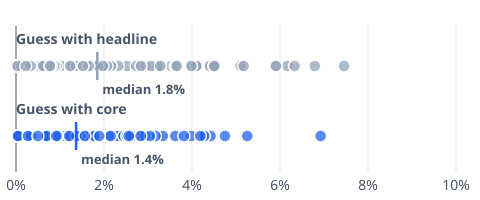

# [Core Inflation vs Headline: Which Predicts Prices Better?](https://mkviz.com/core-inflation/)

Run from the repository root after `cd engine && cargo build --release && cd ..`.

## core-vs-headline-miss

Data: [core-vs-headline-miss.csv](core-vs-headline-miss.csv) · settings: [core-vs-headline-miss.json](core-vs-headline-miss.json)



```
./engine/target/release/mkviz-engine figure closer data/series/fred_CPIAUCSL.csv --a data/series/fred_CPILFESL.csv --ahead 12 --axis 'How far the guess missed inflation a year later (points)' --b data/series/fred_CPIAUCSL.csv --change 12 --from 1985-01-01 --min-gap 0.01 --names 'Guess with core,Guess with headline' --title 'Core was usually the closer guess a year later' --to 2025-09-01 --out core-vs-headline-miss.svg
```
