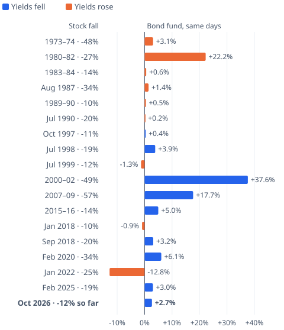
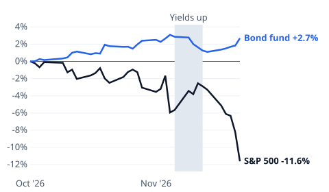

# [Bonds Go Up When Stocks Go Down 15 Times in 18. Not in 2022](https://mkviz.com/do-bonds-go-up-when-stocks-go-down/)

## Research note

**Question.** When the stock market falls a lot, does a plain Treasury bond fund go up over the same days, and what decides whether it does?

**Short answer.** Since July 1969 the S&P 500 fell 10% or more from a record 18 times (record-based, the one under way included). Over the same days, from the stock record to the stock low, a fund of 7-year Treasury notes rose in 15 and lost in three. The direction of the 7-year yield sorts them: in all nine falls where the yield ended lower the fund rose (median +3.9%); in the nine where it ended higher, six still rose (median +0.5%) and three lost: 1999, January-February 2018 and 2022 (-12.8%). In the fall from Oct. 6, 2026 to the Nov. 20 low the S&P 500 fell 11.6% and the fund gained 2.7%, with the yield down from 5.15% to 4.8%.

### Definitions
- Stock fall: every S&P 500 decline of at least 10% from its prior record close, from that record to the lowest close before a new record. Record-based: a later dip that stays below the old record is part of the same decline (so 2010 and 2011 sit inside 2007-09 and are not separate rows; 1971 sits inside the decline that began in November 1968). The decline under way is measured to its lowest close so far (Nov. 20, 2026).
- Bond fund: a constant-maturity 7-year Treasury fund rebuilt from the Federal Reserve's daily yield (FRED DGS7). Every observation day it holds a par note bought at the prior day's yield, prices it at the new yield with that much less time to maturity (semiannual compounding) and adds interest for the days between. No fees, taxes or credit risk. This is the daily version of the monthly fund in the bond fund calculator (Swinkels 2019 method).
- Over the same days: from the yield on the stock record date to the yield on the stock low date (or the last yield before it, when the bond market was closed).
- Yields fell / rose: the 7-year yield on the low date minus the yield on the record date, in percentage points.
- Other definitions: calendar-year comparisons (S&P 500 down years against the bond fund's year) give 12 years and miss falls inside a year; they are in the bond-loss note (S&P 500 price index down in 12 years since 1970, the fund lost in 2 of them, 1994 and 2022). Correlation over rolling windows is another common measure; it says how often the two move together, not what a fund did in a fall.
- Re-scan: with the definition above, every S&P 500 decline of 10%+ whose record date is on or after July 1, 1969 (first DGS7 observation) was kept: 18, including the one under way. The decline from the November 1968 record (low in May 1970) is left out because the yield series starts after its record.

### Data
- Federal Reserve H.15 via FRED: 7-year Treasury constant-maturity yield (DGS7), daily, July 1969 to Nov. 20, 2026.
- S&P 500 daily close (Yahoo Finance ^GSPC), 1950 to Nov. 23, 2026, price only; checked against FRED SP500 through Nov. 20.

### Method

```
python -m msci.cli fred DGS7
./engine/target/release/mkviz-engine figure catch data/macro/index_gspc_long.csv --rates data/macro/fred_DGS7.csv --maturity 7 --threshold 0.10 --out bonds-in-stock-falls.svg
./engine/target/release/mkviz-engine figure lines data/macro/index_gspc_long.csv --name "S&P 500" --series "data/macro/fred_DGS7.csv|Bond fund|bond=7" --from 2026-10-06 --to 2026-11-20 --rebase --out bonds-stocks-this-fall.svg
```
(`figure catch`, the daily bond index and the `bond=` and `--rebase` options of `figure lines` were added to the engine for this note.)

### Results

Every fall (full table in bonds-in-stock-falls.csv):

| Stock record | Stock low | S&P 500 fall | 7-year yield at record | Yield change (points) | Bond fund, same days |
|---|---|---|---|---|---|
| Jan. 1973 | Oct. 1974 | -48.2% | 6.34% | +1.74 | +3.1% |
| Nov. 1980 | Aug. 1982 | -27.1% | 12.86% | +0.77 | +22.2% |
| Oct. 1983 | Jul. 1984 | -14.4% | 11.30% | +2.00 | +0.6% |
| Aug. 1987 | Dec. 1987 | -33.5% | 8.56% | +0.20 | +1.4% |
| Oct. 1989 | Jan. 1990 | -10.2% | 8.08% | +0.39 | +0.5% |
| Jul. 1990 | Oct. 1990 | -19.9% | 8.43% | +0.36 | +0.2% |
| Oct. 1997 | Oct. 1997 | -10.8% | 5.95% | -0.01 | +0.4% |
| Jul. 1998 | Aug. 1998 | -19.3% | 5.57% | -0.54 | +3.9% |
| Jul. 1999 | Oct. 1999 | -12.1% | 5.83% | +0.50 | -1.3% |
| Mar. 2000 | Oct. 2002 | -49.2% | 6.49% | -3.25 | +37.6% |
| Oct. 2007 | Mar. 2009 | -56.8% | 4.49% | -1.96 | +17.7% |
| May 2015 | Feb. 2016 | -14.2% | 1.92% | -0.53 | +5.0% |
| Jan. 2018 | Feb. 2018 | -10.2% | 2.60% | +0.16 | -0.9% |
| Sep. 2018 | Dec. 2018 | -19.8% | 3.03% | -0.37 | +3.2% |
| Feb. 2020 | Mar. 2020 | -33.9% | 1.50% | -0.87 | +6.1% |
| Jan. 2022 | Oct. 2022 | -25.4% | 1.55% | +2.48 | -12.8% |
| Feb. 2025 | Apr. 2025 | -18.9% | 4.46% | -0.41 | +3.0% |
| Oct. 2026 | Nov. 2026 (so far) | -11.6% | 5.15% | -0.35 | +2.7% |

By yield direction:

| Yield over the fall | Falls | Bond fund rose | Median bond fund return |
|---|---|---|---|
| Down | 9 | 9 | +3.9% |
| Up | 9 | 6 | +0.5% |

Test of the obvious alternative, "a bigger stock fall brings a bigger bond gain": the three deepest falls (2007-09, 2000-02, 1973-74) gave +17.7%, +37.6% and +3.1%. The 1973-74 fall, nearly as deep, had rising yields and a small gain, so depth alone does not sort them; yield direction does.

The interest at the start matters when yields rise: 1980-82 started at 12.86% and the fund gained 22.2% although the yield rose; 2022 started at 1.55% and lost. The Oct. 6, 2026 start (5.15%) is the highest at the start of any of these falls since the one that began in March 2000 (6.49%).

This fall day by day (bonds-stocks-this-fall.csv): from Nov. 6 to Nov. 12 the 7-year yield rose from 4.74% to 5.02% and the bond fund fell while the S&P 500 rose. On Nov. 23 the S&P 500 closed 7.4% below its record.

### Limits
- Treasury notes only. A corporate or high-yield fund adds credit risk, which tends to rise when stocks fall. A core bond fund holds a large Treasury and mortgage share and usually sits between the two.
- No fees or taxes; the rebuilt fund repriced daily from one constant-maturity yield, not a real portfolio.
- The sort by yield direction is known only at the end of a fall; it explains past falls and does not forecast the next one.
- Stock falls are price only (no dividends), measured to the lowest close.

### Sources
- Federal Reserve via FRED, 7-year Treasury constant maturity (DGS7): https://fred.stlouisfed.org/series/DGS7
- Yahoo Finance, S&P 500 (^GSPC) history: https://finance.yahoo.com/quote/%5EGSPC/history/
- Federal Reserve via FRED, S&P 500 (SP500), cross-check: https://fred.stlouisfed.org/series/SP500
- FINRA, Bonds (credit risk): https://www.finra.org/investors/investing/investment-products/bonds
- Swinkels, L. (2019). Data: International Government Bond Returns Since 1947. *Data*, 4(3), 108.

### Builds on and leads to
- Builds on [How bond funds lose money](https://mkviz.com/how-bond-funds-lose-money/) (the interest cushion, calendar years) and [Bond fund calculator](https://mkviz.com/bond-fund-calculator/) (same rebuilt fund, monthly), and uses the falls of [Stock market corrections since 1950](https://mkviz.com/stock-market-corrections-history/).
- Open: the same falls with a corporate bond index; 2-year and 10-year funds; falls of the Nasdaq.

### Cite
MKViz (2026). *Do bonds go up when stocks go down?* https://mkviz.com/do-bonds-go-up-when-stocks-go-down/ ; code and data: https://github.com/CertainAmount/mkviz-engine/tree/main/data/do-bonds-go-up-when-stocks-go-down

## Charts

Run from the repository root after `cd engine && cargo build --release && cd ..`.

## bonds-in-stock-falls

Data: [bonds-in-stock-falls.csv](bonds-in-stock-falls.csv) · settings: [bonds-in-stock-falls.json](bonds-in-stock-falls.json)



```
./engine/target/release/mkviz-engine figure catch ../../macro/index_gspc_long.csv --maturity 7 --rates ../../macro/fred_DGS7.csv --threshold 0.10 --title 'A 7-year Treasury fund'\''s return during each S&P 500 fall of 10% or more since 1969' --out bonds-in-stock-falls.svg
```

## bonds-stocks-this-fall

Data: [bonds-stocks-this-fall.csv](bonds-stocks-this-fall.csv) · settings: [bonds-stocks-this-fall.json](bonds-stocks-this-fall.json)



```
./engine/target/release/mkviz-engine figure lines ../../macro/index_gspc_long.csv --band '2026-11-06,2026-11-12|Yields up' --colors '#0f172a,#2563eb' --from 2026-10-06 --name 'S&P 500' --rebase --series '../../macro/fred_DGS7.csv|Bond fund|bond=7' --title 'S&P 500 and a 7-year Treasury fund since the Oct. 6 record, % change' --to 2026-11-20 --out bonds-stocks-this-fall.svg
```
