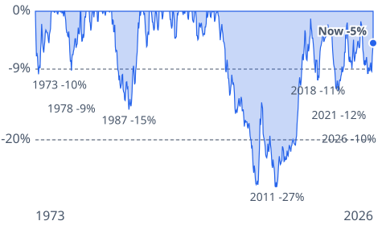

# [The Dollar Stopped Getting Weaker. Last Year's Fall Looks Like a Dip](https://mkviz.com/dollar-weaker-2026/)

## Research note

**Question.** Is the dollar still getting weaker, and does anything in the data tell an ordinary dollar dip from the one fall since 1973 that turned into a decade-long slide?

**Short answer.** No, not in 2026 (the broad index's 2025 fall, 7.4%, was its largest since 2007): the Fed's broad dollar index was up 3.2% this year on Nov. 20, 2026 and 5.2% above its Jan. 29 low, though still 5.0% below its January 2025 peak. Of seven falls of 9% or more since 1973, only the one that began in 2002 had both of two signs at the moment it crossed 9%: the dollar was down 5% or more over the past year against all four big currencies we track (yen, mark or euro, pound, Canadian dollar), and US three-month rates were below German or euro-area rates, and still below a year later. In 2026 the dollar crossed 9% with three of four, US rates well above euro rates; in the year to Nov. 20 it fell 5% or more against none.

### Definitions
- Dollar: the Fed's broad trade-weighted dollar index. The monthly goods-only index (TWEXBMTH, 1973 to 2019) is spliced onto the daily goods-and-services index (DTWEXBGS, from 2006), scaled in the month they meet (engine `--splice`). Depths can shift by a point or two because of the splice.
- Fall: a drop of 9% or more from the previous peak (engine `drawdowns --threshold 0.09`). The 9% mark date is the first day (month before 2006) the index was 9% below its peak.
- Breadth: over the 365 days before each 9% mark, the change in the dollar against the yen (DEXJPUS), the German mark (EXGEUS, to 2001) or euro (DEXUSEU, from 1999), the pound (DEXUSUK) and the Canadian dollar (DEXCAUS); a currency counts when the dollar fell 5% or more against it (engine `events --forward 365` from a date a year before the mark).
- Rate gap: US three-month interbank rate minus Germany's (OECD via FRED, IR3TIB01USM156N minus IR3TIB01DEM156N; the German series follows the euro-area rate after 1999), monthly, at the mark and a year later (engine `position --minus --to`).
- Other definitions: the Fed has also used a 2-year government bond gap, and many studies use expected policy rates; the three-month interbank rate is the longest series that covers 1973 for both sides. With a 3% line, 2003 is still the only fall with all four; at 7% none has all four, because the dollar fell 6.98% against the yen in the year to the 2003 mark (the 2026 count also depends on the window: the Canadian dollar reads 5.5% over the engine's 365 days and about 4.5% from the Jan. 24 close). Rates measured with 10-year government yields (IRLTLT01USM156N minus IRLTLT01DEM156N) put US rates below Germany's at the 9% mark in 1973 and 2003 only, the same two falls as three-month rates.
- Re-scan: all seven falls of 9% or more since January 1973 are in the table, including the current one; none dropped. The yen and Canadian dollar cover all seven; mark/euro: mark for 1973-1986, euro from 2003; pound all seven. The 1973 mark came in July 1973, four months after the major currencies began to float.

### Data
- Federal Reserve via FRED: DTWEXBGS (daily, to Nov. 20, 2026), TWEXBMTH (monthly, 1973-2019), DEXJPUS, DEXUSEU, DEXUSUK, DEXCAUS (daily, to Nov. 20, 2026), EXGEUS (monthly, 1971-2001).
- OECD via FRED: IR3TIB01USM156N and IR3TIB01DEM156N (monthly, to October 2026).

### Method

```
./engine/target/release/mkviz-engine drawdowns data/macro/fred_DTWEXBGS.csv --splice data/macro/fred_TWEXBMTH.csv --threshold 0.09 --deep 0.2
./engine/target/release/mkviz-engine events data/macro/fred_DEXJPUS.csv --dates 1972-07-01,1977-10-01,1985-03-01,2002-05-01,2016-09-06,2019-11-05,2025-01-26,2025-11-20 --forward 365
(same for fred_EXGEUS, fred_DEXUSEU, fred_DEXUSUK, fred_DEXCAUS)
./engine/target/release/mkviz-engine position data/macro/fred_IR3TIB01USM156N.csv --minus data/macro/fred_IR3TIB01DEM156N.csv --to <mark date>   (and a year later)
./engine/target/release/mkviz-engine events data/macro/fred_DTWEXBGS.csv --dates 2025-12-31 --forward 324
./engine/target/release/mkviz-engine figure underwater data/macro/fred_DTWEXBGS.csv --splice data/macro/fred_TWEXBMTH.csv --lines 0.09,0.2 --out dollar-underwater.svg
```

### Results

| Fall (year of the 9% mark) | Deepest | Currencies down 5%+ in the year to the mark (of 4) | US minus German/euro 3-month rate at the mark | A year later |
|---|---|---|---|---|
| 1973 | 10% | 3 | -4.60% | +2.77% |
| 1978 | 9% | 3 | +5.49% | +4.90% |
| 1986 | 15% | 3 | +2.68% | +2.13% |
| 2003 | 27% | 4 | -1.20% | -0.93% |
| 2017 | 11% | 1 | +1.58% | +2.56% |
| 2020 | 12% | 1 | +0.68% | +0.71% |
| 2026 | 10% so far | 3 | +1.60% | not yet; October 2026 +1.49% |

Year to Nov. 20, 2026: the dollar fell 5% or more against zero of the four (yen +0.9%, euro -4.8% for the euro, pound flat, Canadian dollar +1.6% for the dollar).

Per-currency changes in the year to each mark (dollar against the currency; negative = dollar weaker): 1973 yen -12%, mark -26%, pound -6%, Canadian dollar +2%; 1978 yen -28%, mark -19%, pound -11%, Canadian dollar +10%; 1986 yen -31%, mark -31%, pound -26%, Canadian dollar +3%; 2003 yen -7%, euro -19%, pound -9%, Canadian dollar -9%; 2017 yen +6%, euro -6%, pound +3%, Canadian dollar -5% (4.9%, under the line); 2020 yen -4%, euro -6%, pound -1%, Canadian dollar -0.5%; 2026 yen -1%, euro -12%, pound -9%, Canadian dollar -5.5%. (Pound and euro are quoted as dollars per unit; their changes were inverted.)

### Limits
- One long slide among seven falls: two signs that single it out after the fact are a description, not a tested forecast.
- Three-month interbank rates are a rough stand-in for what draws money across borders; long-term yields and expected rates also matter.
- The spliced index changes coverage in 2006 (goods only before, goods and services after).

### Sources
- Federal Reserve via FRED: https://fred.stlouisfed.org/series/DTWEXBGS , https://fred.stlouisfed.org/series/TWEXBMTH , https://fred.stlouisfed.org/series/DEXJPUS , https://fred.stlouisfed.org/series/DEXUSEU , https://fred.stlouisfed.org/series/DEXUSUK , https://fred.stlouisfed.org/series/DEXCAUS , https://fred.stlouisfed.org/series/EXGEUS
- OECD via FRED: https://fred.stlouisfed.org/series/IR3TIB01USM156N , https://fred.stlouisfed.org/series/IR3TIB01DEM156N
- Federal Reserve, weights for the broad dollar index: https://www.federalreserve.gov/releases/h10/weights/

### Builds on and leads to
- [Fed funds rate history](https://mkviz.com/fed-funds-rate-history/) (the US side of the rate gap) and a planned dollar index data page (C5.1).

### Cite
MKViz (2026). *Is the dollar getting weaker? Two signs from every fall since 1973.* https://mkviz.com/dollar-weaker-2026/ ; code and data: https://github.com/CertainAmount/mkviz-engine/tree/main/data/dollar-weaker-2026

## Charts

Run from the repository root after `cd engine && cargo build --release && cd ..`.

## dollar-underwater

Data: [dollar-underwater.csv](dollar-underwater.csv) · settings: [dollar-underwater.json](dollar-underwater.json)



```
./engine/target/release/mkviz-engine figure underwater data/series/fred_DTWEXBGS.csv --lines 0.09,0.2 --splice data/series/fred_TWEXBMTH.csv --title 'Broad dollar index, distance below its last peak since 1973' --out dollar-underwater.svg
```
