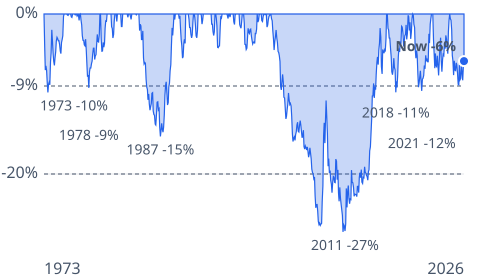

# [dollar-weaker-2026](https://mkviz.com/dollar-weaker-2026/)

Run from the repository root after `cd engine && cargo build --release && cd ..`.

## dollar-underwater

Data: [dollar-underwater.csv](dollar-underwater.csv) · settings: [dollar-underwater.json](dollar-underwater.json)



```
./engine/target/release/mkviz-engine figure underwater data/series/fred_DTWEXBGS.csv --lines 0.09,0.2 --splice data/series/fred_TWEXBMTH.csv --title 'Since 1973 the broad dollar has fallen 9% or more from a peak seven times, counting this one; only the 2002 drop became a long slide' --out dollar-underwater.svg
```
