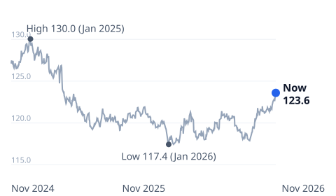
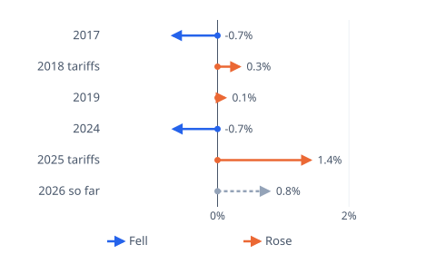

# [After Its Biggest Drop Since 2007, the Dollar Stopped Getting Weaker](https://mkviz.com/dollar-weaker-2026/)

## Research note

**Question.** Is the dollar still getting weaker, and does anything in the data tell an ordinary dollar dip from the one fall since 1973 that turned into a decade-long slide?

**Short answer.** No, not in 2026 (the broad index's 2025 fall, 7.4%, was its largest since 2007): the Fed's broad dollar index was up 3.2% this year on Nov. 20, 2026 and 5.2% above its Jan. 29 low, though still 5.0% below its January 2025 peak. Of seven falls of 9% or more since 1973, only the one that began in 2002 had both of two signs at the moment it crossed 9%: the dollar was down 5% or more over the past year against all four big currencies we track (yen, mark or euro, pound, Canadian dollar), and US three-month rates were below German or euro-area rates, and still below a year later. In 2026 the dollar crossed 9% with three of four, US rates well above euro rates; in the year to Nov. 20 it fell 5% or more against none.

### Definitions
- Dollar: the Fed's broad trade-weighted dollar index. The monthly goods-only index (TWEXBMTH, 1973 to 2019) is spliced onto the daily goods-and-services index (DTWEXBGS, from 2006), scaled in the month they meet (engine `--splice`). Depths can shift by a point or two because of the splice.
- Fall: a drop of 9% or more from the previous peak (engine `drawdowns --threshold 0.09`). The 9% mark date is the first day (month before 2006) the index was 9% below its peak.
- Breadth: over the 365 days before each 9% mark, the change in the dollar against the yen (DEXJPUS), the German mark (EXGEUS, to 2001) or euro (DEXUSEU, from 1999), the pound (DEXUSUK) and the Canadian dollar (DEXCAUS); a currency counts when the dollar fell 5% or more against it (engine `events --forward 365` from a date a year before the mark).
- Rate gap: US three-month interbank rate minus Germany's (OECD via FRED, IR3TIB01USM156N minus IR3TIB01DEM156N; the German series follows the euro-area rate after 1999), monthly, at the mark and a year later (engine `position --minus --to`).
- Other definitions: the Fed has also used a 2-year government bond gap, and many studies use expected policy rates; the three-month interbank rate is the longest series that covers 1973 for both sides. With a 3% line, 2003 is still the only fall with all four; at 7% none has all four, because the dollar fell 6.98% against the yen in the year to the 2003 mark (the 2026 count also depends on the window: the Canadian dollar reads 5.5% over the engine's 365 days and about 4.5% from the Jan. 24 close). Rates measured with 10-year government yields (IRLTLT01USM156N minus IRLTLT01DEM156N) put US rates below Germany's at the 9% mark in 1973 and 2003 only, the same two falls as three-month rates.
- Re-scan: all seven falls of 9% or more since January 1973 are in the table, including the current one; none dropped. The yen and Canadian dollar cover all seven; mark/euro: mark for 1973-1986, euro from 2003; pound all seven. The 1973 mark came in July 1973, four months after the major currencies began to float.

### Data
- Federal Reserve via FRED: DTWEXBGS (daily, to Nov. 20, 2026), TWEXBMTH (monthly, 1973-2019), DEXJPUS, DEXUSEU, DEXUSUK, DEXCAUS (daily, to Nov. 20, 2026), EXGEUS (monthly, 1971-2001).
- OECD via FRED: IR3TIB01USM156N and IR3TIB01DEM156N (monthly, to October 2026).
- BLS via FRED: IREXFUELS, IR4, CUSR0000SACL1E, CPIENGSL, CPIUFDSL (monthly, to October 2026); CUSR0000SACL1 was used in R33 by mistake (see the correction below). BEA via FRED: B235RC1Q027SBEA (quarterly, to Q3 2026).

### Method

```
./engine/target/release/mkviz-engine drawdowns data/macro/fred_DTWEXBGS.csv --splice data/macro/fred_TWEXBMTH.csv --threshold 0.09 --deep 0.2
./engine/target/release/mkviz-engine events data/macro/fred_DEXJPUS.csv --dates 1972-07-01,1977-10-01,1985-03-01,2002-05-01,2016-09-06,2019-11-05,2025-01-26,2025-11-20 --forward 365
(same for fred_EXGEUS, fred_DEXUSEU, fred_DEXUSUK, fred_DEXCAUS)
./engine/target/release/mkviz-engine position data/macro/fred_IR3TIB01USM156N.csv --minus data/macro/fred_IR3TIB01DEM156N.csv --to <mark date>   (and a year later)
./engine/target/release/mkviz-engine events data/macro/fred_DTWEXBGS.csv --dates 2025-12-31 --forward 324
./engine/target/release/mkviz-engine events data/macro/wb_gold.csv --dates <dollar peak> --forward <days to dollar low>   (and index_gspc_long.csv; macro_gold.csv from 2026-01-29)
./engine/target/release/mkviz-engine figure paths data/macro/fred_DTWEXBGS.csv --splice data/macro/fred_TWEXBMTH.csv --dates <seven 9% marks> --days 2920 --out dollar-after-9.svg
./engine/target/release/mkviz-engine figure underwater data/macro/fred_DTWEXBGS.csv --splice data/macro/fred_TWEXBMTH.csv --lines 0.09,0.2 --out dollar-underwater.svg
```

### Results

| Fall (year of the 9% mark) | Deepest | Currencies down 5%+ in the year to the mark (of 4) | US minus German/euro 3-month rate at the mark | A year later |
|---|---|---|---|---|
| 1973 | 10% | 3 | -4.60% | +2.77% |
| 1978 | 9% | 3 | +5.49% | +4.90% |
| 1986 | 15% | 3 | +2.68% | +2.13% |
| 2003 | 27% | 4 | -1.20% | -0.93% |
| 2017 | 11% | 1 | +1.58% | +2.56% |
| 2020 | 12% | 1 | +0.68% | +0.71% |
| 2026 | 10% so far | 3 | +1.60% | not yet; October 2026 +1.49% |

Year to Nov. 20, 2026: the dollar fell 5% or more against zero of the four (yen +0.9%, euro -4.8% for the euro, pound flat, Canadian dollar +1.6% for the dollar).

Per-currency changes in the year to each mark (dollar against the currency; negative = dollar weaker): 1973 yen -12%, mark -26%, pound -6%, Canadian dollar +2%; 1978 yen -28%, mark -19%, pound -11%, Canadian dollar +10%; 1986 yen -31%, mark -31%, pound -26%, Canadian dollar +3%; 2003 yen -7%, euro -19%, pound -9%, Canadian dollar -9%; 2017 yen +6%, euro -6%, pound +3%, Canadian dollar -5% (4.9%, under the line); 2020 yen -4%, euro -6%, pound -1%, Canadian dollar -0.5%; 2026 yen -1%, euro -12%, pound -9%, Canadian dollar -5.5%. (Pound and euro are quoted as dollars per unit; their changes were inverted.)

**After the 9% mark (added Nov. 28, 2026).** Further fall from the level at the 9% mark to the episode low (engine `drawdowns` dates; monthly TWEXBMTH to 2003, daily DTWEXBGS from 2017): 1973 0.0%, 1978 0.0%, 1986 +6.8%, 2003 +19.8%, 2017 +1.8%, 2020 +3.5%, 2026 +0.5% so far. The five falls without both signs lost at most +6.8% more. The 3-month and 10-year rate measures gave the same yes/no answer at every mark, so the post shows one column.

**Years back to the old peak (added Nov. 28, 2026).** Engine `drawdowns` days_peak_to_recover / 365.25 on the spliced index: 1973 2.6 years, 1977 2.6 years, 1985 4.5 years, 2002 14.8 years, 2016 3.2 years, 2020 2.5 years; the 2025 fall had not regained its Jan. 13, 2025 peak 1.9 years later (Nov. 20, 2026). Trip example at the Dec. 31, 2025 rate: $4,694. Rate gap in dollars: $149 a year on $10,000 at October 2026's gap (approximate).

**Gold and stocks during each fall (added Nov. 28, 2026).** Change from the dollar's peak to its bottom (engine `events --forward <days from peak to low>` on World Bank monthly gold, from the first day of the peak month to the first day of the low month so each window compares the monthly averages of those two months, and Yahoo ^GSPC daily from the peak date to the low date, prices only; corrected Nov. 28, 2026 from windows that ran one month late for 2002-11, 2016-18, 2020-21 and 2025-26):

| Fall | Gold | S&P 500 |
|---|---|---|
| 1973 (Jan.-Jul. 1973) | +84.6% | -13.6% |
| 1977-78 | +51.3% | +6.3% |
| 1985-87 | +54.8% | +26.6% |
| 2002-11 | +431.4% | +18.7% |
| 2016-18 | +15.0% | +25.4% |
| 2020-21 (from Mar. 23, 2020, the S&P 500's pandemic low) | +15.3% | +87.8% |
| 2025-26 | +75.4% | +19.4% |

From the dollar's Jan. 29, 2026 low to Nov. 20: gold futures (Yahoo GC=F daily) -33.9%, S&P 500 -0.8%.

**Rates in 2025.** US minus euro-area three-month rate: +1.63% in January 2025, +1.69% in December 2025, +1.49% in October 2026 (engine `position --minus --to`). The 2025 fall came with US rates above Europe's all year, unlike 2003.

Figure `dollar-after-9.svg`: engine `figure paths` on the spliced index from each 9% mark date, 2,920 days (eight years).

**Buying euros for a trip a year away (added Nov. 28, 2026).** FRED DEXUSEU (dollars per euro), first trading day of each month, 323 start months from January 1999 to November 2025. For each start month: cost of euros bought all at once at the start, bought in 12 equal monthly pieces (months 0-11), and bought at trip time (month 12); differences are against buying at trip time (plus = paid more).

| Method | Cheaper than waiting | 5th to 95th percentile | Worst |
|---|---|---|---|
| All at once, a year ahead | +51% of months | -13.6% to +16.5% | +28.2% |
| 12 equal monthly pieces | +54% of months | -8.4% to +10.2% | +18.9% |

The euro's dollar price moved more than 10% over the following 12 months in +30% of start months. Fund currency effect in 2026: 0.4 x the broad index's +3.2% rise, about -1.3% (approximate; a fund's currency mix differs from the broad index). Figures: `dollar-recent.svg` (engine `figure recent --weeks 500`), `dollar-fall-depths.svg` (engine `figure arrows`, each fall from its peak to its low, and the 2025 fall from its low to now).

**Fund exposure (added Nov. 28, 2026).** Vanguard Target Retirement 2050 Fund, fact sheet Sept. 30, 2026: +36.2% in Total International Stock Index Fund (allocation of underlying funds); the sheet says its foreign bonds are hedged and makes no hedging claim for stocks. S&P DJI annual foreign sales report: S&P 500 companies with full reporting made +43.6% of 2017 sales outside the US (latest published count; record 47.8% in 2014). Other counts use different samples (S&P Global Market Intelligence quarterly groups, Goldman Sachs) and are not comparable, so the post uses only the S&P DJI figure with its year.

**Tariffs and store prices (added Nov. 28, 2026, R33).** Federal customs duties (BEA via FRED B235RC1Q027SBEA, quarterly, seasonally adjusted annual rate): 89.1 billion dollars in Q4 2024, 366.7 billion in Q4 2025 (about 4.1 times), 275.3 billion in Q3 2026. CPI for commodities less food and energy commodities (CUSR0000SACL1, includes tariffs paid): +0.7% Dec 2024-Dec 2025, +5.9% Dec 2025-Oct 2026. Import prices of consumer goods excluding autos (IR4, before tariffs): -0.5% and +3.1% over the same spans. Reading: the store-price rise came about a year after collections jumped and is larger than the pre-tariff consumer import price rise, which fits tariffs reaching shelves with a delay; it does not fit the dollar (down 7.4% in 2025, up 3.2% in 2026). The data cannot split the 2026 store rise between tariffs and foreign sellers' own increases, nor show who bore the duties; co-occurrence in time, not a tested cause. Figure: `dollar-vs-import-prices.svg` (engine arrows, six rows: dollar, IREXFUELS, CUSR0000SACL1 for 2025 and 2026).

**Correction (Nov. 28, 2026, R34).** CUSR0000SACL1 is the CPI for commodities less food, which includes energy; it is not core goods. Its monthly moves track oil (Sept. 2005 +4.1%, Nov. 2008 -6.8%, March 2026 +3.2% as Brent went from about $69 to $100 a barrel), so the R33 reading above ("store prices for goods" +0.7% in 2025, +5.9% in 2026, a jump the year after the tariffs) does not hold. The core-goods series is CUSR0000SACL1E (commodities less food and energy commodities): -0.7% in 2017, +0.3% in 2018, +0.1% in 2019, -0.7% in 2024, +1.4% in 2025 (December to December) and +0.8% from December 2025 to October 2026. Broad dollar in the comparison years: -7.0% (2017), +5.0% (2018), +9.2% (2024). Customs duties at an annual rate: 39.5, 71.9 and 85.4 billion dollars in Q4 2017, Q4 2018 and Q4 2019. Reading: in both tariff episodes core goods had slipped the year before (about -0.7%) and rose in the year collections jumped (+0.3% in 2018 when collections rose about 1.8 times, +1.4% in 2025 when they rose about 4.1 times); in the two non-tariff years with large dollar moves in opposite directions (2017 -7.0%, 2024 +9.2%) core goods slipped 0.7% both times. The year after the 2018 jump core goods rose 0.1% with collections near their new level; in 2026 they are up 0.8% through October with collections easing. Two episodes, same timing (the jump year, not the year after); not a tested cause, and nothing here shows who absorbed the duties. The 2026 rise in CPI commodities less food is mostly energy (CPI energy +19.1% December to October; food +2.2%). Figure: `dollar-store-goods-tariffs.svg` (engine arrows, six rows of CUSR0000SACL1E).

### Limits
- One long slide among seven falls: two signs that single it out after the fact are a description, not a tested forecast.
- Three-month interbank rates are a rough stand-in for what draws money across borders; long-term yields and expected rates also matter.
- The spliced index changes coverage in 2006 (goods only before, goods and services after).

### Sources
- Federal Reserve via FRED: https://fred.stlouisfed.org/series/DTWEXBGS , https://fred.stlouisfed.org/series/TWEXBMTH , https://fred.stlouisfed.org/series/DEXJPUS , https://fred.stlouisfed.org/series/DEXUSEU , https://fred.stlouisfed.org/series/DEXUSUK , https://fred.stlouisfed.org/series/DEXCAUS , https://fred.stlouisfed.org/series/EXGEUS
- OECD via FRED: https://fred.stlouisfed.org/series/IR3TIB01USM156N , https://fred.stlouisfed.org/series/IR3TIB01DEM156N
- BLS via FRED: https://fred.stlouisfed.org/series/IREXFUELS , https://fred.stlouisfed.org/series/IR4 , https://fred.stlouisfed.org/series/CUSR0000SACL1E , https://fred.stlouisfed.org/series/CPIENGSL , https://fred.stlouisfed.org/series/CPIUFDSL ; BEA via FRED: https://fred.stlouisfed.org/series/B235RC1Q027SBEA
- Federal Reserve, weights for the broad dollar index: https://www.federalreserve.gov/releases/h10/weights/
- World Bank, Commodity Markets (Pink Sheet) gold monthly: https://datatopics.worldbank.org/commodity-markets/
- Yahoo Finance, gold futures (GC=F) and S&P 500 (^GSPC): https://finance.yahoo.com/quote/GC%3DF/history/

### Builds on and leads to
- [Fed funds rate history](https://mkviz.com/fed-funds-rate-history/) (the US side of the rate gap) and a planned dollar index data page (C5.1).

### Cite
MKViz (2026). *Is the dollar getting weaker? Two signs from every fall since 1973.* https://mkviz.com/dollar-weaker-2026/ ; code and data: https://github.com/CertainAmount/mkviz-engine/tree/main/data/dollar-weaker-2026

## Charts

Run from the repository root after `cd engine && cargo build --release && cd ..`.

## dollar-recent

Data: [dollar-recent.csv](dollar-recent.csv) · settings: [dollar-recent.json](dollar-recent.json)



```
./engine/target/release/mkviz-engine figure recent data/series/fred_DTWEXBGS.csv --decimals 1 --title 'The dollar since late 2024' --weeks 500 --out dollar-recent.svg
```

## dollar-store-goods-tariffs

Data: [dollar-store-goods-tariffs.csv](dollar-store-goods-tariffs.csv) · settings: [dollar-store-goods-tariffs.json](dollar-store-goods-tariffs.json)



```
./engine/target/release/mkviz-engine figure arrows data/series/fred_CUSR0000SACL1E.csv --names Fell,Rose --open '2026 so far' --rows '2017:0,-0.0068;2018 tariffs:0,0.0033;2019:0,0.0011;2024:0,-0.0067;2025 tariffs:0,0.0141;2026 so far:0,0.0078' --title 'Store prices for goods rose in both tariff years' --out dollar-store-goods-tariffs.svg
```
