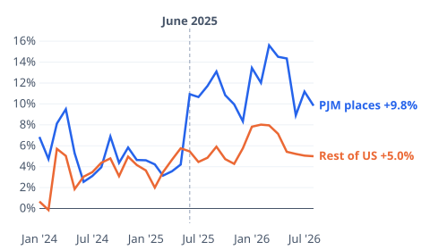

# [Are Data Centers Raising Electric Bills? The June 2025 Jump](https://mkviz.com/electricity-bills-data-centers/)

## Research note

**Question.** Are AI data centers raising household electric bills, and where does it show?

**Short answer.** Nationally, household electricity rose 4.4% over the year to September 2026 against 3.7% for all prices, and after inflation it is higher than in about 77% of months since 1978 but 14% below the 1984 peak. The clearer signal is regional: in the eight places that sit almost wholly inside the PJM grid, where data-center demand drove record capacity prices, the median household price rose about 12% (12 months to August 2026 against the 12 before) against about 6% elsewhere. The gap between the two groups' yearly price rises went from PJM 1.5 points lower in May 2025 to 5.5 points higher in June 2025, the month the 2025-26 capacity price (about nine times the year before) reached bills.

### Definitions
- Household price: EIA average residential retail price by state, cents per kWh, monthly (EIA electricity data browser; data/macro/eia_res_<ST>.csv), to August 2026. The Nov. 26, 2026 refresh failed (HTTP 504), so August is the latest month used.
- PJM places: DC, DE, MD, NJ, OH, PA, VA, WV, which lie almost wholly inside PJM. States only partly in PJM (IL, IN, KY, MI, NC, TN) are counted as "other"; Illinois (northern part in PJM) rose about 11%, which if anything understates the difference.
- Level comparison: each place's 12-month average price against the 12 months before (`position --avg 12 --change 12`), then the median of the eight PJM places and of the other 43 (median taken over the engine outputs, by hand).
- Timing comparison: each place's price change from the same month a year earlier (`figure recent --pct-change 12`), then for every month the median of the PJM places minus the median of the other states (computed over the engine outputs; data/content/figures/power-pjm-gap.csv).
- Re-scan: every state file from 2018 was included; regional aggregates (census divisions, US) were excluded from the medians. None dropped otherwise.

### Data
- EIA residential retail prices by state (eia-power adapter), to August 2026.
- BLS CPI electricity (CUSR0000SEHF01, CUUR0000SEHF01) and all items (CPIAUCSL) via FRED.
- PJM Base Residual Auction results: 2024-25 $28.92, 2025-26 $269.92, 2026-27 about $329.17, 2027-28 $333.44 per MW-day (the cap; about $530 without it, per Maryland's Office of People's Counsel).

### Method

```
./engine/target/release/mkviz-engine position data/macro/eia_res_<ST>.csv --avg 12 --change 12
./engine/target/release/mkviz-engine figure recent data/macro/eia_res_<ST>.csv --pct-change 12 --weeks 60 --out <ST>.svg   (per-state monthly yearly changes, CSV)
./engine/target/release/mkviz-engine figure lines power-pjm-median.csv --name "PJM places" --series "power-other-median.csv|Rest of US" --from 2024-01-01 --mark "2025-06-01|June 2025" --out power-pjm-timing.svg   (medians split from power-pjm-gap.csv; 2022-23, when PJM also ran ahead, are in the gap file and the text)
```

### Results

| Month | PJM median yearly change | Other states median | Gap (points) |
|---|---|---|---|
| June 2023 | 14.4% | 3.4% | 10.9 |
| June 2024 | 2.6% | 3.0% | -0.5 |
| May 2025 | 4.2% | 5.8% | -1.5 |
| June 2025 | 10.9% | 5.5% | 5.5 |
| Sept. 2025 | 13.1% | 5.9% | 7.2 |
| May 2026 | 14.3% | 5.4% | 8.9 |
| Aug. 2026 | 9.8% | 5.0% | 4.8 |

PJM places also ran hotter in 2022-23, before the capacity price jump (natural gas costs and default-service supply auctions in several of these states are the usual explanations); that gap closed by mid-2024 and reopened in June 2025.

### Limits
- State averages, not bills; utilities within a state differ.
- Timing lines up with the capacity price, but other costs (gas, transmission, storms) move rates too; this is a coincidence in timing, not a proof of cause.
- Some non-PJM states (NH, WA, NY) also rose fast.

### Sources
- EIA, Electricity data browser: https://www.eia.gov/electricity/data/browser/
- PJM, 2027/2028 Base Residual Auction results (Dec. 17, 2025): https://www.pjm.com/-/media/DotCom/about-pjm/newsroom/2025-releases/20251217-pjm-auction-procures-134479-mw-of-generation-resources.pdf
- Maryland Office of People's Counsel bulletin on the 2027-28 auction: https://content.govdelivery.com/accounts/MDOPC/bulletins/4006939
- Rutgers Policy Lab (2026): https://policylab.rutgers.edu/?p=11153
- Utility Dive (Dec. 2025): https://www.utilitydive.com/news/pjm-interconnection-capacity-auction-data-center/808264/

### Cite
MKViz (2026). *Are data centers raising electric bills?* https://mkviz.com/electricity-bills-data-centers/ ; code and data: https://github.com/CertainAmount/mkviz-engine/tree/main/data/electricity-bills-data-centers

## Charts

Run from the repository root after `cd engine && cargo build --release && cd ..`.

## power-pjm-timing

Data: [power-pjm-timing.csv](power-pjm-timing.csv) · settings: [power-pjm-timing.json](power-pjm-timing.json)



```
./engine/target/release/mkviz-engine figure lines data/content/figures/power-pjm-median.csv --from 2024-01-01 --mark '2025-06-01|June 2025' --name 'PJM places' --series 'data/content/figures/power-other-median.csv|Rest of US' --title 'Household power price, change from a year earlier, typical place (%)' --out power-pjm-timing.svg
```
