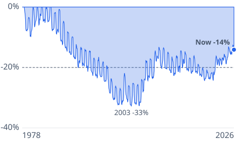
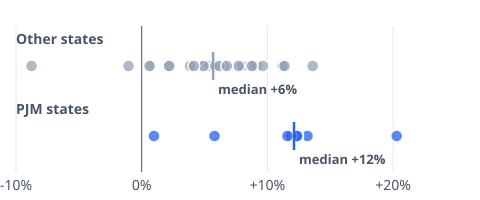

# [electricity-bills-data-centers](https://mkviz.com/electricity-bills-data-centers/)

Run from the repository root after `cd engine && cargo build --release && cd ..`.

## power-underwater

Data: [power-underwater.csv](power-underwater.csv) · settings: [power-underwater.json](power-underwater.json)



```
./engine/target/release/mkviz-engine figure underwater data/series/bls_CUUR0000SEHF01.csv --deflate data/series/fred_CPIAUCSL.csv --lines 0.2 --title 'Household electricity prices after inflation, measured below their 1984 record' --out power-underwater.svg
```

## dc-share-pictogram

Data: [dc-share-pictogram.csv](dc-share-pictogram.csv) · settings: [dc-share-pictogram.json](dc-share-pictogram.json)



```
./engine/target/release/mkviz-engine figure pictogram data/series/fred_CPIAUCSL.csv --groups 'Data centers in 2023:4:100:about 4%,High-end guess for 2028:12:100:up to 12%' --title 'Data centers'\'' share of US electricity use: 2023 and the high end of the government-funded 2028 projection' --out dc-share-pictogram.svg
```

## power-states-strip

Data: [power-states-strip.csv](power-states-strip.csv) · settings: [power-states-strip.json](power-states-strip.json)



```
./engine/target/release/mkviz-engine figure strip data/series/fred_CPIAUCSL.csv --names 'PJM states,Other states' --rows 'AK:0.0518:0;AL:0.0397:0;AR:0.0669:0;AZ:0.0214:0;CA:0.0461:0;CO:0.0786:0;CT:-0.0876:0;DC:0.2028:1;DE:0.0579:1;FL:0.0484:0;GA:0.0418:0;HI:0.0893:0;IA:0.0462:0;ID:0.0916:0;IL:0.1142:0;IN:0.0885:0;KS:0.0568:0;KY:0.0664:0;LA:0.0581:0;MA:0.0073:0;MD:0.1319:1;ME:0.0964:0;MI:0.0779:0;MN:0.0415:0;MO:0.0609:0;MS:0.0799:0;MT:0.0876:0;NC:0.0507:0;ND:0.0564:0;NE:0.0652:0;NH:0.136:0;NJ:0.1239:1;NM:0.0484:0;NV:-0.0105:0;NY:0.112:0;OH:0.1186:1;OK:0.0563:0;OR:0.0219:0;PA:0.1236:1;RI:0.0062:0;SC:0.053:0;SD:0.0771:0;TN:0.0385:0;TX:0.0492:0;UT:0.0414:0;VA:0.1159:1;VT:0.0586:0;WA:0.1136:0;WI:0.0618:0;WV:0.0098:1;WY:0.0678:0' --title 'Residential electricity prices, latest 12 months vs the 12 before, by state: core PJM grid states vs all others' --out power-states-strip.svg
```
