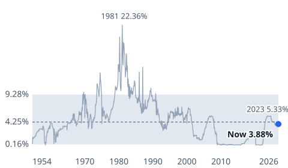
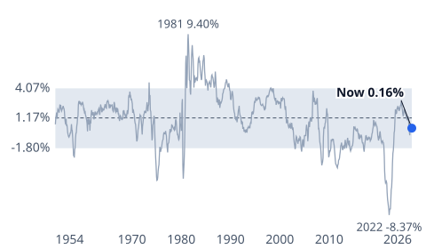
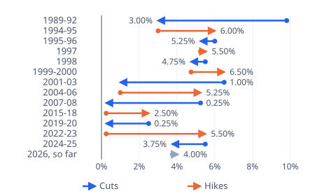

# [How High Is the Fed Funds Rate? Its History Since 1954](https://mkviz.com/fed-funds-rate-history/)

## Research note

**Question.** Where does today's federal funds rate sit against every day since 1954, before and after inflation, and how does the cycle that ended in 2025 and the September 2026 hike compare with every Fed rate cycle since 1989?

**Short answer.** The effective fed funds rate was 3.88% on Nov. 26, 2026, inside the Fed's 3.75% to 4.00% target range. That is below the median of 4.25% for every day since July 1954 (45% of days were at or below it), but above 75% of days since 2000. After 12-month CPI inflation (3.7% in October 2026) the rate was 0.16%; only 35% of months since 1954 were at or below it, and it is near the median since 1990 (0.21%). The September 2026 hike came 280 days after the last cut of 2024-25, the shortest wait after a cutting cycle of a point or more since 1989.

### Definitions
- Fed funds rate: the effective federal funds rate (FRED DFF, daily from July 1, 1954; FEDFUNDS for the monthly average). The target the Fed sets is a single number to Dec. 15, 2008 (DFEDTAR, from Sept. 27, 1982) and a range since (DFEDTARU and DFEDTARL); the effective rate trades inside it.
- After inflation ("real"): the monthly average effective rate minus the 12-month change in CPI-U (CPIAUCSL, seasonally adjusted), engine `--minus-pct-change 12`. October 2025 has no CPI survey; the engine fills that month with the geometric mean of September and November (`--fill-gaps`), which only matters for the October 2026 12-month change.
- Other definitions: many Fed papers subtract core PCE inflation or expected inflation instead of past CPI. Core PCE usually runs below CPI, so the real rate measured that way would be somewhat higher; the shape over time is the same. We keep CPI because it is the inflation households read about and the one on our [inflation tracker](https://mkviz.com/inflation-rate-tracker/).
- Cycle: a run of target changes in the same direction (engine `cycles`, target series DFEDTAR to 2008, the upper bound of the range after). A change of direction starts a new cycle. The table starts in 1989, after the 1980s, when the Fed moved its unannounced target in small steps that blur where a cycle begins.
- Gap: days from the last move of one cycle to the first move of the next (engine `gap_days`).
- Year rows: calendar-year mean, lowest and highest daily effective rate; 1954 starts in July and is left out; 2026 runs to Nov. 26.
- Re-scan: all 26,447 daily readings from July 1, 1954 to Nov. 26, 2026 and all 868 months to October 2026 were used; none dropped. The cycle scan found 32 cycles since 1982; the 14 since 1989 are all in the table, including the small 1997 and 1998 ones. Cutting cycles of a point or more since 1989: five (1989-92, 2001-03, 2007-08, 2019-20, 2024-25); the 1998 cuts (0.75 point) are counted separately in the text.

### Data
- Federal Reserve via FRED: DFF (daily) to Nov. 26, 2026; FEDFUNDS (monthly) to October 2026; DFEDTAR (1982-2008), DFEDTARU and DFEDTARL (2008-) to Nov. 27, 2026. BLS via FRED: CPIAUCSL to October 2026. NBER recession dates via FRED (USREC).

### Method

```
./engine/target/release/mkviz-engine position data/macro/fred_DFF.csv
./engine/target/release/mkviz-engine position data/macro/fred_DFF.csv --from 2000-01-01
./engine/target/release/mkviz-engine position data/macro/fred_DFF.csv --from 2009-01-01 --to 2021-12-31
./engine/target/release/mkviz-engine position data/macro/fred_FEDFUNDS.csv --minus data/macro/fred_CPIAUCSL.csv --minus-pct-change 12 --fill-gaps
./engine/target/release/mkviz-engine position data/macro/fred_FEDFUNDS.csv --minus data/macro/fred_CPIAUCSL.csv --minus-pct-change 12 --fill-gaps --from 1990-01-01
./engine/target/release/mkviz-engine cycles data/macro/fred_DFEDTAR.csv,data/macro/fred_DFEDTARU.csv --flag data/macro/fred_USREC.csv --within 730
./engine/target/release/mkviz-engine yearly data/macro/fred_DFF.csv
./engine/target/release/mkviz-engine figure tracker data/macro/fred_FEDFUNDS.csv --minus data/macro/fred_CPIAUCSL.csv --minus-pct-change 12 --fill-gaps --suffix '%' --years 1981,low:2022 --out fed-real-rate-tracker.svg
./engine/target/release/mkviz-engine figure arrows data/macro/fred_DFF.csv --rows "<cycle rows from cycles>" --open "2026, so far" --names "Cuts,Hikes" --decimals 2 --out fed-cycles-arrows.svg
```
(`--minus-pct-change`, `gap_days` on `cycles` and `--decimals` on `figure arrows` were added to the engine on Nov. 28, 2026.)

### Results

| Measure | Value |
|---|---|
| Effective rate, Nov. 26, 2026 / target range | 3.88% / 3.75% to 4.00% |
| Median since July 1954 / days at or below now | 4.25% / +45% |
| Median since 2000 / days at or below now | 1.42% / +75% |
| Days below 0.5%, 2009-2021 | +75% |
| Highest monthly average (June 1981) | 19.10% |
| Real rate, October 2026 (CPI 3.7%) | 0.16% |
| Real rate: median since 1954 / months at or below now | 1.17% / +35% |
| Real rate: median since 1990 / months at or below now | 0.21% / +48% |
| Real rate: highest (June 1981) / lowest (March 2022) | 9.40% / -8.37% |
| 2024-25 cutting cycle | 1.75 points in six cuts, Sept. 19, 2024 to Dec. 11, 2025 |
| Days from last cut to next hike: 1994 / 2004 / 2015 / 2022 / 2026 | 518 / 371 / 2,556 / 731 / 280 |
| After the 1998 cuts (0.75 point) | 225 days to the June 30, 1999 hike |

The yearly table (1955-2026) is on the page; the same numbers are in the engine output and the package (ext.hist.ff_ymean_YYYY, ext.hist.ff_ylow_YYYY, ext.hist.ff_yhigh_YYYY).

### Limits
- Past CPI is a backward-looking yardstick; what matters for borrowers is inflation over the life of a loan, which nobody observes.
- The effective rate is an overnight bank rate. Card, auto and mortgage rates move with it in different ways and with different lags.
- Five cutting cycles of a point or more since 1989 are too few to say what a short wait before the next hike predicts.

### Sources
- Federal Reserve via FRED, DFF: https://fred.stlouisfed.org/series/DFF
- Federal Reserve via FRED, FEDFUNDS: https://fred.stlouisfed.org/series/FEDFUNDS
- Federal Reserve via FRED, DFEDTAR, DFEDTARU, DFEDTARL: https://fred.stlouisfed.org/series/DFEDTARU
- BLS via FRED, CPIAUCSL: https://fred.stlouisfed.org/series/CPIAUCSL
- Federal Reserve, FOMC meeting calendars: https://www.federalreserve.gov/monetarypolicy/fomccalendars.htm
- Federal Reserve Bank of New York, Effective Federal Funds Rate: https://www.newyorkfed.org/markets/reference-rates/effr

### Builds on and leads to
- [Fed rate hikes: mortgage rates followed the 10-year, not the Fed](https://mkviz.com/fed-interest-rates/) (what the six turns from cuts to hikes since 1990 did to loans) and [How do Fed rate cuts affect mortgage rates?](https://mkviz.com/fed-rate-cut-mortgage-rates/).
- Open: how long the Fed waits between moves (C1.2 longtail), using `gap_days`.

### Cite
MKViz (2026). *Fed funds rate history since 1954, before and after inflation.* https://mkviz.com/fed-funds-rate-history/ ; code and data: https://github.com/CertainAmount/mkviz-engine/tree/main/data/fed-funds-rate-history

## Charts

Run from the repository root after `cd engine && cargo build --release && cd ..`.

## fed-funds-tracker

Data: [fed-funds-tracker.csv](fed-funds-tracker.csv) · settings: [fed-funds-tracker.json](fed-funds-tracker.json)



```
./engine/target/release/mkviz-engine figure tracker data/series/fred_DFF.csv --decimals 2 --suffix '%' --title 'Effective fed funds rate, daily since 1954' --years 1981,2023 --out fed-funds-tracker.svg
```

## fed-real-rate-tracker

Data: [fed-real-rate-tracker.csv](fed-real-rate-tracker.csv) · settings: [fed-real-rate-tracker.json](fed-real-rate-tracker.json)



```
./engine/target/release/mkviz-engine figure tracker data/series/fred_FEDFUNDS.csv --decimals 2 --fill-gaps --minus data/series/fred_CPIAUCSL.csv --minus-pct-change 12 --suffix '%' --title 'Fed funds rate minus inflation, monthly since 1954' --years 1981,low:2022 --out fed-real-rate-tracker.svg
```

## fed-cycles-arrows

Data: [fed-cycles-arrows.csv](fed-cycles-arrows.csv) · settings: [fed-cycles-arrows.json](fed-cycles-arrows.json)



```
./engine/target/release/mkviz-engine figure arrows data/series/fred_DFF.csv --decimals 2 --names Cuts,Hikes --open '2026, so far' --rows '1989-92:0.098125,0.03;1994-95:0.03,0.06;1995-96:0.06,0.0525;1997:0.0525,0.055;1998:0.055,0.0475;1999-2000:0.0475,0.065;2001-03:0.065,0.01;2004-06:0.01,0.0525;2007-08:0.0525,0.0025;2015-18:0.0025,0.025;2019-20:0.025,0.0025;2022-23:0.0025,0.055;2024-25:0.055,0.0375;2026, so far:0.0375,0.04' --title 'Fed target rate, first to last move of each cycle' --out fed-cycles-arrows.svg
```
