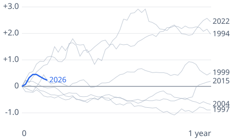
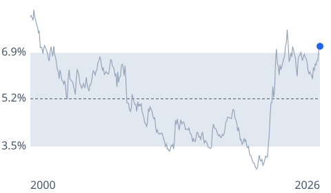

# [fed-interest-rates](https://mkviz.com/fed-interest-rates/)

Run from the repository root after `cd engine && cargo build --release && cd ..`.

## mortgage-after-first-hike

Data: [mortgage-after-first-hike.csv](mortgage-after-first-hike.csv) · settings: [mortgage-after-first-hike.json](mortgage-after-first-hike.json)

## mortgage-rate-band

Data: [mortgage-rate-band.csv](mortgage-rate-band.csv) · settings: [mortgage-rate-band.json](mortgage-rate-band.json)

