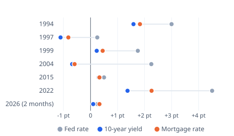
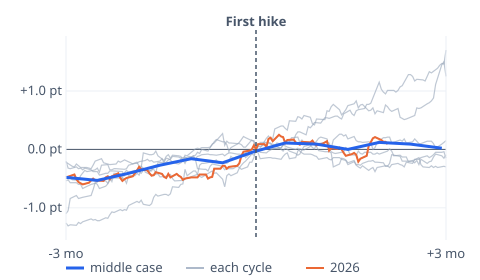

# [Fed Rate Hikes: Mortgage Rates Followed the 10-Year, Not the Fed](https://mkviz.com/fed-interest-rates/)

## Research note

**Question.** When the Fed turns from cutting to raising rates, what happens to mortgage rates over the next year, and what moves first?

**Short answer.** Since 1990 the Fed has turned from cuts to hikes six times before 2026. In every case its target rate was higher a year later, by 0.25 points to 4.50 points points. The 30-year mortgage rate was higher in four and lower in two, and in all six it moved the same way as the 10-year Treasury yield, usually by a similar amount. The 2-year Treasury yield had already risen 0.20 points to 1.26 points points in the three months before each first hike, more than the quarter-point hike itself. In four of the six the Fed raised again at the next meeting; the two that paused (1997 and 2015) did not raise again for a year or more.

### Definitions
- First hike after cuts: the first increase in the Fed's target rate (DFEDTAR to Dec. 2008, then the top of the range, DFEDTARU) after a run of cuts, using engine `cycles` (moves grouped by direction). Since 1990: Feb. 4, 1994; March 25, 1997; June 30, 1999; June 30, 2004; Dec. 16, 2015; March 16, 2022; and Sept. 17, 2026 (shown separately, under way).
- A year later: the change from the first-hike date to 365 days later (mortgage rate: the nearest weekly survey). Fed target: from the day before the first hike, so the first hike is included.
- The mortgage-Treasury gap: the 30-year mortgage rate minus the average 10-year yield over the survey week (seven days up to the release), as on the mortgage gap page.
- Re-scan: every direction change in the target since 1990 was listed by `cycles`; the six down-to-up turns before 2026 all qualify and none was dropped. The 1980s are left out because the Fed then moved its target in small, frequent steps that blur cycles.

### Data
- Fed target rate: FRED DFEDTAR (to 2008), DFEDTARU (from 2008), through Nov. 20, 2026.
- 30-year fixed mortgage rate: Freddie Mac PMMS (FRED MORTGAGE30US), weekly, through Nov. 19, 2026.
- 10-year and 2-year Treasury yields: FRED DGS10, DGS2, daily, through Nov. 19, 2026.
- Nasdaq Composite (FRED NASDAQCOM), unemployment rate (UNRATE), NBER recessions (USREC).

### Method

```
./engine/target/release/mkviz-engine cycles data/macro/fred_DFEDTAR.csv,data/macro/fred_DFEDTARU.csv --flag data/macro/fred_USREC.csv --within 730
./engine/target/release/mkviz-engine events data/macro/fred_MORTGAGE30US.csv --dates 1994-02-04,1997-03-25,1999-06-30,2004-06-30,2015-12-16,2022-03-16 --forward 91,365 --diff
./engine/target/release/mkviz-engine events data/macro/fred_DGS10.csv --dates (same) --forward 91,365 --diff
./engine/target/release/mkviz-engine events data/macro/fred_DFEDTAR.csv --dates 1994-02-03,1997-03-24,1999-06-29,2004-06-29 --forward 366 --diff
./engine/target/release/mkviz-engine events data/macro/fred_DFEDTARU.csv --dates 2015-12-15,2022-03-15 --forward 366 --diff
./engine/target/release/mkviz-engine figure around data/macro/fred_DGS2.csv --dates (six + 2026-09-17) --before 91 --after 91 --highlight "2026-09-17|2026" --out fed-2y-around-hike.svg
./engine/target/release/mkviz-engine figure rowdots --unit pt --rows "<case>:<fed>,<10y>,<mortgage>;…" --marks "Fed rate,10-year yield,Mortgage rate" --out fed-vs-10y-mortgage.svg
./engine/target/release/mkviz-engine position data/macro/fred_MORTGAGE30US.csv --minus data/macro/fred_DGS10.csv --minus-window 7
```

### Results

One year after the first hike (percentage points):

| First hike | Fed target | 10-year yield | 30-year mortgage | Hikes in the cycle | Next hike |
|---|---|---|---|---|---|
| 1994 | +3.00 points | +1.59 points | +1.83 | 7 | next meeting (March 22) |
| 1997 | +0.25 points | -1.11 points | -0.82 | 1 | none |
| 1999 | +1.75 points | +0.23 points | +0.45 | 6 | next meeting (Aug. 24) |
| 2004 | +2.25 points | -0.68 points | -0.59 | 17 | next meeting (Aug. 10) |
| 2015 | +0.50 points | +0.30 points | +0.33 | 9 | a year later (Dec. 14, 2016) |
| 2022 | +4.50 points | +1.37 points | +2.26 | 11 | next meeting (May 4) |

2-year Treasury yield, three months before each first hike to the day of it: 1994 +0.22, 1997 +0.48, 1999 +0.54, 2004 +1.10, 2015 +0.20, 2022 +1.26; 2026 +0.48 points. Each first hike was a quarter point.

Since the Sept. 17, 2026 hike, to Nov. 19: the 30-year mortgage rate went from 6.95% to 7.28%; the gap over the 10-year widened from 1.97 points to 2.17 points points, so most of the rise came from the gap, not the 10-year yield. The 2-year yield rose 0.06 points points.

Earlier results kept from the first version (Oct. 29, 2026): the Nasdaq was higher a year after the first hike in five of six (median 4% against 15% over any year since 1971); unemployment was lower a year later in all six; a recession followed within two years once (1999).

### Limits
- Six cases. The 2022 hikes were the fastest in decades, and 1997 was a single hike.
- A year is a fixed window; mortgage rates in 1994 and 2022 peaked inside it.
- The 2-year yield's rise before a hike is visible only looking back; it also rises at times when no hike follows.

### Sources
- Federal Reserve via FRED, DFEDTAR and DFEDTARU: https://fred.stlouisfed.org/series/DFEDTARU
- Freddie Mac via FRED, MORTGAGE30US: https://fred.stlouisfed.org/series/MORTGAGE30US
- Treasury via FRED, DGS10 and DGS2: https://fred.stlouisfed.org/series/DGS10 , https://fred.stlouisfed.org/series/DGS2
- Federal Reserve, FOMC statements: https://www.federalreserve.gov/newsevents/pressreleases.htm

### Builds on and leads to
- Builds on [Why are mortgage rates so high?](https://mkviz.com/mortgage-rates-treasury-gap/) (the gap) and [How do Fed rate cuts affect mortgage rates?](https://mkviz.com/fed-rate-cut-mortgage-rates/) (the mirror case).
- Open: how long the Fed has paused between moves in every cycle.

### Cite
MKViz (2026). *Fed rate hikes and mortgage rates.* https://mkviz.com/fed-interest-rates/ ; code and data: https://github.com/CertainAmount/mkviz-engine/tree/main/data/fed-interest-rates

## Charts

Run from the repository root after `cd engine && cargo build --release && cd ..`.

## fed-vs-10y-mortgage

Data: [fed-vs-10y-mortgage.csv](fed-vs-10y-mortgage.csv) · settings: [fed-vs-10y-mortgage.json](fed-vs-10y-mortgage.json)



```
./engine/target/release/mkviz-engine figure rowdots data/series/fred_DGS10.csv --marks 'Fed rate,10-year yield,Mortgage rate' --rows '1994:3.0,1.59,1.83;1997:0.25,-1.11,-0.82;1999:1.75,0.23,0.45;2004:2.25,-0.68,-0.59;2015:0.5,0.3,0.33;2022:4.5,1.37,2.26;2026 (2 months):0.25,0.1,0.33' --unit pt --out fed-vs-10y-mortgage.svg
```

## fed-2y-around-hike

Data: [fed-2y-around-hike.csv](fed-2y-around-hike.csv) · settings: [fed-2y-around-hike.json](fed-2y-around-hike.json)



```
./engine/target/release/mkviz-engine figure around data/series/fred_DGS2.csv --after 91 --before 91 --dates 1994-02-04,1997-03-25,1999-06-30,2004-06-30,2015-12-16,2022-03-16,2026-09-17 --event-label 'First hike' --highlight '2026-09-17|2026' --unit ' pt' --out fed-2y-around-hike.svg
```
