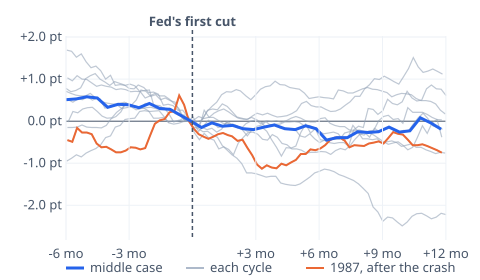
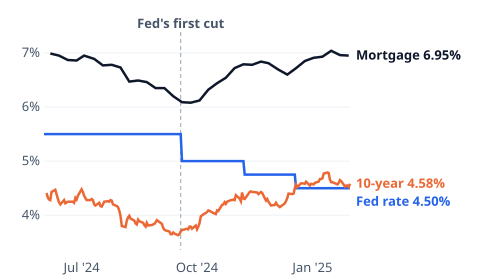

# [How Do Fed Rate Cuts Affect Mortgage Rates? The Drop Comes First](https://mkviz.com/fed-rate-cut-mortgage-rates/)

## Research note

**Question.** When the Fed starts cutting rates, what happens to the 30-year mortgage rate, and when?

**Short answer.** In eight of nine Fed easing cycles since 1984, the 30-year rate was lower on the week of the first cut than about three months earlier, by about 0.38 points in the middle case. The exception, the November 1987 cut after the stock market crash (less than two months after the Fed's last hike), saw the rate rise 0.62 points into the cut and fall 1.03 points after it. After the first cut the direction was a coin flip: higher three months later in four of 9 (middle case -0.12 points), higher a year later in four of 9 (middle case -0.38 points, range -2.22 points to 1.06 points). An expected cut is priced in before it happens; a surprise one after.

### Definitions
- First cut: the first reduction in the Fed's target rate after a run of increases or holds, where the cycle went on to at least two more cuts or lasted months (engine `cycles` on DFEDTAR to 2008, then the upper limit DFEDTARU). The 1985-86 cuts continue the 1984 cycle and 1990-92 continue 1989. The nine first cuts: Sept. 20, 1984; Nov. 4, 1987 (after the Oct. 19 crash; the Fed had raised its target on Sept. 4 and Sept. 24, 1987); June 6, 1989; July 6, 1995; Sept. 29, 1998; Jan. 3, 2001; Sept. 18, 2007; Aug. 1, 2019 (announced July 31; FRED's daily target series shows Aug. 1); Sept. 19, 2024 (announced Sept. 18).
- Mortgage rate: Freddie Mac's weekly 30-year fixed average (FRED MORTGAGE30US). Changes are in percentage points, measured from the last weekly reading on or before the cut day. Each other end is the first weekly reading on or after the offset (-91, +91, +365 days). Using the last reading on or before -91 instead gives a pre-cut median of 0.43 rather than 0.38; the count is the same.
- The Fed's rate and the mortgage rate are different things: the mortgage rate tracks the 10-year Treasury yield plus a markup (St. Louis Fed, 2026).
- Re-scan: every reduction in DFEDTAR (1982-2008) and DFEDTARU (2008-) was checked against the definition. Nine first cuts qualify. Left out: the 1985-86 cuts (continuation of the 1984 cycle) and 1990-92 (continuation of 1989). The Nov. 1987 cut was first missed and added after review; it is the one cycle where the rate rose into the cut.

### Data
- Freddie Mac PMMS, 30-year fixed, weekly since 1971 (FRED: MORTGAGE30US), through Nov. 12, 2026.
- Fed funds target (FRED: DFEDTAR, 1982-2008) and target range upper limit (DFEDTARU, 2008-), through Nov. 18, 2026.

### Method

```
./engine/target/release/mkviz-engine cycles data/macro/fred_DFEDTAR.csv,data/macro/fred_DFEDTARU.csv --flag data/macro/fred_USREC.csv
./engine/target/release/mkviz-engine figure around data/macro/fred_MORTGAGE30US.csv --highlight "1987-11-04|1987, after the crash" --dates 1984-09-20,1987-11-04,1989-06-06,1995-07-06,1998-09-29,2001-01-03,2007-09-18,2019-08-01,2024-09-19 --before 182 --after 365 --event-label "Fed's first cut" --out cut-around.svg
./engine/target/release/mkviz-engine figure strips data/macro/fred_MORTGAGE30US.csv --diff --base-prior --days 91 --sets "3 months after the first cut=<dates>;1 year after@365=<dates>" --out cut-after.svg
./engine/target/release/mkviz-engine figure lines data/macro/fred_DFEDTARU.csv --name "Fed rate" --series "data/macro/fred_DGS10.csv|10-year;data/macro/fred_MORTGAGE30US.csv|Mortgage" --from 2024-06-01 --to 2025-01-31 --mark "2024-09-18|Fed's first cut" --out cut-lines.svg
./engine/target/release/mkviz-engine payment --loan 400000 --rates 7.11,6.61,6.11
```

### Results

| First cut | 3 months before (rate was higher by) | 3 months after | 1 year after |
|---|---|---|---|
| Sept. 1984 | +0.06 | -1.25 | -2.22 |
| Nov. 1987 | -0.62 | -1.03 | -0.85 |
| June 1989 | +0.38 | -0.31 | -0.38 |
| July 1995 | +0.88 | +0.04 | +0.61 |
| Sept. 1998 | +0.34 | +0.19 | +1.06 |
| Jan. 2001 | +0.70 | -0.12 | +0.01 |
| Sept. 2007 | +0.38 | -0.17 | -0.53 |
| July 2019 | +0.39 | +0.03 | -0.87 |
| Sept. 2024 | +0.78 | +0.63 | +0.21 |

All in percentage points against the last weekly reading on or before the cut. Before the cut: the rate had fallen in eight of nine (1984 only barely, after a mid-1984 peak); 1987 rose into the cut. Two of the "higher" cases after the cut are nearly flat (2019 at three months, 2001 at a year).

Refinance payback on $400,000 at 7.28%: a half-point drop saves $134 a month (59 months to earn back 2% closing costs, 149 at 5%); a one-point drop saves $266 (30 and 75 months). On $250,000 or from 7.4% the months are within one of these, since saving and costs both scale with the loan.

The 2024 case: the rate fell 0.78 points point in the three months before the Sept. 18 cut and rose 0.63 points point in the three months after. The Atlanta Fed notes that from September 2024 to January 2025 the fed funds rate fell about 0.80 points while the 10-year Treasury yield rose about 0.90 points.

Today: the Fed raised its target range in September 2026 to an upper limit of 4.00%; the 30-year rate was 7.28% in the week of Nov. 19, 2026; the next decision is Dec. 9, 2026.

### Limits
- Nine cycles. Several first cuts came with recessions or crises (2001, 2007, 2019-20), when Treasury yields fell for other reasons too.
- Weekly survey data blur the exact day; the cut-day base is the last survey before the decision.
- This measures the average 30-year rate, not any borrower's quote, which also depends on credit, points and the lender's margin.

### Sources
- Freddie Mac via FRED, MORTGAGE30US: https://fred.stlouisfed.org/series/MORTGAGE30US
- Federal Reserve via FRED, DFEDTAR and DFEDTARU: https://fred.stlouisfed.org/series/DFEDTARU
- Federal Reserve Bank of St. Louis, What Determines Mortgage Rates? (Page One Economics, October 2026): https://www.stlouisfed.org/publications/page-one-economics/2026/oct/what-determines-mortgage-rates
- Federal Reserve Bank of Atlanta, Not Joined at the Hip: Relationship between the Fed Funds Rate and Mortgage Rates (Nov. 10, 2025): https://www.atlantafed.org/research-and-data/2025/11/10/not-joined-at-the-hip-relationship-between-the-fed-funds-rate-and-mortgage-rates
- CFPB, What's a lock-in or a rate lock?: https://www.consumerfinance.gov/ask-cfpb/whats-a-lock-in-or-a-rate-lock-en-143/
- Freddie Mac, closing costs (2% to 5% of the loan): https://myhome.freddiemac.com/blog/homebuying/5-tips-to-help-you-save-on-closing-costs
- Federal Reserve, FOMC meeting calendar: https://www.federalreserve.gov/monetarypolicy/fomccalendars.htm

### Builds on and leads to
- Builds on [Will mortgage rates ever get back to 3%?](https://mkviz.com/mortgage-rates-back-to-3-percent/) (what the 10-year would have to do) and the [mortgage gap note](https://mkviz.com/mortgage-rates-treasury-gap/).
- Open: the same before/after test for the 10-year yield itself, and for cuts that came with and without recessions.

### Cite
MKViz (2026). *How do Fed rate cuts affect mortgage rates? Every easing cycle since 1984.* https://mkviz.com/fed-rate-cut-mortgage-rates/ ; code and data: https://github.com/CertainAmount/mkviz-engine/tree/main/data/fed-rate-cut-mortgage-rates

## Charts

Run from the repository root after `cd engine && cargo build --release && cd ..`.

## cut-around

Data: [cut-around.csv](cut-around.csv) · settings: [cut-around.json](cut-around.json)



```
./engine/target/release/mkviz-engine figure around data/series/fred_MORTGAGE30US.csv --after 365 --before 182 --dates 1984-09-20,1987-11-04,1989-06-06,1995-07-06,1998-09-29,2001-01-03,2007-09-18,2019-08-01,2024-09-19 --event-label 'Fed'\''s first cut' --highlight '1987-11-04|1987, after the crash' --title '30-year mortgage rate around the Fed'\''s first rate cut, change in points' --out cut-around.svg
```

## cut-lines

Data: [cut-lines.csv](cut-lines.csv) · settings: [cut-lines.json](cut-lines.json)



```
./engine/target/release/mkviz-engine figure lines data/series/fred_DFEDTARU.csv --from 2024-06-01 --mark '2024-09-18|Fed'\''s first cut' --name 'Fed rate' --series 'data/series/fred_DGS10.csv|10-year;data/series/fred_MORTGAGE30US.csv|Mortgage' --title 'Fed target rate, 10-year Treasury yield and 30-year mortgage rate, 2024-25' --to 2025-01-31 --out cut-lines.svg
```
