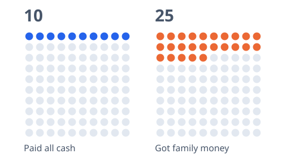
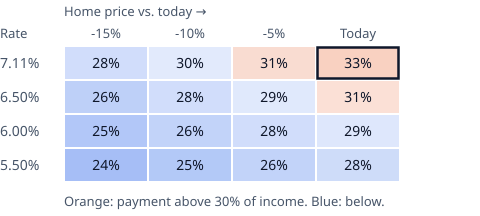
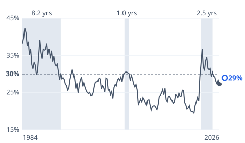

# [First-Time Home Buyers: What Would Make a Home Affordable Again?](https://mkviz.com/first-time-home-buyers/)

## Research note

**Question.** Why are first-time buyers so scarce, and what would have to change for the typical home to be affordable to them again?

**Short answer.** The price of the median new home sold is about where it was in the summer of 2021 ($393,300 vs $395,200), but the monthly principal and interest on it, with 20% down, rose about 59% as the 30-year rate went from 2.98% to 7.11%. For a buyer putting down the median first-time 9%, the payment takes 33% of median household income. A rate near 6% (29%), a price about 10% lower (30%) or about 10% more income would each bring it back to about 30%. Going from 9% to 20% down does about what a 6% rate does.

### Definitions
- Payment share: monthly principal and interest on a 30-year fixed loan, divided by one-twelfth of median household income (Census, annual, the latest year carried forward). Taxes, insurance and mortgage insurance are left out unless stated.
- Price: median sales price of new houses sold in the US (Census, quarterly; FRED MSPUS). This is the new-home median, not the existing-home median NAR publishes.
- Rate: Freddie Mac's weekly 30-year fixed average for that quarter or week.
- 30% line: the common rule of thumb for housing costs; not a lending rule.
- Private mortgage insurance (PMI): required by most lenders on conventional loans with less than 20% down; Freddie Mac puts it at roughly $30 to $70 a month per $100,000 borrowed, depending on credit and down payment. FHA loans charge their own premium and are not modeled here.

### Data
- Census median sales price of houses sold (FRED: MSPUS), quarterly 1963-Q3 2026.
- Freddie Mac PMMS 30-year fixed (FRED: MORTGAGE30US), weekly, through Nov. 12, 2026.
- Census median household income (FRED: MEHOINUSA646N), annual through 2025.
- S&P CoreLogic Case-Shiller U.S. National Home Price Index (FRED: CSUSHPINSA).
- NAR 2026 Profile of Home Buyers and Sellers (July 2025-June 2026 purchases).
- NAHB analysis of Census ACS property taxes (2024); Insurify homeowners insurance premiums (first half of 2026).
- Freddie Mac, Breaking down PMI.

### Method

```
./engine/target/release/mkviz-engine afford data/macro/fred_MSPUS.csv --rate data/macro/fred_MORTGAGE30US.csv --income data/macro/fred_MEHOINUSA646N.csv --down 0.2
./engine/target/release/mkviz-engine figure grid data/macro/fred_MSPUS.csv --down 0.09 --line 0.30 --now-rate 7.11 --rate-income data/macro/fred_MEHOINUSA646N.csv --rates 5.5,6,6.5,7.11 --changes "-0.15,-0.1,-0.05,0,0.05" --out home-payment-grid.svg
./engine/target/release/mkviz-engine figure spells data/macro/fred_MSPUS.csv --afford data/macro/fred_MORTGAGE30US.csv,data/macro/fred_MEHOINUSA646N.csv --now 0.290 --threshold 0.30 --out home-payment-spells.svg
./engine/target/release/mkviz-engine payment --loan <price x (1 - down)> --rates 7.11
```

### Results

Same house, then and now (20% down):

| | Q3 2021 | Now |
|---|---|---|
| Median new-home price | $395,200 | $393,300 |
| 30-year rate | 2.98% | 7.11% |
| Principal and interest | $1,330 | $2,117 |
| Share of median income | 23% | 29% |

Median household income rose 24% from 2021 to 2025 (about 5% a year).

Grid, 9% down, share of median income:

| Rate | Price -15% | -10% | -5% | Today | +5% |
|---|---|---|---|---|---|
| 5.5% | 23.7% | 25.1% | 26.5% | 27.9% | 29.3% |
| 6% | 25.0% | 26.5% | 28.0% | 29.4% | 30.9% |
| 6.5% | 26.4% | 27.9% | 29.5% | 31.0% | 32.6% |
| 7.11% | 28.1% | 29.7% | 31.4% | 33.0% | 34.7% |

Down payment ladder on $393,300 at 7.11%:

| Down | Cash | Principal and interest | PMI (Freddie Mac range) | P&I share of income |
|---|---|---|---|---|
| 5% | $19,665 | $2,513 | $112-$262 | 35% |
| 9% | $35,397 | $2,408 | $107-$251 | 33% |
| 20% | $78,660 | $2,117 | none | 29% |

Going from 9% to 20% down takes about $43,300 more cash and brings the share to about 29%, close to a 6% rate at 9% down (29%), and it removes PMI.

Stretches above 30% since 1984 (20% down): most of 1984-92 (peak 43% in 1984, after the 18.63% rate peak of 1981), about a year around 2006, and mid-2022 to early 2025 (peak 37%). Only after 2006 did national prices fall hard (27%, July 2006 to Feb. 2012, Case-Shiller).

Other monthly costs, national averages: property tax $4,271 a year, insurance $3,012 a year, together $607 a month or 8% of median income; all-in at 9% down about 41%.

### Limits
- New-home median price; existing homes, which most first-time buyers buy, have a different median.
- National medians and averages; local prices, taxes and insurance vary widely.
- Income is household income for all households, not first-time buyers' own income.
- PMI is a range from Freddie Mac, not a quote; FHA loans not modeled.

### Sources
- Census via FRED, MSPUS: https://fred.stlouisfed.org/series/MSPUS
- Freddie Mac via FRED, MORTGAGE30US: https://fred.stlouisfed.org/series/MORTGAGE30US
- Census via FRED, MEHOINUSA646N: https://fred.stlouisfed.org/series/MEHOINUSA646N
- S&P CoreLogic Case-Shiller via FRED, CSUSHPINSA: https://fred.stlouisfed.org/series/CSUSHPINSA
- NAR, 2026 Profile of Home Buyers and Sellers: https://www.nar.realtor/newsroom/first-time-home-buyer-share-inches-up-to-22-median-age-remains-at-record-high-of-40
- NAHB, Property taxes on homes, 2024: https://www.nahb.org/blog/2025/12/property-taxes-2024-residential
- Insurify, Home insurance rates in the first half of 2026: https://insurify.com/homeowners-insurance/insights/rates-increase-first-half-2026
- Freddie Mac, Breaking down PMI: https://myhome.freddiemac.com/buying/breaking-down-pmi

### Builds on and leads to
- Builds on [the mortgage rates history page](https://mkviz.com/mortgage-rates-history/) and [How do Fed rate cuts affect mortgage rates?](https://mkviz.com/fed-rate-cut-mortgage-rates/).
- Open: the same grid on the existing-home median and on state-level taxes and insurance.

### Cite
MKViz (2026). *First-time home buyers: what would make a home affordable again?* https://mkviz.com/first-time-home-buyers/ ; code and data: https://github.com/CertainAmount/mkviz-engine/tree/main/data/first-time-home-buyers

## Charts

Run from the repository root after `cd engine && cargo build --release && cd ..`.

## home-first-time-pictogram

Data: [home-first-time-pictogram.csv](home-first-time-pictogram.csv) · settings: [home-first-time-pictogram.json](home-first-time-pictogram.json)



```
./engine/target/release/mkviz-engine figure pictogram data/series/fred_CPIAUCSL.csv --groups 'Paid all cash:10:100:10,Got family money:25:100:25' --title 'Out of every 100 first-time home buyers, July 2025 to June 2026' --out home-first-time-pictogram.svg
```

## home-payment-grid

Data: [home-payment-grid.csv](home-payment-grid.csv) · settings: [home-payment-grid.json](home-payment-grid.json)



```
./engine/target/release/mkviz-engine figure grid data/series/fred_MSPUS.csv --changes -0.15,-0.1,-0.05,0 --down 0.09 --line 0.30 --now-rate 7.11 --rate-income data/series/fred_MEHOINUSA646N.csv --rates 7.11,6.5,6,5.5 --title 'Share of median household income for the monthly payment on a median-priced new home with 9% down, by mortgage rate and price' --out home-payment-grid.svg
```

## home-payment-spells

Data: [home-payment-spells.csv](home-payment-spells.csv) · settings: [home-payment-spells.json](home-payment-spells.json)



```
./engine/target/release/mkviz-engine figure spells data/series/fred_MSPUS.csv --afford data/series/fred_MORTGAGE30US.csv,data/series/fred_MEHOINUSA646N.csv --now 0.290 --now-label 'At this week'\''s rate' --threshold 0.30 --title 'Monthly mortgage payment on a median-priced home as a share of median household income, 1984-2026; shaded when above 30%' --out home-payment-spells.svg
```
