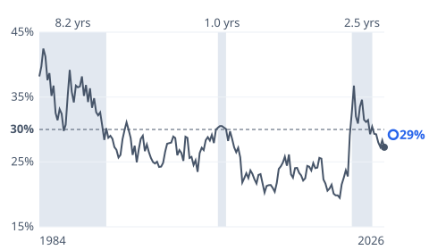

# [first-time-home-buyers](https://mkviz.com/first-time-home-buyers/)

Run from the repository root after `cd engine && cargo build --release && cd ..`.

## home-payment-spells

Data: [home-payment-spells.csv](home-payment-spells.csv) · settings: [home-payment-spells.json](home-payment-spells.json)



```
./engine/target/release/mkviz-engine figure spells data/series/fred_MSPUS.csv --afford data/series/fred_MORTGAGE30US.csv,data/series/fred_MEHOINUSA646N.csv --now 0.292 --now-label 'At this week'\''s rate' --threshold 0.30 --title 'Monthly mortgage payment on a median-priced home as a share of median household income, 1984-2026; shaded when above 30%' --out home-payment-spells.svg
```

## home-first-time-pictogram

Data: [home-first-time-pictogram.csv](home-first-time-pictogram.csv) · settings: [home-first-time-pictogram.json](home-first-time-pictogram.json)



```
./engine/target/release/mkviz-engine figure pictogram data/series/fred_CPIAUCSL.csv --groups 'Paid all cash:10:100:10,Got family money:25:100:25' --title 'Out of every 100 first-time home buyers, July 2025 to June 2026' --out home-first-time-pictogram.svg
```
