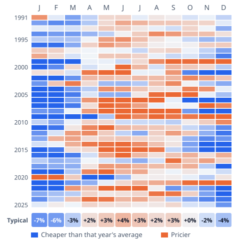
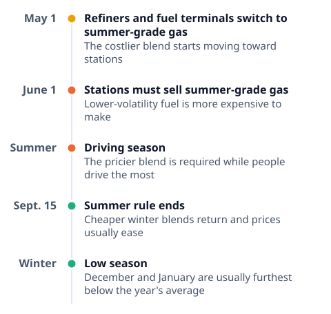
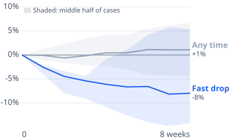

# [When Are Gas Prices Cheapest? Winter, and Weeks After a Drop](https://mkviz.com/fuel-prices/)

## Research note

**Question.** When in the year is US gasoline usually cheapest, and when the price has already fallen fast, has it usually kept falling?

**Short answer.** Over the 35 complete years 1991-2025, January ran a median 7% below its year's average and June 4% above. Since 1990 the weekly price fell 10% or more within four weeks 23 times (finished cases); four weeks later it was lower again in 18, by a median 6% more, and eight weeks later by a median 8%, against about 1% up over any eight weeks. The fall to Nov. 23, 2026 ($4.27 to $3.64, 15% in four weeks) is the 24th.

### Definitions
- Gas price: EIA's weekly US regular gasoline retail price, all formulations (FRED GASREGW), Monday readings, from August 1990.
- Seasonal pattern: each month's average over its own calendar year's average, so long-run price changes don't distort it; median across 1991-2025.
- Fast drop: a week whose price is at least 10% below the highest of the four weeks before it. A new case can start only four weeks after the last one, so a long slide can count more than once (2008 counts three times: October, November and December).
- Other definitions: spacing cases at least eight weeks apart (tested) gives 15 finished cases, 14 of them lower four weeks later; the result doesn't hinge on the spacing.
- Re-scan: with the weekly definition, every case from August 1990 to Nov. 23, 2026 was kept: 24, of which 23 have four and eight weeks of data after them. None was dropped.

### Data
- EIA via FRED, GASREGW, weekly, Aug. 20, 1990 to Nov. 23, 2026 (data/macro/fred_GASREGW.csv).

### Method

```
./engine/target/release/mkviz-engine spikes data/macro/fred_GASREGW.csv --window 4 --threshold 0.10 --forward 28,56 --drops
./engine/target/release/mkviz-engine figure fan data/macro/fred_GASREGW.csv --dates <the 23 finished starts> --weeks 8 --label "Fast drop" --base --base-label "Any time" --out gas-after-drops.svg
```
(`--drops` was added to the engine's `spikes` command on Nov. 25, 2026.) "Any time" is the path from every 21st week since 1990, the same length, as a base rate.

### Results

| Fast drop starts | Change 4 weeks later | Change 8 weeks later |
|---|---|---|
| Jan. 21, 1991 | -9.6% | -12.5% |
| Mar. 4, 1991 | +2.6% | +7.7% |
| Jul. 2, 2001 | -6.1% | +0.9% |
| Oct. 8, 2001 | -10.8% | -18.0% |
| Nov. 5, 2001 | -8.1% | -9.1% |
| Oct. 24, 2005 | -15.4% | -15.1% |
| Nov. 21, 2005 | +0.5% | +5.4% |
| Sep. 4, 2006 | -15.3% | -18.7% |
| Oct. 2, 2006 | -4.0% | -2.8% |
| Oct. 13, 2008 | -29.4% | -46.1% |
| Nov. 10, 2008 | -23.6% | -24.3% |
| Dec. 8, 2008 | -0.9% | +11.4% |
| Dec. 15, 2014 | -16.2% | -14.2% |
| Jan. 12, 2015 | +2.4% | +16.3% |
| Sep. 7, 2015 | -4.9% | -8.7% |
| Feb. 1, 2016 | -2.1% | +13.4% |
| Dec. 3, 2018 | -7.5% | -8.0% |
| Mar. 23, 2020 | -14.5% | -11.4% |
| Apr. 20, 2020 | +3.6% | +15.8% |
| Jul. 25, 2022 | -10.4% | -15.6% |
| Aug. 22, 2022 | -5.8% | -0.2% |
| Dec. 5, 2022 | -4.9% | +2.9% |
| Jun. 22, 2026 | +2.2% | +3.4% |
| Nov. 16, 2026 | under way | under way |

Lower four weeks later in 18 of 23. The five that were higher started in March 1991, November 2005, January 2015, April 2020 and June 2026; each started within about two weeks of a low in WTI crude (Feb. 22, 1991; Nov. 17, 2005; Jan. 23, 2015; Apr. 20, 2020; July 6, 2026). December 2008 was still lower at four weeks and turned up by eight, after oil's Dec. 23, 2008 low.

Cost of waiting, illustration: a 12-gallon fill at $3.64 with another 6% off saves about $2.67.

Seasonal results (1991-2025, unchanged from the Oct. 29, 2026 version): January below its year's average in 86% of years; December was the cheapest single month in 13 years and January in 11.

### Limits
- National average; states and stations differ by more than the seasonal swing.
- 23 cases, several in the same oil collapses (2008, 2014-16, 2020, 2022), so they are not independent.
- The rule is known only after a fall has happened; it describes past falls and does not forecast this one.

### Sources
- EIA via FRED, US Regular All Formulations Gas Price (GASREGW): https://fred.stlouisfed.org/series/GASREGW
- EIA, Today in Energy: summer and winter gasoline: https://www.eia.gov/todayinenergy/detail.php?id=67464
- Federal Reserve Bank of St. Louis, Rockets and feathers (2014): https://www.stlouisfed.org/publications/regional-economist/october-2014/rockets-and-feathers-why-dont-gasoline-prices-always-move-in-sync-with-oil-prices

### Builds on and leads to
- Builds on [Oil prices falling: how fast the pump follows](https://mkviz.com/oil-prices-falling/) (pass-through from crude to the pump).
- Open: a gas-price data page (C2.2) with this week's price against every week since 1990.

### Cite
MKViz (2026). *When are gas prices cheapest?* https://mkviz.com/fuel-prices/ ; code and data: https://github.com/CertainAmount/mkviz-engine/tree/main/data/fuel-prices

## Charts

Run from the repository root after `cd engine && cargo build --release && cd ..`.

## gas-calendar

Data: [gas-calendar.csv](gas-calendar.csv) · settings: [gas-calendar.json](gas-calendar.json)



```
./engine/target/release/mkviz-engine figure calendar data/series/fred_GASREGW.csv --title 'US regular gas price each month versus that year'\''s average, 1991 to 2025' --out gas-calendar.svg
```

## gas-year-rules

Data: [gas-year-rules.csv](gas-year-rules.csv) · settings: [gas-year-rules.json](gas-year-rules.json)



```
./engine/target/release/mkviz-engine figure timeline data/series/fred_CPIAUCSL.csv --items 'May 1|Refiners and fuel terminals switch to summer-grade gas|The costlier blend starts moving toward stations|mixed;June 1|Stations must sell summer-grade gas|Lower-volatility fuel is more expensive to make|bad;Summer|Driving season|The pricier blend is required while people drive the most|bad;Sept. 15|Summer rule ends|Cheaper winter blends return and prices usually ease|good;Winter|Low season|December and January are usually furthest below the year'\''s average|good' --title 'The yearly gas calendar: the federal summer-fuel rule and driving season' --out gas-year-rules.svg
```

## gas-after-drops

Data: [gas-after-drops.csv](gas-after-drops.csv) · settings: [gas-after-drops.json](gas-after-drops.json)



```
./engine/target/release/mkviz-engine figure fan ../../macro/fred_GASREGW.csv --base --base-label 'Any time' --dates 1991-01-21,1991-03-04,2001-07-02,2001-10-08,2001-11-05,2005-10-24,2005-11-21,2006-09-04,2006-10-02,2008-10-13,2008-11-10,2008-12-08,2014-12-15,2015-01-12,2015-09-07,2016-02-01,2018-12-03,2020-03-23,2020-04-20,2022-07-25,2022-08-22,2022-12-05,2026-06-22 --label 'Fast drop' --weeks 8 --out gas-after-drops.svg
```
