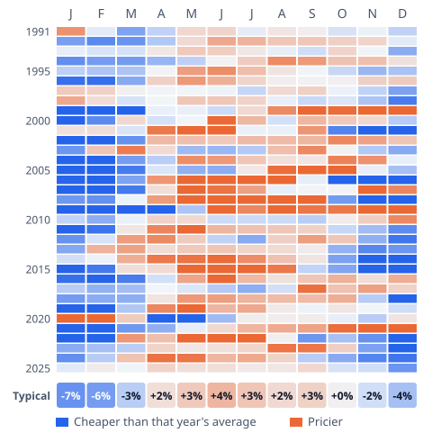
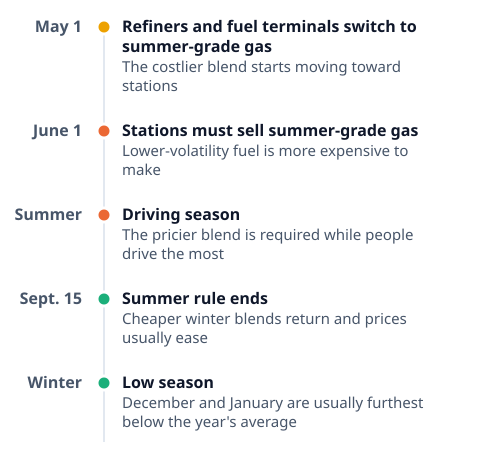

# [When Are Gas Prices Cheapest? 35 Years of Monthly Prices](https://mkviz.com/fuel-prices/)

Run from the repository root after `cd engine && cargo build --release && cd ..`.

## gas-calendar

Data: [gas-calendar.csv](gas-calendar.csv) · settings: [gas-calendar.json](gas-calendar.json)



```
./engine/target/release/mkviz-engine figure calendar data/series/fred_GASREGW.csv --title 'US regular gas price each month versus that year'\''s average, 1991 to 2025' --out gas-calendar.svg
```

## gas-year-rules

Data: [gas-year-rules.csv](gas-year-rules.csv) · settings: [gas-year-rules.json](gas-year-rules.json)



```
./engine/target/release/mkviz-engine figure timeline data/series/fred_CPIAUCSL.csv --items 'May 1|Refiners and fuel terminals switch to summer-grade gas|The costlier blend starts moving toward stations|mixed;June 1|Stations must sell summer-grade gas|Lower-volatility fuel is more expensive to make|bad;Summer|Driving season|The pricier blend is required while people drive the most|bad;Sept. 15|Summer rule ends|Cheaper winter blends return and prices usually ease|good;Winter|Low season|December and January are usually furthest below the year'\''s average|good' --title 'The yearly gas calendar: the federal summer-fuel rule and driving season' --out gas-year-rules.svg
```
