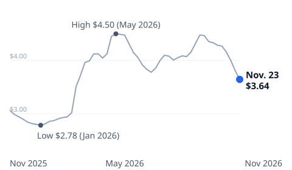
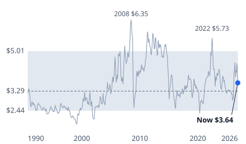
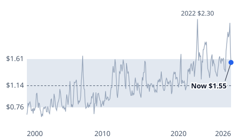

# [Gas Price History Since 1990, With the Crude Inside It](https://mkviz.com/gas-prices-vs-oil/)

## Research note

**Question.** Where does today's US gas price sit against every week since 1990, before and after inflation, and how much of a gallon's price is crude oil?

**Short answer.** Regular gas was $3.64 in the week of Nov. 23, 2026. That is higher than 90% of weeks since August 1990 in plain dollars, but after inflation only higher than 61%, close to the median of $3.29 in today's dollars. The part of the price that isn't crude averaged $1.81 a gallon in 2026, the highest yearly average since 1990, and was back to $1.55 on Nov. 23.

### Definitions
- Gas: EIA weekly US regular retail price, all formulations (FRED GASREGW), Monday readings from Aug. 20, 1990.
- Today's dollars: each week's price times the latest CPI-U (seasonally adjusted, CPIAUCSL) over that month's CPI (engine `--deflate`). October 2026 is the latest CPI month, so recent weeks use it.
- Crude in a gallon: WTI spot (DCOILWTICO) divided by 42 gallons a barrel, averaged over the seven days before each Monday survey. Gap ("not crude"): gas minus that. It covers refining, distribution, taxes and the station margin; it is not a refiner margin (which uses wholesale gasoline).
- Year rows: calendar-year mean, lowest and highest weekly price; 1990 starts in August and is left out of the table; 2026 runs to Nov. 23.
- Other definitions: Brent instead of WTI changes the gap level (Brent usually costs more) but not its shape; we keep WTI because it is the US benchmark.
- Re-scan: every weekly reading from Aug. 20, 1990 to Nov. 23, 2026 was used (1,887 weeks); none dropped. WTI starts in 1986, so the gap is available for every gas week except three 1999 weeks with no WTI price in the week before the survey (Apr. 5, Jul. 12, Sep. 13), so 1999's yearly gap averages the 49 weeks that have one; the gap tracker starts in 2000 for readability, and the median quoted is since 2000.

### Data
- EIA via FRED: GASREGW (weekly) and DCOILWTICO (daily) to Nov. 23-24, 2026; BLS via FRED: CPIAUCSL to Oct. 2026.

### Method

```
./engine/target/release/mkviz-engine position data/macro/fred_GASREGW.csv
./engine/target/release/mkviz-engine position data/macro/fred_GASREGW.csv --deflate data/macro/fred_CPIAUCSL.csv
./engine/target/release/mkviz-engine yearly data/macro/fred_GASREGW.csv --minus data/macro/fred_DCOILWTICO.csv --minus-scale 0.0238095 --minus-window 7
./engine/target/release/mkviz-engine figure recent data/macro/fred_GASREGW.csv --weeks 53 --suffix '$' --decimals 2 --out gas-recent.svg
./engine/target/release/mkviz-engine figure tracker data/macro/fred_GASREGW.csv --deflate data/macro/fred_CPIAUCSL.csv --suffix '$' --years 2008,2022 --out gas-real-tracker.svg
./engine/target/release/mkviz-engine figure tracker data/macro/fred_GASREGW.csv --minus data/macro/fred_DCOILWTICO.csv --minus-scale 0.0238095 --minus-window 7 --suffix '$' --years 2022 --from 2000-01-01 --out gas-gap-tracker.svg
```
(`--minus-scale` on `yearly`, and cents on small dollar labels, were added to the engine on Nov. 26, 2026.)

### Results

| Measure | Value |
|---|---|
| Week of Nov. 23, 2026 | $3.64 |
| A year earlier | $3.06 |
| 2026 high / low | $4.50 (May 11) / $2.78 (Jan. 12) |
| 2026 average so far / 2022 average | $3.87 / $3.95 |
| Weeks since 1990 at or below now, plain / after inflation | +90% / +61% |
| Median since 1990, today's dollars | $3.29 |
| Highest / lowest, today's dollars | $6.35 (June 30, 2008) / $1.86 (Feb. 22, 1999) |
| Gap now / median since 2000 / widest (June 27, 2022) | $1.55 / $1.14 / $2.30 |
| Gap, 2026 yearly average / 2022 | $1.81 / $1.69 |

The yearly table (1991-2026) is on the page; the same numbers are in the engine output and the package (ext.hist.gp_y*_YYYY).

### Limits
- National average; state taxes and blends make state prices differ by more than a dollar.
- The gap is in plain dollars; taxes and costs drift up over time, so compare it with recent years.
- CPI includes gas itself, so the real price is measured against a basket that moves partly with it.

### Sources
- EIA via FRED, GASREGW: https://fred.stlouisfed.org/series/GASREGW
- EIA via FRED, DCOILWTICO: https://fred.stlouisfed.org/series/DCOILWTICO
- BLS via FRED, CPIAUCSL: https://fred.stlouisfed.org/series/CPIAUCSL
- EIA, Gasoline explained: factors affecting gasoline prices: https://www.eia.gov/energyexplained/gasoline/factors-affecting-gasoline-prices.php

### Builds on and leads to
- [Oil prices are falling. Gas has already caught up](https://mkviz.com/oil-prices-falling/) (the gap after this year's oil fall) and [When are gas prices cheapest?](https://mkviz.com/fuel-prices/) (seasons and fast drops).

### Cite
MKViz (2026). *Gas price history since 1990, with the crude inside it.* https://mkviz.com/gas-prices-vs-oil/ ; code and data: https://github.com/CertainAmount/mkviz-engine/tree/main/data/gas-prices-vs-oil

## Charts

Run from the repository root after `cd engine && cargo build --release && cd ..`.

## gas-recent

Data: [gas-recent.csv](gas-recent.csv) · settings: [gas-recent.json](gas-recent.json)



```
./engine/target/release/mkviz-engine figure recent data/series/fred_GASREGW.csv --decimals 2 --now 'Nov. 23' --suffix '$' --title 'US regular gas, dollars a gallon, past year' --weeks 53 --out gas-recent.svg
```

## gas-real-tracker

Data: [gas-real-tracker.csv](gas-real-tracker.csv) · settings: [gas-real-tracker.json](gas-real-tracker.json)



```
./engine/target/release/mkviz-engine figure tracker data/series/fred_GASREGW.csv --deflate data/series/fred_CPIAUCSL.csv --suffix '$' --title 'US regular gas in today'\''s dollars, every week since 1990' --years 2008,2022 --out gas-real-tracker.svg
```

## gas-gap-tracker

Data: [gas-gap-tracker.csv](gas-gap-tracker.csv) · settings: [gas-gap-tracker.json](gas-gap-tracker.json)



```
./engine/target/release/mkviz-engine figure tracker data/series/fred_GASREGW.csv --from 2000-01-01 --minus data/series/fred_DCOILWTICO.csv --minus-scale 0.0238095 --minus-window 7 --suffix '$' --title 'Gas price minus the crude in it, dollars a gallon, since 2000' --years 2022 --out gas-gap-tracker.svg
```
