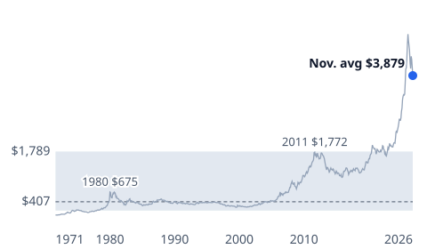
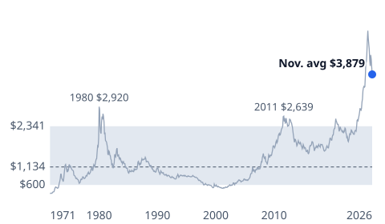
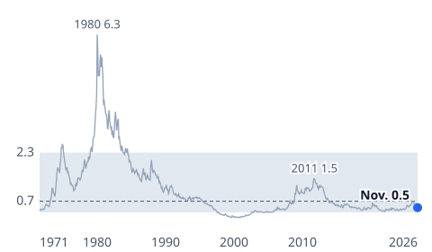
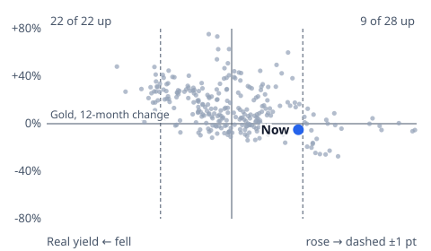

# [Gold Price History Since 1971: Is Gold Expensive Now?](https://mkviz.com/gold-price-history/)

## Research note

**Question.** Where does today's gold price sit among every month since the fixed gold price ended in 1971, before and after inflation, and what did each year and each fall of 20% or more look like?

**Short answer.** Gold futures closed at $3,543 on Nov. 24, 2026, 33% below the Jan. 29, 2026 record close. In monthly averages adjusted to October 2026 dollars with the CPI, November's average so far is higher than 98% of months since August 1971; the median month is about $1,134. The January 1980 monthly average ($2,920 in today's dollars) was first topped in Feb. 1, 2025.

### Definitions
- Gold price, long history: the World Bank's monthly average (Pink Sheet, US dollars per troy ounce), August 1971 to October 2026. November 2026 is the average of COMEX front-month futures closes (Yahoo Finance GC=F) from Nov. 2 to Nov. 24 ($3,879), because the World Bank's November value is not out yet.
- Gold price, this year: COMEX front-month futures daily closes. The record close is $5,318 on Jan. 29, 2026; the record monthly average is $5,020 (February 2026). Daily figures run further from the record than monthly ones (33% against 23%) because averaging smooths spikes; the page names the basis wherever it gives a number.
- After inflation: each month's value times CPI (CPIAUCSL) for October 2026 over CPI for that month; November uses October's CPI.
- Other definitions: the London fix is the benchmark most often quoted for the 1980 peak ($850 on Jan. 21, 1980, afternoon fix); New York's intraday high that day was higher. The page compares that daily figure only with daily futures closes, never with monthly averages.
- Re-scan: with the monthly definition, every fall of 20% or more from a prior record monthly average since August 1971 was kept: five finished (1973, 1974, 1980, 2008, 2011) and the one under way since February 2026. None was dropped. The same five as in the slump note (gold-price.md).

### Data
- World Bank, Commodity Price Data (Pink Sheet), monthly gold price (data/macro/wb_gold.csv).
- Yahoo Finance, COMEX gold futures (GC=F), daily closes Sept. 23, 2025 to Nov. 24, 2026 (data/macro/macro_gold.csv).
- FRED: CPIAUCSL to October 2026.
- Yahoo Finance, S&P 500 (^GSPC) daily closes to Nov. 23, 2026 (data/macro/index_gspc_long.csv).

### Method

```
./engine/target/release/mkviz-engine position gold-monthly-input.csv --deflate data/macro/fred_CPIAUCSL.csv
./engine/target/release/mkviz-engine yearly gold-monthly-input.csv
./engine/target/release/mkviz-engine drawdowns gold-monthly-input.csv --threshold 0.20
./engine/target/release/mkviz-engine figure recent data/macro/macro_gold.csv --weeks 300 --suffix '$' --decimals 0 --out gold-price-recent.svg
./engine/target/release/mkviz-engine figure tracker gold-monthly-input.csv --deflate data/macro/fred_CPIAUCSL.csv --suffix '$' --years 1980,2011 --mid 0.8 --out gold-real-history.svg
```
(The `yearly` command and the `$` label format of `recent` and `tracker` were added to the engine on Nov. 25, 2026.)

Yearly figures: the mean, lowest and highest of each year's monthly averages; 1971 runs August to December and 2026 January to November (November partial). Change = this year's mean over last year's mean, minus one.

Stock-down days: every trading day from Oct. 7 to Nov. 23, 2026 with both closes; S&P 500 close below the prior close, and whether gold futures closed above their prior close the same day.

### Results

| Measure | Value |
|---|---|
| Latest futures close (Nov. 24) | $3,543 |
| Below the Jan. 29 record close | 33% |
| November average so far | $3,879 |
| Below the February record month | 23% |
| Median month since 1971, October 2026 dollars | $1,134 |
| Share of months below November, after inflation | 98% |
| Jan. 1980 month, October 2026 dollars | $2,920 |
| Feb. 2026 record month, October 2026 dollars | $5,174 |
| $850 London fix of Jan. 21, 1980, October 2026 dollars | $3,678 |

Yearly: the largest rises in the yearly average were 1980 (+98%), 1973, 1974, 1979 and 2025 (+44%); the yearly average fell in 16 of the 54 full-year changes from 1972 to 2025, most in 1981.

Falls of 20% or more (monthly averages, record to lowest month, months from the record to the first month back at or above it): July 1973 -20.8%, six; December 1974 -40.2%, 39; January 1980 -62.1%, 316; March 2008 -21.4%, 18; September 2011 -39.3%, 106; February 2026 -22.7% so far.

Stock-down days, Oct. 7 to Nov. 23, 2026: the S&P 500 fell on 20 days; gold futures rose on six of them. Of the 9 days the S&P 500 fell 1% or more, gold rose on 3. On the worst, Nov. 5 (-4.4%), gold rose 1.0%; on Nov. 20 (S&P 500 -3.7%) gold fell 4.6%.

### Added Nov. 25, 2026 (after cold reads asked why gold fell, whether it's cheap next to stocks, and what happened after falls like this)

**What moved with gold (real yields).** `cond gold-monthly-input.csv --x fred_DFII10.csv --months 12 --at 1.0`; drawn with `figure quad` (same pairs, one dot per month since January 2004, the first month with a 12-month TIPS change). Both series are monthly averages. Of 22 months whose 10-year real yield was 1 point or more lower than a year earlier, gold was higher than a year earlier in all 22 (median +27.0%). Of 28 months with the real yield 1 point or more higher, gold was higher in nine (median -4.7%). Correlation of the two 12-month changes, 274 months: -0.42. November 2026: real yield 0.94 points higher than a year earlier, gold -5.1%. From the Jan. 29 record to Nov. 23 the 10-year real yield went from 1.89% to 2.79%, and the broad dollar index (DTWEXBGS) rose +5.2% to Nov. 20. Months overlap (each 12-month window shares 11 months with the next), so the counts are not independent cases.

**Against stocks.** `position gold-monthly-input.csv --per index_gspc_long.csv` and `figure tracker … --per …`: each month's gold average divided by the S&P 500 close on the last trading day before that month (price index, no dividends). November 2026: 0.51, with 33% of months since August 1971 lower; median 0.72; highest 6.25 (January 1980), lowest 0.18 (September 2000).

**After the first month 20% below the record.** `drawdowns gold-monthly-input.csv --threshold 0.20 --forward 365,1095,1826` (change from the first month at least 20% below the record to the month one, three and five years later):

| Record | First month 20% below | 1 year later | 3 years later | 5 years later |
|---|---|---|---|---|
| Jul. 1973 | Nov. 1973 | +91.6% | +36.8% | +116.8% |
| Dec. 1974 | Sep. 1975 | -20.8% | +47.2% | +368.1% |
| Jan. 1980 | Apr. 1980 | -4.1% | -16.2% | -36.8% |
| Mar. 2008 | Nov. 2008 | +48.1% | +128.5% | +67.7% |
| Sep. 2011 | May 2013 | -8.8% | -10.8% | -7.9% |

Higher one year later in two of five, five years later in three. After inflation the 1973, 1974 and 1980 cases keep their signs.

### Limits
- CPI is one price index; another index would move the inflation-adjusted figures somewhat.
- Monthly averages blur daily peaks; the November figure is a partial-month futures average, not the World Bank's.
- Futures are not the price a coin or bar buyer pays; dealers add spreads and fees.
- Thirty-four trading days of stock-down comparisons are a snapshot, not a rule.
- TIPS yields start in 2003, so the real-yield test covers about two decades and one regime of central-bank buying; five falls are too few for odds.

### Sources
- World Bank, Commodity Markets (Pink Sheet): https://www.worldbank.org/en/research/commodity-markets
- Yahoo Finance, Gold futures (GC=F) history: https://finance.yahoo.com/quote/GC%3DF/history/
- FRED, CPIAUCSL: https://fred.stlouisfed.org/series/CPIAUCSL
- FRED, 10-year TIPS yield (DFII10): https://fred.stlouisfed.org/series/DFII10 ; broad dollar index (DTWEXBGS): https://fred.stlouisfed.org/series/DTWEXBGS
- Federal Reserve Bank of Cleveland, After Silver and Gold: Some Sober Thoughts on Speculative Bubbles (May 1980): https://www.clevelandfed.org/newsroom-and-events/publications/economic-commentary/economic-commentary-archives/1980-economic-commentaries/ec-19800505-after-silver-and-gold-some-sober-thoughts-on-speculative-bubbles
- Federal Reserve History, Nixon ends convertibility of US dollars to gold: https://www.federalreservehistory.org/essays/gold-convertibility-ends
- Yahoo Finance, S&P 500 (^GSPC) history: https://finance.yahoo.com/quote/%5EGSPC/history/

### Builds on and leads to
- Builds on [How long do gold slumps last?](https://mkviz.com/gold-price/) (same falls, followed month by month).
- Open: gold and Fed rate cuts; gold in recessions (the two longtail questions under this page).

### Cite
MKViz (2026). *Gold price history since 1971.* https://mkviz.com/gold-price-history/ ; code and data: https://github.com/CertainAmount/mkviz-engine/tree/main/data/gold-price-history

## Charts

Run from the repository root after `cd engine && cargo build --release && cd ..`.

## gold-price-history

Data: [gold-price-history.csv](gold-price-history.csv) · settings: [gold-price-history.json](gold-price-history.json)



```
./engine/target/release/mkviz-engine figure tracker gold-monthly-input.csv --mid 0.8 --now 'Nov. avg' --suffix '$' --title 'Gold, monthly average (dollars per ounce)' --years 1980,2011 --out gold-price-history.svg
```

## gold-real-history

Data: [gold-real-history.csv](gold-real-history.csv) · settings: [gold-real-history.json](gold-real-history.json)



```
./engine/target/release/mkviz-engine figure tracker gold-monthly-input.csv --deflate ../../macro/fred_CPIAUCSL.csv --mid 0.8 --now 'Nov. avg' --suffix '$' --title 'Gold, monthly average in October 2026 dollars' --years 1980,2011 --out gold-real-history.svg
```

## gold-vs-stocks

Data: [gold-vs-stocks.csv](gold-vs-stocks.csv) · settings: [gold-vs-stocks.json](gold-vs-stocks.json)



```
./engine/target/release/mkviz-engine figure tracker gold-monthly-input.csv --mid 0.8 --now Nov. --per ../../macro/index_gspc_long.csv --title 'Gold price divided by the S&P 500, monthly since 1971' --years 1980,2011 --out gold-vs-stocks.svg
```

## gold-real-yield

Data: [gold-real-yield.csv](gold-real-yield.csv) · settings: [gold-real-yield.json](gold-real-yield.json)



```
./engine/target/release/mkviz-engine figure quad gold-monthly-input.csv --at 1.0 --months 12 --title 'Gold'\''s 12-month change against the change in the 10-year real yield, monthly since 2004' --x ../../macro/fred_DFII10.csv --xlabel 'Real yield' --xunit pt --ylabel 'Gold, 12-month change' --out gold-real-yield.svg
```
