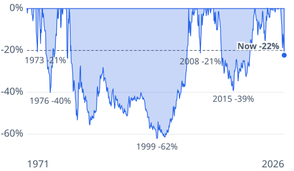
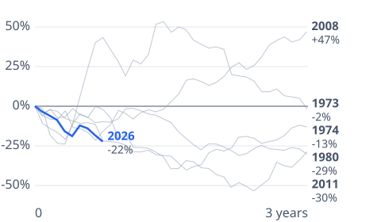

# [Gold Price Is Down More Than 20%. How Long Gold Slumps Last](https://mkviz.com/gold-price/)

## Research note

**Question.** How long do gold slumps last, and what did past falls do once they got as deep as the one under way in November 2026?

**Short answer.** Since the August 1971 end of the fixed gold price, gold's monthly average fell 20% or more from a record five times before 2026. Two stopped near 21% (1973, 2008) and set a new record six and 18 months after their peaks. Three went to 39-62% (1974, 1980, 2011) and took about 3.25, nine and 26 years. In November 2026 so far the average is 22% below February's peak, past where the two quick ones turned; none of the three that got this deep got back to its record within two years of first reaching it (fewest 29 months).

### Definitions
- Gold price: the World Bank's monthly average (Pink Sheet, US dollars per troy ounce), August 1971 to October 2026. November 2026 is the average of COMEX front-month futures closes (Yahoo Finance GC=F) from Nov. 2 to Nov. 23, because the World Bank's November figure is not out yet. Over October 2026 the two agree within 0.4% (futures 4,121, World Bank 4,105).
- Fall: every stretch at least 20% below the prior record monthly average, followed to its lowest month and to the first month at or above the old record.
- Other definitions: the daily view (futures closes) puts the record at $5,318.40 on Jan. 29, 2026 and the Nov. 23 close 31% below it. Daily falls are deeper than monthly ones because averaging smooths spikes; the post names both and uses monthly averages for every comparison with history, since daily data does not reach back to 1971 in our set.
- Re-scan: with the monthly definition, every fall of 20% or more since August 1971 was kept: five finished (1973, 1974, 1980, 2008, 2011) and the one under way. None was dropped.

### Data
- World Bank, Commodity Price Data (Pink Sheet), monthly gold price, 1960 to October 2026 (data/macro/wb_gold.csv).
- Yahoo Finance, COMEX gold futures (GC=F), daily closes to Nov. 23, 2026 (data/macro/macro_gold.csv).
- FRED: CPIAUCSL (inflation adjustment), NASDAQCOM (crash comparison below).

### Method

```
python -m msci.cli worldbank gold Gold
(head -1 wb_gold.csv; rows from 1971-08; plus 2026-11-01 = mean of GC=F closes Nov. 2-23) > gold-monthly-input.csv
./engine/target/release/mkviz-engine figure underwater gold-monthly-input.csv --lines 0.2 --out gold-underwater.svg
./engine/target/release/mkviz-engine figure paths gold-monthly-input.csv --dates 1973-07-01,1974-12-01,1980-01-01,2008-03-01,2011-09-01,2026-02-01 --days 1100 --labels "1973,1974,1980,2008,2011,2026" --out gold-after-peaks.svg
```
(The paths end-label spacing was added to the engine for this note.)

### Results

| Record month | Low | Depth | Months record to first 22% below | Months record to back at or above the record |
|---|---|---|---|---|
| Jul. 1973 | Nov. 1973 | -20.8% | never got that deep | 6 |
| Dec. 1974 | Aug. 1976 | -40.2% | 10 | 39 |
| Jan. 1980 | Jul. 1999 | -62.1% | 3 | 316 |
| Mar. 2008 | Nov. 2008 | -21.4% | never got that deep | 18 |
| Sep. 2011 | Dec. 2015 | -39.3% | 21 | 106 |
| Feb. 2026 | (under way) | -22.3% so far | 9 | not yet |

From first reaching 22% to back at the record: 1974 fall 29 months (Oct. 1975 to Mar. 1978, when the monthly average matched the 1974 record; it topped it in July 1978), 2011 fall 85 months, 1980 fall 313 months (matched May 2006, topped April 2007).

After inflation (CPI), gold's January 1980 peak was not topped until 2025, about 45 years later.

Gold during big stock falls (moved here from the post's first version; its own question): over 14 Nasdaq falls of 20% or more since 1971 (2007-09 included), gold rose over the same months in eight, median change +0.9%; it rose +22.4% in 2007-09 and fell -24.2% in the 1981-82 fall, when interest rates were very high.

Selling costs and US tax (moved here from the post's first version): coins and bars sell below the quoted price plus dealer fees; physical-gold funds charge a yearly fee; long-term gains on physical gold and grantor-trust gold funds are taxed as collectibles at up to +28%, against a top +20% on most stocks (IRS Topic 409; SPDR Gold Trust 10-K). IRAs generally can't hold collectibles, but certain US gold coins and bullion held by the trustee are an exception.

### Limits
- Five finished falls, three of them past today's depth: too few for a rule.
- Monthly averages blur the exact turn; the November figure is a partial-month futures average, not the World Bank's number.
- Prices in dollars, not adjusted for inflation except where stated.

### Sources
- World Bank, Commodity Markets (Pink Sheet): https://www.worldbank.org/en/research/commodity-markets
- Yahoo Finance, Gold futures (GC=F) history: https://finance.yahoo.com/quote/GC%3DF/history/
- FRED, CPIAUCSL: https://fred.stlouisfed.org/series/CPIAUCSL ; NASDAQCOM: https://fred.stlouisfed.org/series/NASDAQCOM
- Federal Reserve History, Nixon ends convertibility of US dollars to gold: https://www.federalreservehistory.org/essays/gold-convertibility-ends
- IRS, Topic no. 409: https://www.irs.gov/taxtopics/tc409 ; IRS, Investments in collectibles in individually directed qualified plan accounts: https://www.irs.gov/retirement-plans/investments-in-collectibles-in-individually-directed-qualified-plan-accounts
- SPDR Gold Trust 10-K: https://www.sec.gov/Archives/edgar/data/1222333/000143774925036305/gld20250930_10k.htm

### Builds on and leads to
- Builds on [Is the dollar getting weaker?](https://mkviz.com/dollar-weaker-2026/) (the dollar side of gold).
- Open: a gold data page with the record and every fall (C5.2); gold in recessions; gold and Fed rate cuts.

### Cite
MKViz (2026). *How long do gold slumps last?* https://mkviz.com/gold-price/ ; code and data: https://github.com/CertainAmount/mkviz-engine/tree/main/data/gold-price

## Charts

Run from the repository root after `cd engine && cargo build --release && cd ..`.

## gold-underwater

Data: [gold-underwater.csv](gold-underwater.csv) · settings: [gold-underwater.json](gold-underwater.json)



```
./engine/target/release/mkviz-engine figure underwater gold-monthly-input.csv --lines 0.2 --title 'Gold'\''s falls of 20% or more since 1971, monthly averages, % below the prior record' --out gold-underwater.svg
```

## gold-after-peaks

Data: [gold-after-peaks.csv](gold-after-peaks.csv) · settings: [gold-after-peaks.json](gold-after-peaks.json)



```
./engine/target/release/mkviz-engine figure paths gold-monthly-input.csv --dates 1973-07-01,1974-12-01,1980-01-01,2008-03-01,2011-09-01,2026-02-01 --days 1100 --labels 1973,1974,1980,2008,2011,2026 --title 'Gold in the three years after each record that led to a 20% fall, % from the record' --out gold-after-peaks.svg
```
