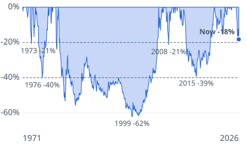
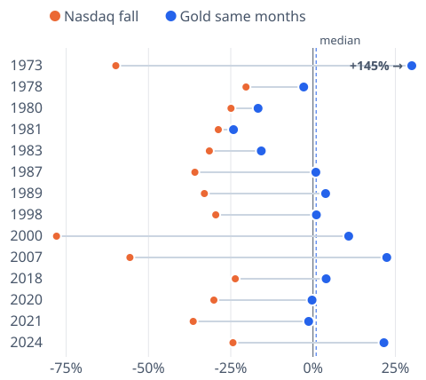

# [Gold Price Is Down 18% From Its Peak. How Long Gold Slumps Last](https://mkviz.com/gold-price/)

Run from the repository root after `cd engine && cargo build --release && cd ..`.

## gold-underwater

Data: [gold-underwater.csv](gold-underwater.csv) · settings: [gold-underwater.json](gold-underwater.json)



```
./engine/target/release/mkviz-engine figure underwater data/series/wb_gold.csv --from 1971-08-01 --lines 0.2,0.4 --title 'Gold'\''s slumps since 1971: some ended within months, the one that began in 1980 lasted about 26 years' --out gold-underwater.svg
```

## gold-during-crashes

Data: [gold-during-crashes.csv](gold-during-crashes.csv) · settings: [gold-during-crashes.json](gold-during-crashes.json)



```
./engine/target/release/mkviz-engine figure during data/series/wb_gold.csv --episodes data/series/fred_NASDAQCOM.csv --names 'Nasdaq fall,Gold same months,' --threshold 0.2 --title 'During 14 big Nasdaq falls since 1971, gold rose in eight and fell in six' --windows 2007-10-31:2009-03-09 --out gold-during-crashes.svg
```
