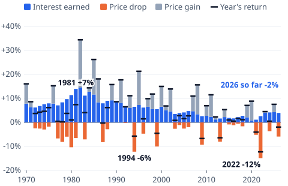

# [Why Bond Funds Lose Money in a Year Like 2026](https://mkviz.com/how-bond-funds-lose-money/)

## Research note

**Question.** When does a bond fund lose money over a year, and can one number tell you in advance how much rise in yields a year's interest can absorb?

**Short answer.** A fund's interest is a cushion. Divide the yield at the start of the year by the fund's duration and you get roughly how many points yields can rise over the year before the price loss uses up the year's interest. For a fund of 7-year Treasury notes, that rule called 53 of 56 calendar years correctly since 1970; the fund lost money in seven of them, worst 12.3% in 2022, when the cushion was 0.22 points and the yield rose 2.52. In 2026 through Nov. 19 the 7-year yield rose one point against a cushion of 0.65, and the fund is down 1.9%. At the Nov. 19 yield of 4.94% the cushion for the next twelve months is about 0.84 points.

### Definitions
- Bond fund: a constant-maturity Treasury fund rebuilt from the Federal Reserve's daily yields (FRED DGS2, DGS7, DGS10). Each month it buys a par note at that month's last yield, reprices it a month later at the new yield with one month less to maturity (semiannual compounding) and adds a month of interest (Swinkels 2019). No fees, taxes or credit risk.
- Losing year: a calendar year whose total return, end of December to end of December, is below zero.
- Cushion: the yield at the end of the prior December divided by the modified duration of a par note at that yield, in percentage points. Price loss ≈ duration × rise, a year's interest ≈ yield, so the two are equal when the rise equals yield ÷ duration. It ignores roll-down (the note gets shorter during the year) and the higher interest earned after the rise.
- Interest part and price part: each month's return is split into interest (the fund's value times the prior month's yield divided by 12) and price (the rest). A year's parts are the sums over its months divided by the value at the end of the prior December, so interest plus price equals the year's total return.
- Yield change: the month-end yield in December (or the latest month) minus the yield at the end of the prior December.
- Other definitions: fund fact sheets report 1-year returns on a rolling basis and net of fees; a fund with corporate bonds also loses when credit spreads widen or issuers default, which this Treasury-only measure does not capture. A fund's own yield and duration are on its fact sheet.
- Re-scan: every full calendar year in the data was kept (2-year 1977-2025: 49, 7-year 1970-2025: 56, 10-year 1963-2025: 63). The first partial year of each series is dropped because it has no prior December. 2026 is shown separately as year to date and not counted.

### Data
- Federal Reserve H.15 via FRED: 2-year (DGS2, from June 1976), 7-year (DGS7, from July 1969) and 10-year (DGS10, from January 1962) Treasury constant-maturity yields, daily, through Nov. 19, 2026.
- S&P 500 daily close (Yahoo Finance ^GSPC), 1950 to Nov. 20, 2026, price only, for the stocks-and-bonds comparison.

### Method

```
python -m msci.cli fred DGS2 DGS7 DGS10
./engine/target/release/mkviz-engine cushion data/macro/fred_DGS7.csv --maturity 7
./engine/target/release/mkviz-engine cushion data/macro/fred_DGS2.csv --maturity 2
./engine/target/release/mkviz-engine cushion data/macro/fred_DGS10.csv --maturity 10
./engine/target/release/mkviz-engine figure cushion data/macro/fred_DGS7.csv --maturity 7 --marks 1994,2022,2021,2013,1981 --out bond-fund-cushion.svg
./engine/target/release/mkviz-engine figure split data/macro/fred_DGS7.csv --maturity 7 --from 1970 --marks 1981,1994,2022 --out bond-fund-split.svg
./engine/target/release/mkviz-engine figure intrayear data/macro/index_gspc_long.csv --out sp500-years.svg
```
(`cushion`, the `figure cushion` scatter and the `figure split` bars were added to the engine for this note.)

### Results

By maturity:

| Fund | Full years | Losing years | Worst year | Cushion entering 2026 | Yield change in 2026 so far | Return in 2026 so far | Cushion at the Nov. 19 yield |
|---|---|---|---|---|---|---|---|
| 2-year Treasury | 49 | 5 | -4.0% (2022) | 1.81 | +1.29 | +1.3% | 2.52 |
| 7-year Treasury | 56 | 7 | -12.3% (2022) | 0.65 | +1 | -1.9% | 0.84 |
| 10-year Treasury | 63 | 12 | -16.4% (2022) | 0.52 | +0.86 | -2.7% | 0.65 |

Losing years: 2-year 1994, 2014, 2015, 2021, 2022; 7-year 1987, 1994, 1999, 2009, 2013, 2021, 2022; 10-year 1967, 1969, 1978, 1980, 1987, 1994, 1999, 2009, 2013, 2021, 2022, 2024.

Interest against price, 7-year fund (the post's chart; full table in bond-fund-split.csv):

| Year | Interest part | Price part | Total return |
|---|---|---|---|
| 1981 | +13.9% | -6.5% | +7.4% |
| 2021 | +1.1% | -5.2% | -4.0% |
| 2022 | +2.6% | -14.9% | -12.3% |

The interest part never fell below 11.2% from 1980 through 1985 and stayed under 3% every year from 2009 through 2022. On $10,000 at the start of 2026, through Nov. 19: interest $395, price drop $590, net down $195. At the Nov. 19 yield of 4.94%, a month's interest is about 0.41% of the fund, so the 2026 drop would take about 4.7 months of interest to earn back if yields did not move (a condition, not a forecast).

7-year fund, the losing years and the cushion:

| Year | Yield at the start | Cushion (points) | Yield change (points) | Total return |
|---|---|---|---|---|
| 1987 | 7.09% | 1.30 | +1.58 | -0.3% |
| 1994 | 5.53% | 0.96 | +2.31 | -5.7% |
| 1999 | 4.73% | 0.80 | +1.82 | -4.5% |
| 2009 | 1.87% | 0.29 | +1.52 | -6.7% |
| 2013 | 1.18% | 0.18 | +1.27 | -6.4% |
| 2021 | 0.65% | 0.1 | +0.79 | -4.0% |
| 2022 | 1.44% | 0.22 | +2.52 | -12.3% |
| 2026 so far | 3.94% | 0.65 | +1 | -1.9% |

The rule missed three 7-year years (1977, 1978, 1980): each time the rise beat the cushion by 0.14 point or less and the fund still ended slightly up (+0.2% to +1.0%), because the note's roll-down and the higher interest after the rise are left out. The 2-year and 10-year misses were the same kind (flat years within 0.15 point of the line). The largest single cushion that held: 1981, 2.73 points at a 12.49% start; the yield still rose 1.48 and the fund returned +7.4%.

Stocks and bonds, calendar years since 1970: the S&P 500 price index fell in 14 years (counting 2011, down 0.003%). The 7-year fund lost money in two of them, 1994 (stocks -1.5%, fund -5.7%) and 2022 (stocks -19.4%, fund -12.3%). In 2008 stocks fell 38.5% and the fund gained 15.7%. In 2026 through Nov. 20 the S&P 500 price index is +1.0% for the year.

### Limits
- Treasury notes only. Corporate and high-yield funds add credit losses; a mortgage-backed fund's duration changes as rates move.
- The fund is rebuilt from month-end yields, so it misses moves inside a month and carries no fees. A real fund's return differs by its fee and holdings; the author's own run with December averages gave -11.4% for 2022 against -12.3% here.
- The cushion is a one-line approximation (no roll-down, no convexity). It is meant to tell a reader in advance roughly how much rise a year's interest covers, not to forecast returns.
- Stock years are price only (no dividends).

### Sources
- Federal Reserve via FRED, 7-year Treasury constant maturity (DGS7): https://fred.stlouisfed.org/series/DGS7
- Federal Reserve via FRED, 2-year (DGS2): https://fred.stlouisfed.org/series/DGS2
- Federal Reserve via FRED, 10-year (DGS10): https://fred.stlouisfed.org/series/DGS10
- Yahoo Finance, S&P 500 (^GSPC) history: https://finance.yahoo.com/quote/%5EGSPC/history/
- Swinkels, L. (2019). Data: International Government Bond Returns Since 1947. *Data*, 4(3), 108.

### Builds on and leads to
- Builds on [Bond fund calculator](https://mkviz.com/bond-fund-calculator/) (every 5% loss since 1969 and its recovery, same rebuilt fund) and [Bond funds and rising yields](https://mkviz.com/bond-funds/) (break-even after a jump).
- Open: the same cushion for a corporate bond index; rolling twelve-month windows instead of calendar years.

### Cite
MKViz (2026). *How do bond funds lose money?* https://mkviz.com/how-bond-funds-lose-money/ ; code and data: https://github.com/CertainAmount/mkviz-engine/tree/main/data/how-bond-funds-lose-money

## Charts

Run from the repository root after `cd engine && cargo build --release && cd ..`.

## bond-fund-split

Data: [bond-fund-split.csv](bond-fund-split.csv) · settings: [bond-fund-split.json](bond-fund-split.json)



```
./engine/target/release/mkviz-engine figure split data/series/fred_DGS7.csv --from 1970 --marks 1981,1994,2022 --maturity 7 --title 'Interest earned vs price change, 7-year Treasury fund, each year since 1970' --out bond-fund-split.svg
```
