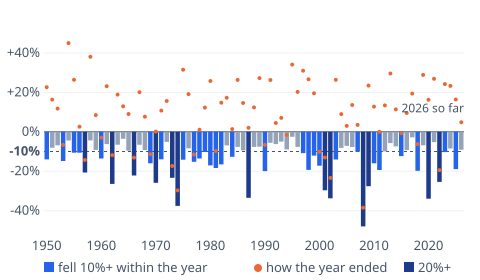

# [How Often Do Stock Market Corrections Happen? More Years Than Not](https://mkviz.com/how-long-do-corrections-last/)

## Research note

**Question.** How often does the stock market fall 10%, and how long do those falls last?

**Short answer.** It depends on how you count, and both counts are common. Within a calendar year, the S&P 500 fell 10% or more from that year's high in 41 of the 76 years from 1950 to 2025, a little more than every other year, and in 22 of those years it still finished higher. The median year's deepest fall was 10.4%. Counted from a record close instead, there were 26 declines of 10% or more since 1950, with a median of about 2.6 years between the records that came before them. The 15 that stopped short of 20% were back at a record in a median of about seven months, and none took longer than 18; the 11 that went further took a median of about 25 months.

### Definitions
- Within-year fall: for each calendar year, the deepest drop from that year's highest close to any later close in the same year. This is the "intra-year decline" many fund companies chart. It resets each January, so one long fall can show up in two years, and a fall that straddles New Year can be split and look smaller.
- Decline from a record: every close at least 10% below the prior all-time closing high, followed to the lowest close and to the next record (engine `drawdowns`). A fall inside a longer bear market does not count again, so 2011's 19% drop, which came while the index was still below its 2007 record, is not a separate decline here.
- The two answer different questions: the first is how often a year is bumpy; the second is how often the market sets a record and then loses 10% from it. We show both and say which one a number belongs to.
- Prices only (no dividends). Daily closes from Yahoo Finance (^GSPC) since Jan. 3, 1950. The 1950 change is measured from that first close (it counts among the 22 years that ended higher; without 1950 the count is 21 of 40).
- Re-scan: all 76 full years (1950-2025) were measured; none dropped, 2026 is shown separately as year to date. All closes since 1950 were scanned for 10% declines from a record; 26 qualify, including the one that began Feb. 19, 2025. The 2026 dips (9.1% from Jan. 27 to March 30, and 8.2% from the Oct. 6 record as of Nov. 19) have not reached 10% and are not counted.

### Data
- S&P 500 daily closes, Yahoo Finance ^GSPC, Jan. 3, 1950 to Nov. 19, 2026.
- NBER recession months (FRED USREC) for the deep declines.

### Method

```
./engine/target/release/mkviz-engine figure intrayear data/macro/index_gspc_long.csv --line 0.10 --out sp-intrayear.svg
./engine/target/release/mkviz-engine drawdowns data/macro/index_gspc_long.csv --threshold 0.10 --deep 0.20 --flag data/macro/fred_USREC.csv
```

### Results

Within-year falls, 1950-2025 (76 years):

| Fall within the year | Years | Of those, ended the year higher |
|---|---|---|
| 5% or more | 70 | |
| 10% or more | 41 | 22 |
| 20% or more | 13 | |

The index ended higher in 56 of the 76 years. The longest run without a 10% within-year fall was six years, 1991 to 1996. Recent 10% years: 2003, 2007, 2008, 2009, 2010, 2011, 2015, 2018, 2020, 2022, 2023, 2025. In 2026 so far the deepest fall is 9.1% (Jan. 27 to March 30), and the index is up 4.8% for the year through Nov. 19, 2026.

Declines of 10% or more from a record, 1950-2026:

| | Count | Record to new record, median | Longest |
|---|---|---|---|
| Stopped between 10% and 20% | 15 | about 7 months | about 18 months (1959-61) |
| Went 20% or more | 11 | about 25 months | about 7.5 years (1973-80) |

As of Nov. 19, 2026, the index was 8.2% below its record of Oct. 6, 2026.

### Limits
- Prices only; with dividends, recoveries are shorter.
- 76 years and 26 declines. The deep declines mostly came with recessions, so they are not independent draws.
- Calendar years are an arbitrary window; that is why the record-based count is shown too.

### Sources
- Yahoo Finance, S&P 500 (^GSPC) history: https://finance.yahoo.com/quote/%5EGSPC/history/
- NBER via FRED, USREC: https://fred.stlouisfed.org/series/USREC

### Builds on and leads to
- Builds on [Stock market corrections since 1950](https://mkviz.com/stock-market-corrections-history/), which tracks the current dip and the odds of each depth.
- Open: the same within-year count for the Nasdaq-100, and with dividends.

### Cite
MKViz (2026). *How often do stock market corrections happen, and how long do they last?* https://mkviz.com/how-long-do-corrections-last/ ; code and data: https://github.com/CertainAmount/mkviz-engine/tree/main/data/how-long-do-corrections-last

## Charts

Run from the repository root after `cd engine && cargo build --release && cd ..`.

## sp-intrayear

Data: [sp-intrayear.csv](sp-intrayear.csv) · settings: [sp-intrayear.json](sp-intrayear.json)



Drawn from market prices we don't redistribute; the chart data is in the CSV.
