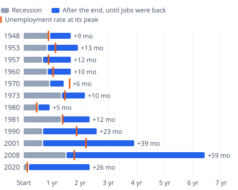

# [How Long Do Recessions Last? 10 Months. The Jobs Take Longer](https://mkviz.com/how-long-do-recessions-last/)

## Research note

**Question.** How long do US recessions last, and how long until the job losses are made up?

**Short answer.** The 12 recessions since 1948 lasted a median of 10 months by the official dates (NBER's own average for 1945-2020 is 10.3), from two months in 2020 to 18 in 2007-09. Payroll jobs got back to their pre-recession high a median of 12 months after the official end. For the first eight recessions (1948-1982) that took five to 13 months; for the last four it took 23, 39, 59 and 26 months. The unemployment rate kept rising for a median of three months after the end. NBER announced the end eight to 21 months after it happened (median 15, 1980-2020).

### Definitions
- Recession: the months NBER dates as a contraction, from the month after a peak to the trough month, as flagged in FRED's USREC series. Length is the number of flagged months. NBER's own tables count peak to trough, which gives the same length.
- Jobs back: the first month after the official end when total nonfarm payroll employment (BLS, FRED PAYEMS) is at or above its highest level in the 12 months up to the recession's first month. Counted in months from the trough month. Other ways to measure "recovered" exist: the unemployment rate back to its pre-recession level takes longer than payrolls in most cycles because the labor force grows; we use payrolls because it is the count of jobs and it is revised into a consistent series.
- Unemployment peak: the highest monthly unemployment rate from the recession's first month to 36 months after the end, or to the next recession's start if sooner (so the 1980 window does not run into 1981).
- Re-scan: every USREC run since January 1948 was taken; 12 qualify and none was dropped. The 1980 and 1981-82 recessions are counted separately as NBER dates them. The current period (through October 2026) is not a recession by NBER's dates and is not counted.

### Data
- NBER recession months via FRED (USREC), monthly, through Oct. 2026.
- BLS total nonfarm payrolls (FRED PAYEMS), monthly, 1939 to Oct. 2026.
- BLS unemployment rate (FRED UNRATE), monthly, 1948 to Oct. 2026.
- DOL initial jobless claims (FRED ICSA), weekly, 1967 to Nov. 14, 2026 (4-week average).
- NBER Business Cycle Dating Committee announcements (dates of each peak and trough announcement).

### Method

```
./engine/target/release/mkviz-engine recessions data/macro/fred_USREC.csv --with data/macro/fred_UNRATE.csv --after 36 --from 1948-01-01 --recover data/macro/fred_PAYEMS.csv --claims data/macro/fred_ICSA.csv
./engine/target/release/mkviz-engine figure aftermath data/macro/fred_USREC.csv --with data/macro/fred_UNRATE.csv --after 36 --from 1948-01-01 --recover data/macro/fred_PAYEMS.csv --out recession-aftermath.svg
```

### Results

| Recession | Months | Jobs back, months after the end | Unemployment peak, months after the end | Unemployment rise, points |
|---|---|---|---|---|
| 1948-49 | 11 | 9 | 0 | 4.1 |
| 1953-54 | 10 | 13 | 4 | 3.5 |
| 1957-58 | 8 | 12 | 3 | 3.4 |
| 1960-61 | 10 | 10 | 3 | 1.9 |
| 1970 | 11 | 6 | 9 | 2.6 |
| 1973-75 | 16 | 10 | 2 | 4.2 |
| 1980 | 6 | 5 | 0 | 1.5 |
| 1981-82 | 16 | 12 | 1 | 3.6 |
| 1990-91 | 8 | 23 | 15 | 2.3 |
| 2001 | 8 | 39 | 19 | 2.0 |
| 2007-09 | 18 | 59 | 4 | 5.0 |
| 2020 | 2 | 26 | 0 | 11.3 |
| Median | 10 | 12 | 3 | 3.45 points |

When NBER announced each date (announcement month minus the dated month):

| Recession | Start announced | End announced | Months after the end |
|---|---|---|---|
| 1980 | June 3, 1980 | July 8, 1981 | 12 |
| 1981-82 | Jan. 6, 1982 | July 8, 1983 | 8 |
| 1990-91 | April 25, 1991 | Dec. 22, 1992 | 21 |
| 2001 | Nov. 26, 2001 | July 17, 2003 | 20 |
| 2007-09 | Dec. 1, 2008 | Sept. 20, 2010 | 15 |
| 2020 | June 8, 2020 | July 19, 2021 | 15 |

In three of the last four recessions (1990-91, 2001, 2020) the start was announced in or after the month the recession ended.

Claims back down versus jobs back (recessions since weekly claims began in 1967). 'Halfway down': the first week after the claims peak (start to a year after the end) when the 4-week average was below the midpoint between its low of the year before the start and that peak.

| Recession | Claims peak | Halfway down | Jobs back | Months from halfway down to jobs back |
|---|---|---|---|---|
| 1970 | May 1970 | March 1972 | May 1971 | -10 (jobs first) |
| 1973-75 | Feb. 1975 | Dec. 1975 | Jan. 1976 | 1 |
| 1980 | June 1980 | Sept. 1980 | Dec. 1980 | 3 |
| 1981-82 | Oct. 1982 | Dec. 1982 | Nov. 1983 | 11 |
| 1990-91 | March 1991 | May 1992 | Feb. 1993 | 9 |
| 2001 | Oct. 2001 | Nov. 2003 | Feb. 2005 | 15 |
| 2007-09 | March 2009 | Jan. 2010 | May 2014 | 52 |
| 2020 | April 2020 | May 2020 | June 2022 | 25 |
| Median | | | | 10 |

This tests the author's unwind order (restore contributions when claims are halfway down, keep cash and stay off credit for months): in seven of eight, jobs came back after claims had halved, by a median of about 10 months.

### Limits
- Twelve recessions; the four since 1990 differ from the eight before in many ways at once (labor force growth, the mix of industries, the 2020 shutdown), so the split is a pattern, not a cause.
- Payrolls are revised; the series used is today's vintage, not what people saw at the time.
- The claims test uses the author's own threshold (half the rise); other thresholds move the dates.
- Jobs back at the old high is not the same as a full recovery: the population and labor force kept growing.

### Sources
- NBER via FRED, USREC: https://fred.stlouisfed.org/series/USREC
- BLS via FRED, PAYEMS: https://fred.stlouisfed.org/series/PAYEMS
- BLS via FRED, UNRATE: https://fred.stlouisfed.org/series/UNRATE
- NBER, US business cycle expansions and contractions: https://www.nber.org/research/data/us-business-cycle-expansions-and-contractions
- NBER, Business Cycle Dating Committee announcements: https://www.nber.org/research/business-cycle-dating/business-cycle-dating-committee-announcements

### Builds on and leads to
- Builds on [Recession indicators](https://mkviz.com/recession-indicators/), which tracks the six monthly numbers NBER looks at, and [Is a recession coming?](https://mkviz.com/recession-watch/).
- Open: the same jobs-back count by industry, and with the unemployment rate instead of payrolls.

### Cite
MKViz (2026). *How long do recessions last?* https://mkviz.com/how-long-do-recessions-last/ ; code and data: https://github.com/CertainAmount/mkviz-engine/tree/main/data/how-long-do-recessions-last

## Charts

Run from the repository root after `cd engine && cargo build --release && cd ..`.

## recession-aftermath

Data: [recession-aftermath.csv](recession-aftermath.csv) · settings: [recession-aftermath.json](recession-aftermath.json)



```
./engine/target/release/mkviz-engine figure aftermath data/series/fred_USREC.csv --after 36 --from 1948-01-01 --recover data/series/fred_PAYEMS.csv --with data/series/fred_UNRATE.csv --out recession-aftermath.svg
```
