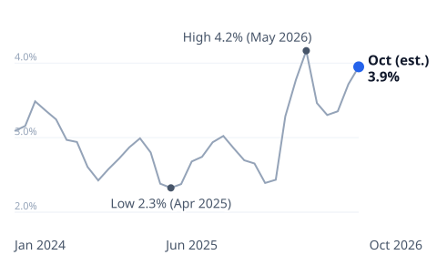
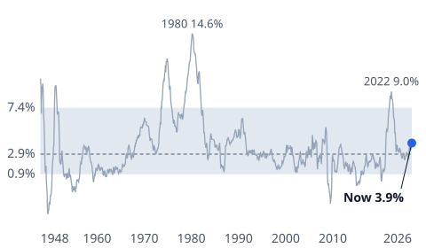

# [Current Inflation Rate: Tracker, Calculator, History Since 1948](https://mkviz.com/inflation-rate-tracker/)

## Research note

**Question.** What is the US inflation rate right now, is it going up or down, and where does it sit against every month since 1948, when October 2025 was never surveyed?

**Short answer.** Prices rose about 3.9% in the year to October 2026 (the two standard ways to fill the missing month give 3.8% to 3.9% after removing each method's usual bias). From July to October they rose at a 5.7% yearly pace, faster than the yearly rate, so inflation is not going down. Core prices, without food and energy, rose about 2.7%, just below their long-run middle (October 2025 filled with the BLS midpoint method and its usual October bias removed; uncorrected fill 2.8%); energy rose 20.4%. The yearly rate is higher than in 70% of months since 1948.

### Data
- Consumer Price Index for All Urban Consumers (CPI-U), all items, seasonally adjusted, monthly since January 1947 (BLS via FRED: CPIAUCSL), through October 2026, released Nov. 10, 2026.
- CPI-U all items less food and energy, seasonally adjusted (FRED: CPILFESL); CPI-U energy, seasonally adjusted (FRED: CPIENGSL).
- CPI-U all items, not seasonally adjusted, since January 1913 (FRED: CPIAUCNS; BLS: CUUR0000SA0), for the calculator and the official 12-month rate.
- October 2025 has no index: the 2025 federal shutdown stopped the price survey that month.

### Method
- Yearly rate = index this month / index in the same month a year earlier, minus 1, matched by calendar month.
- Missing month: October 2025 is filled with the geometric mean of September and November 2025 (the approximation BLS describes for missing CPI data). The research note for [the October inflation rate](https://mkviz.com/october-inflation-rate/) tests this fill and the Treasury fallback rule on every October since 1985 and reports their usual bias; the bias-adjusted range is quoted above.
- Pace = the change over the last three months, compounded to a yearly rate, on seasonally adjusted data (a 3-month change without seasonal adjustment mixes in the usual calendar swings).
- Acceleration test: every month since January 1985 when the 3-month pace ran at least 1 percentage point above the yearly rate, compared with the yearly rate 12 months later.
- Position = share of months since January 1948 with a yearly rate at or below this month's.
- Calculator: the not seasonally adjusted index since 1913, the series BLS's own calculator uses; October 2025 filled as above.

```
mkviz-engine position data/macro/fred_CPIAUCSL.csv --change 12 --fill-gaps --from 1948-01-01
mkviz-engine gapfill data/macro/bls_CUUR0000SA0.csv --missing 2025-10 --from 1985-01-01
mkviz-engine accel data/macro/fred_CPIAUCSL.csv --short 3 --gap 0.01 --ahead 12 --from 1985-01-01 --fill-gaps
mkviz-engine accel data/macro/fred_CPILFESL.csv --short 3 --gap 0.01 --ahead 12 --from 1985-01-01 --fill-gaps
mkviz-engine figure recent data/macro/fred_CPIAUCSL.csv --pct-change 12 --fill-gaps --weeks 34 --suffix % --decimals 1 --now "Oct (est.)" --out inflation-recent.svg
mkviz-engine figure tracker data/macro/fred_CPIAUCSL.csv --pct-change 12 --fill-gaps --suffix % --years 1980,2022 --out inflation-tracker.svg
mkviz-engine export data/macro/fred_CPIAUCNS.csv --fill-gaps --out cpi.json
```

### Results

| Measure, October 2026 | Value |
|---|---|
| Yearly rate, all items (Oct 2025 filled) | +3.9% |
| Range of the two fills, bias-adjusted | +3.8% to +3.9% |
| Yearly rate, September 2026 (official) | +3.7% |
| 3-month pace, all items | +5.7% |
| Yearly rate, core | +2.7% |
| 3-month pace, core | +3.7% |
| Yearly rate, energy | +20.4% |

This year the yearly rate ran from +2.4% in January to +4.2% in May, as energy prices jumped, then eased over the summer and climbed again in the fall.

Against every month since 1948: median +2.9%, highest +14.6% (March 1980), the 2022 peak +9.0% (June 2022). October 2026 is at or above +70% of months.

Acceleration since 1985: in 123 months the 3-month pace ran a point or more above the yearly rate; the yearly rate was higher a year later in +60% of them. For core prices the same signal came in 22 months, followed by a higher yearly rate in +73%.

Calculator check: $100 of January 2020 prices costs $130.83 in October 2026.

### Past test
The fill was tested on every October from 1985 to 2023 by treating it as missing: the geometric-mean fill ran high in four of five years, by about a tenth of a point on average (full table in the October inflation note). The acceleration signal is a weak guide for all items: a little better than a coin flip, because a fast 3-month pace driven by energy often reverses. It has been rarer and more reliable for core prices, but 22 months is a small sample and many of them fall in the same few years.

### Limits
- October 2026's yearly rate is an estimate until BLS publishes an official substitute; from November 2026 on, official 12-month rates resume.
- Seasonally adjusted and unadjusted yearly rates differ by a few hundredths of a point; the official headline rate uses the unadjusted index.
- The CPI measures an average basket for urban consumers; a household's own rate depends on what it buys.
- The acceleration test counts overlapping months, so its cases are not independent.

### Sources
- Bureau of Labor Statistics via FRED, CPI-U all items, seasonally adjusted (CPIAUCSL): https://fred.stlouisfed.org/series/CPIAUCSL
- Bureau of Labor Statistics via FRED, CPI-U all items, not seasonally adjusted (CPIAUCNS): https://fred.stlouisfed.org/series/CPIAUCNS
- Bureau of Labor Statistics via FRED, CPI-U less food and energy (CPILFESL): https://fred.stlouisfed.org/series/CPILFESL
- Bureau of Labor Statistics via FRED, CPI-U energy (CPIENGSL): https://fred.stlouisfed.org/series/CPIENGSL
- Bureau of Labor Statistics, CPI release schedule: https://www.bls.gov/schedule/news_release/cpi.htm

### Builds on and leads to
- Builds on [the October inflation rate note](https://mkviz.com/october-inflation-rate/) (how to fill the missing month) and [core vs headline](https://mkviz.com/core-inflation/) (which one predicts better).
- Open: split the yearly rate into the parts that drove it (energy, food, shelter, other goods and services) using BLS relative importance weights.

### Cite
MKViz (2026). *US inflation rate tracker: the rate now, its pace and every month since 1948.* https://mkviz.com/inflation-rate-tracker/ ; code and data: https://github.com/CertainAmount/mkviz-engine/tree/main/data/inflation-rate-tracker

## Charts

Run from the repository root after `cd engine && cargo build --release && cd ..`.

## inflation-recent

Data: [inflation-recent.csv](inflation-recent.csv) · settings: [inflation-recent.json](inflation-recent.json)



```
./engine/target/release/mkviz-engine figure recent data/series/fred_CPIAUCSL.csv --decimals 1 --fill-gaps --now 'Oct (est.)' --pct-change 12 --suffix '%' --weeks 34 --out inflation-recent.svg
```

## inflation-tracker

Data: [inflation-tracker.csv](inflation-tracker.csv) · settings: [inflation-tracker.json](inflation-tracker.json)



```
./engine/target/release/mkviz-engine figure tracker data/series/fred_CPIAUCSL.csv --fill-gaps --note 'Shaded: where the middle 80% of months fell. Dashed: the median.' --pct-change 12 --suffix '%' --years 1980,2022 --out inflation-tracker.svg
```
