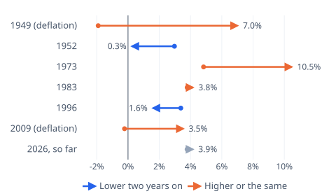
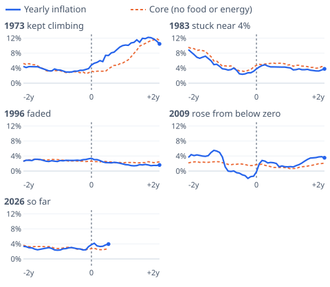

# [Is Inflation Going Down? Only 2 of 6 Past Rebounds Faded](https://mkviz.com/is-inflation-going-down/)

## Research note

**Question.** US inflation came down from its 2022 peak and then turned back up in 2026. When that has happened before, did it come back down, and what told the cases apart?

**Short answer.** Since 1948, yearly CPI inflation peaked at +5% or more, cooled to +3% or less, and then rose a point above its low six times before 2026 (finished cases). Only two of those rebounds (1952, 1996) were below the rebound month's rate both one and two years later. Core CPI starts in 1957, so four cases can be split by core: in 1973 and 1983 core monthly increases of 0.3% or more ran for months around the rebound and the headline rate did not come back down within two years; in 1996 and 2009 there was no run of two such months within two years. The 2026 rebound (April, 3.8%) is the seventh; core rose 0.33% in September and 0.30% in October 2026.

### Definitions
- Inflation: the 12-month change in the CPI for all urban consumers (FRED CPIAUCSL, seasonally adjusted), monthly from 1948. Core: the same index without food and energy (CPILFESL), from 1957 (12-month changes from 1958).
- The missing October 2025 survey: filled with the geometric mean of September and November 2025 (engine `--fill-gaps`), the same fill as the inflation tracker. The October 2026 core rate in the post uses the tracker's BLS-midpoint fill (2.7%); with the geometric fill it is 2.8%. The six-month core changes are on the geometric fill.
- Wave: a run of months at or above +5%; its peak is the highest month. If inflation has not yet cooled to +3% and later goes higher, the peak moves there (so 1973-74 and 1980 count as one wave: inflation never cooled to 3% in between).
- Rebound: the first month at least +1% point above the lowest month since the peak, counted only once that low is at or below +3%.
- Other definitions: a cool-down line of 3.5% instead of 3% gives the same seven cases. The 1949 and 2009 lows were negative (prices falling after the 1948 and 2008 peaks), so their rebounds started from deflation; they are kept, and flagged in the post.
- Re-scan: with this definition every month from January 1948 to October 2026 was scanned; seven peaks qualified (1948, 1951, 1970, 1980, 1990, 2008, 2022), six with finished rebounds. None was dropped.
- Core run (the author's line): consecutive months with core CPI up +0.3% or more on the month (seasonally adjusted).

### Data
- BLS via FRED: CPIAUCSL, CPILFESL, CPIENGSL (energy), monthly to October 2026 (data/macro/fred_*.csv).

### Method

```
./engine/target/release/mkviz-engine rebounds data/macro/fred_CPIAUCSL.csv --pct-change 12 --fill-gaps --peak 5 --rise 1 --cool 3 --forward 6,12,24 --also data/macro/fred_CPILFESL.csv
./engine/target/release/mkviz-engine figure rebounds data/macro/fred_CPIAUCSL.csv --pct-change 12 --fill-gaps --peak 5 --rise 1 --cool 3 --also data/macro/fred_CPILFESL.csv --months 24 --only-also --labels "…" --out inflation-rebounds.svg
./engine/target/release/mkviz-engine spells data/macro/fred_CPILFESL.csv --pct-change 1 --fill-gaps --threshold 0.3
```
(`rebounds` and `figure rebounds` were added to the engine on Nov. 26, 2026.)

### Results

| Rebound | Peak before | Low | At rebound | 1 year later | 2 years later | Core, 6 months after |
|---|---|---|---|---|---|---|
| Nov. 1949 | +10.2% | -3.0% | -1.9% | +3.8% | +7.0% | no data |
| Jul. 1952 | +9.6% | +1.8% | +3.0% | +0.4% | +0.3% | no data |
| Mar. 1973 | +6.4% | +2.9% | +4.8% | +10.1% | +10.5% | +0.6% |
| Dec. 1983 | +14.6% | +2.4% | +3.8% | +4.0% | +3.8% | +0.6% |
| Dec. 1996 | +6.4% | +2.3% | +3.4% | +1.7% | +1.6% | -0.2% |
| Oct. 2009 | +5.5% | -2.0% | -0.2% | +1.2% | +3.5% | -0.7% |
| Apr. 2026 | +9.0% | +2.3% | +3.8% | under way | under way | +0.0% |

Peaks: Jan. 1948, Apr. 1951, Feb. 1970, Mar. 1980, Oct. 1990, Jul. 2008, Jun. 2022. Lows: Aug. 1949, May 1952, Aug. 1972, Jul. 1983, May 1994, Jul. 2009, Apr. 2025.

Core runs of 0.3% or more a month (two months or longer) within two years after each rebound with core data: 1973, a run from August 1973 of 83 months; 1983, April to November 1983 (before the December rebound) and March to October 1984 (eight months); 1996, none; 2009, none. 2026 so far: April 0.38% alone, then August 0.29%, September 0.33%, October 0.30%; core over the three months to October ran at a 3.7% yearly pace.

What 2026 is made of: energy prices were up 20% over the year to October; yearly inflation was 3.9% and core 2.7%.

The author's quick sign, tested (Nov. 26, 2026): every run since 1985 of core CPI up 0.3% or more on the month as published (0.25% or more unrounded), measured from the month the run reached its length, against yearly core inflation 12 months later (`spells --pct-change 1 --threshold 0.25`, then `events fred_CPILFESL --pct-change 12 --fill-gaps --forward 365 --diff --dates …`):

| Run | Finished cases | Yearly core higher a year later | Median change | Any month (base) |
|---|---|---|---|---|
| Two months in a row | 22 | 7 | -0.25 pt | +42% |
| Three months in a row | 15 | 5 | -0.24 pt | +42% |

On unrounded data (0.30% or more) the counts are 21 runs with 7 higher and 12 runs with 6 higher; the reading is the same. Runs overlap month to month, so the separate episodes are fewer. The slower measure from the inflation tracker (core's three-month pace at least a point above its yearly rate, since 1985) was followed by higher yearly core in 16 of 22 months; that cutoff was set on the tracker page and may flatter itself; 12 of those months fall in 2020-22, and outside them it was six of 10. Base rate: any month since 1985, +42%. Now: pace 3.7%, yearly 2.7%.

Parts of the CPI over the year to October 2026 (October 2025 filled): energy 20%, shelter 3.4%, food 2.9%, core 2.7%, core goods 0.8% (FRED CPIENGSL, CUSR0000SAH1, CPIUFDSL, CPILFESL, CUSR0000SACL1E). Months since 1948 with prices lower than a year earlier: 41 of 946 (`spells --pct-change 12 --threshold 0 --below`).

### Limits
- Six finished cases, four with core data; two of them (1949, 2009) rebounded from deflation. Too few for a rule; the post shows every case rather than a rate.
- The core-run line is the author's own rough line; tested on all months since 1985 it was not followed by higher core more often than an ordinary month, so the four-rebound split is hindsight, not a signal.
- 12-month rates move partly because of what happened a year earlier (base effects), which is why the 2009 rebound came so fast.
- National CPI; a household's own basket can differ a lot.

### Sources
- BLS via FRED, CPI for All Urban Consumers (CPIAUCSL): https://fred.stlouisfed.org/series/CPIAUCSL
- BLS via FRED, CPI less food and energy (CPILFESL): https://fred.stlouisfed.org/series/CPILFESL
- BLS via FRED, CPI energy (CPIENGSL): https://fred.stlouisfed.org/series/CPIENGSL
- BLS, CPI release schedule: https://www.bls.gov/schedule/news_release/cpi.htm

### Builds on and leads to
- Builds on [Current inflation rate](https://mkviz.com/inflation-rate-tracker/) (the 3-month pace test) and [Core inflation vs headline](https://mkviz.com/core-inflation/) (which number predicts next year's prices).
- Open: the same rebound test on PCE inflation, the Fed's own target measure.

### Cite
MKViz (2026). *Is inflation going down?* https://mkviz.com/is-inflation-going-down/ ; code and data: https://github.com/CertainAmount/mkviz-engine/tree/main/data/is-inflation-going-down

## Charts

Run from the repository root after `cd engine && cargo build --release && cd ..`.

## inflation-rebound-outcomes

Data: [inflation-rebound-outcomes.csv](inflation-rebound-outcomes.csv) · settings: [inflation-rebound-outcomes.json](inflation-rebound-outcomes.json)



```
./engine/target/release/mkviz-engine figure arrows data/series/fred_CPIAUCSL.csv --names 'Lower two years on,Higher or the same' --open '2026, so far' --rows '1949 (deflation):-0.01903974,0.0699187;1952:0.02971826,0.00261292;1973:0.04830918,0.10460251;1983:0.03787103,0.03791469;1996:0.03378817,0.01606922;2009 (deflation):-0.00223968,0.03522268;2026, so far:0.03779246,0.039495' --title 'Yearly inflation from each rebound to two years later' --out inflation-rebound-outcomes.svg
```

## inflation-rebounds

Data: [inflation-rebounds.csv](inflation-rebounds.csv) · settings: [inflation-rebounds.json](inflation-rebounds.json)



```
./engine/target/release/mkviz-engine figure rebounds data/series/fred_CPIAUCSL.csv --also data/series/fred_CPILFESL.csv --cool 3 --fill-gaps --labels '1973:kept climbing;1983:stuck near 4%;1996:faded;2009:rose from below zero;2026:so far' --months 24 --names 'Yearly inflation,Core (no food or energy)' --only-also --pct-change 12 --peak 5 --rise 1 --title 'Yearly inflation two years either side of each rebound since core began' --out inflation-rebounds.svg
```
