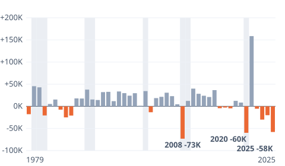

# [Jobs Report: How Much Could October's 165,000 Change?](https://mkviz.com/jobs-report-revisions/)

Run from the repository root after `cd engine && cargo build --release && cd ..`.

## jobs-revisions-years

Data: [jobs-revisions-years.csv](jobs-revisions-years.csv) · settings: [jobs-revisions-years.json](jobs-revisions-years.json)



```
./engine/target/release/mkviz-engine figure years data/series/bls_ces_first.csv --final data/series/bls_ces_third.csv --flag data/series/fred_USREC.csv --marks 3 --suffix K --title 'First jobs numbers have been revised down four years in a row' --out jobs-revisions-years.svg
```
