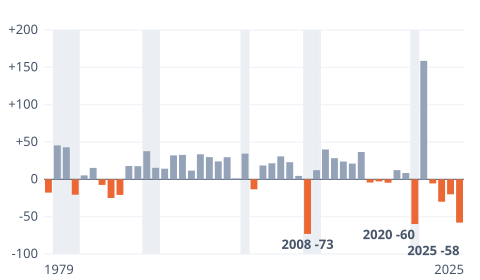
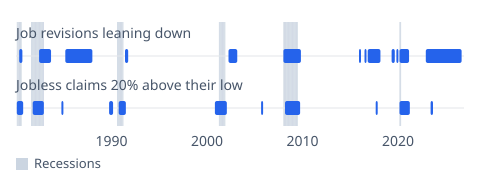

# [Jobs Report Revisions: Down 4 Years. Is That a Recession Sign?](https://mkviz.com/jobs-report-revisions/)

## Research note

**Question.** How much does the first monthly jobs number change after it is published, and when revisions keep leaning down, does a recession follow?

**Short answer.** From January 1979 to August 2026 (571 months), the change from the first to the third estimate of monthly payroll growth had a median size of 41,000 jobs; eight in ten fell between 69,000 down and 97,000 up, and the sign flipped 31 times. The 12-month average revision dropped below zero in 11 separate stretches; a recession began within 12 months of the start of three of them (1979, 1980 and 2019, the last before the 2020 pandemic recession). The 1990 and 2001 recessions began with no such stretch in the year before. The stretch that began in December 2022 has run 44 months through August 2026, the longest in the record (the next longest, March 1985 to December 1987, ran 33 months and was not followed by a recession until 1990).

### Definitions
- First and third estimates: BLS publishes a month's payroll change in the jobs report for that month, then revises it in each of the next two reports as late survey responses arrive ("final sample-based estimates are published 2 months after the initial release"). Revision here = third estimate minus first, in thousands of jobs, from the BLS revisions table.
- The annual benchmark is separate: once a year BLS re-levels the payroll count to March employment counts from unemployment insurance tax records, which cover about 97% of jobs. Its effect is not in the first-to-third revision.
- Downward lean: the 12-month moving average of monthly revisions below zero. A stretch is a run of such months; a new stretch starting within 365 days of the last one is joined to it, and a recession starting during a stretch ends it.
- Recession: NBER-dated recession months (FRED USREC). Followed = a recession began within 12 months after the stretch started.
- Re-scan: every month with a 12-month average below zero since January 1980 was grouped; 11 stretches qualify and none was dropped. The 1980 recession began too soon after the series starts to be checked, so 5 recessions (1981, 1990, 2001, 2008, 2020) are checked for whether a stretch came first.

### Data
- BLS, Current Employment Statistics, revisions between over-the-month estimates (first, second, third), January 1979 to October 2026 (first estimate), August 2026 (third).
- NBER recession months via FRED (USREC).

### Method

```
python -m msci.cli bls --revisions
./engine/target/release/mkviz-engine revisions data/macro/bls_ces_first.csv --final data/macro/bls_ces_third.csv --flag data/macro/fred_USREC.csv --now 165
./engine/target/release/mkviz-engine lead data/macro/bls_ces_third.csv --minus data/macro/bls_ces_first.csv --avg 12 --threshold 0 --below --event data/macro/fred_USREC.csv --gap 365
./engine/target/release/mkviz-engine figure lead (same options) --mark 12 --out jobs-revisions-lean-lead.svg
./engine/target/release/mkviz-engine figure years data/macro/bls_ces_first.csv --final data/macro/bls_ces_third.csv --flag data/macro/fred_USREC.csv --out jobs-revisions-years.svg
```

### Results

Size of revisions, first to third estimate, 1979-2026: median 41,000; 10th to 90th percentile 69,000 down to 97,000 up. Applied to October 2026's first estimate of 165,000: 96,000 to 262,000. BLS's own 90% sampling interval is about ±122,000.

Years with the most negative average revision: 2008 (73,000 down a month, recession), 2020 (60,000, recession), 2025 (58,000, no recession). 2022 to 2025 were four downward years in a row; January to August 2026 averaged 8,000 down.

Downward-lean stretches (12-month average revision below zero):

| Stretch started | Ended | Next recession began | Months from start |
|---|---|---|---|
| Dec. 1979 | Jan. 1980 | Feb. 1980 | 2 |
| Aug. 1980 | Aug. 1980 | Aug. 1981 | 12 |
| Dec. 1982 | Aug. 1983 | Aug. 1990 | 92 |
| March 1985 | Dec. 1987 | Aug. 1990 | 65 |
| June 1991 | Sept. 1991 | April 2001 | 118 |
| April 2002 | Feb. 2003 | Jan. 2008 | 69 |
| July 2009 | Oct. 2009 | March 2020 | 128 |
| Dec. 2015 | Feb. 2018 | March 2020 | 51 |
| May 2019 | Nov. 2019 | March 2020 | 10 |
| May 2020 | Feb. 2021 | none yet | 75 so far |
| Dec. 2022 | Aug. 2026 (latest) | none yet | 44 so far |

Recessions and the stretch before them: 1981 (a stretch began 12 months before), 1990 (none in the year before), 2001 (none), 2008 (a stretch began the month the recession began), 2020 (one began 10 months before; the recession came from the pandemic).

### Limits
- Few recessions (five checked) and overlapping causes; a lean in revisions mostly says the first estimates ran high, not why.
- The 12-month average and the 12-month window are our choices; a 6-month average gives more, shorter stretches.
- The annual benchmark, which made the largest cuts in 2024 and 2025, is not in these monthly revisions.
- Why revisions have leaned down since 2022 is not settled: BLS points to late responses and the birth-death model for new and closing businesses; others point to immigration estimates. This note does not test the cause.

### Sources
- BLS, CES revisions between over-the-month estimates: https://www.bls.gov/web/empsit/cesnaicsrev.htm
- BLS, CES national benchmark article: https://www.bls.gov/web/empsit/cesbmart.htm
- BLS, CES net birth-death model: https://www.bls.gov/web/empsit/cesbd.htm
- BLS, Beyond the Numbers, revisions to jobs numbers: https://www.bls.gov/opub/btn/volume-2/revisions-to-jobs-numbers.htm
- NBER via FRED, USREC: https://fred.stlouisfed.org/series/USREC

### Builds on and leads to
- Builds on [Recession indicators](https://mkviz.com/recession-indicators/) (payrolls are one of the six numbers NBER watches) and [How long do recessions last?](https://mkviz.com/how-long-do-recessions-last/).
- Open: the same test with the annual benchmark revisions; revisions by industry.

### Cite
MKViz (2026). *Jobs report revisions.* https://mkviz.com/jobs-report-revisions/ ; code and data: https://github.com/CertainAmount/mkviz-engine/tree/main/data/jobs-report-revisions

## Charts

Run from the repository root after `cd engine && cargo build --release && cd ..`.

## jobs-revisions-years

Data: [jobs-revisions-years.csv](jobs-revisions-years.csv) · settings: [jobs-revisions-years.json](jobs-revisions-years.json)



```
./engine/target/release/mkviz-engine figure years data/series/bls_ces_first.csv --final data/series/bls_ces_third.csv --flag data/series/fred_USREC.csv --title 'Average revision to the first jobs estimate, by year' --out jobs-revisions-years.svg
```

## jobs-revisions-lean-timeline

Data: [jobs-revisions-lean-timeline.csv](jobs-revisions-lean-timeline.csv) · settings: [jobs-revisions-lean-timeline.json](jobs-revisions-lean-timeline.json)



```
./engine/target/release/mkviz-engine figure lights data/series/fred_USREC.csv --from 1980-01-01 --labels 'Job revisions leaning down,Jobless claims 20% above their low' --signals 'data/series/bls_ces_third.csv minus=data/series/bls_ces_first.csv avg=12 threshold=0 below;data/series/fred_ICSA.csv threshold=0.2 avg=4 from-low=52' --title 'Two job signals and the recessions that followed' --out jobs-revisions-lean-timeline.svg
```
