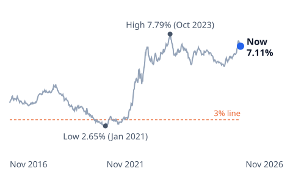
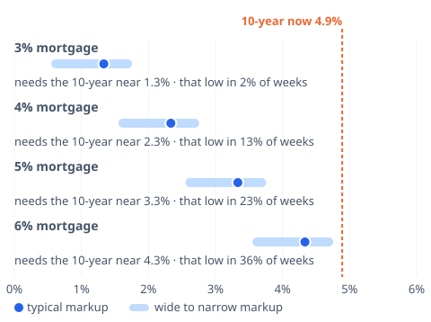

# [Will Mortgage Rates Ever Get Back to 3%? What It Would Take](https://mkviz.com/mortgage-rates-back-to-3-percent/)

## Research note

**Question.** Could the 30-year mortgage rate get back to 3%, and what would have to happen for it to?

**Short answer.** In 2,903 weekly readings since April 1971, the rate was at or below 3% in 56, all between July 2020 and November 2021. Those weeks did not have an unusually narrow gap over the 10-year Treasury (median 1.64 points points, close to the long-run 1.67 points); they had a 10-year yield near or below 1.3%, which happened in no other year since 1971. At the median gap, a 3% mortgage needs the 10-year near 1.33%; it is now about 4.89%. Of 196 earlier weeks with a rate within 0.25 point of today's, none fell below 5.21% within five years.

### Data
- Freddie Mac Primary Mortgage Market Survey, 30-year fixed, weekly since April 2, 1971 (FRED: MORTGAGE30US), through Nov. 12, 2026.
- 10-year Treasury constant-maturity yield, daily since 1962 (Federal Reserve H.15 via FRED: DGS10), through Nov. 16, 2026.
- Fed funds target (FRED: DFEDTAR) for June 2003.
- FHFA National Mortgage Database aggregate statistics, outstanding mortgages by rate band (quarterly).

### Method
- Each weekly mortgage rate is paired with the 10-year yield averaged over the seven days before the Thursday release (the week Freddie Mac's survey covers). Gap = rate minus that average.
- For a target rate, the 10-year yield it needs = target minus the median gap since 1971; the range uses the 90th and 10th percentile gaps. The share is the share of weeks whose 10-year average was at or below the needed yield.
- Similar starts: every week with a rate within 0.25 point of this week's 7.11% and five full years of data after it; for each, the lowest weekly rate within those five years. Weeks after October 2022 are left out because their five years are not over.
- Payments are monthly principal and interest on a $400,000, 30-year fixed loan.

```
./engine/target/release/mkviz-engine need data/macro/fred_MORTGAGE30US.csv --minus data/macro/fred_DGS10.csv --minus-window 7 --targets 3,4,5,6 --years 5 --near 0.25
./engine/target/release/mkviz-engine figure need data/macro/fred_MORTGAGE30US.csv --minus data/macro/fred_DGS10.csv --minus-window 7 --targets 3,4,5,6 --out m3-need.svg
./engine/target/release/mkviz-engine figure recent data/macro/fred_MORTGAGE30US.csv --weeks 522 --suffix % --line "3|3% line" --out m3-ten-years.svg
./engine/target/release/mkviz-engine spells data/macro/fred_MORTGAGE30US.csv --threshold 3 --below
./engine/target/release/mkviz-engine payment --loan 400000 --rates 7.11,6,5,4,3
```

### Results

| Mortgage rate | 10-year it needs at the median gap | Range (wide to narrow gap) | Weeks since 1971 the 10-year was that low |
|---|---|---|---|
| 6% | 4.33% | 3.55% to 4.76% | 36% |
| 5% | 3.33% | 2.55% to 3.76% | 23% |
| 4% | 2.33% | 1.55% to 2.76% | 13% |
| 3% | 1.33% | 0.55% to 1.76% | 2% |

Weeks at or below 1.33% on the 10-year average: 44 in 2020 and 16 in 2021, none in any other year. The 10-year's lowest close was 0.52% on Aug. 4, 2020.

Weeks at or below 3%: 56, from July 16, 2020 to Nov. 10, 2021; the record low 2.65% on Jan. 7, 2021. Weeks at or below 4%: 367, all from Oct. 6, 2011 on.

Similar starts (rate within 0.25 point of 7.11%, five years after):

| Weeks starting in | Lowest rate within five years |
|---|---|
| 1971-72 | 7.23% (March 1972; rates then rose through the 1970s) |
| 1993-96 | 6.49% (October 1998) |
| 1997 | 5.94% (November 2002) |
| 1998-2002 | 5.21% (June 13, 2003, with the Fed's target at 1.25%) |

Median five-year low across all 196 weeks: 5.61%. Since October 2022 the rate has been within 0.25 point of today's in 53 weeks; its lowest week since then was 5.98% (Feb. 26, 2026).

Payments on $400,000: $2,691 at 7.11%, $2,398 at 6%, $2,147 at 5%, $1,910 at 4%, $1,686 at 3%.

### Limits
- The gap is not fixed. It was narrow in parts of the 2010s and 2020-21 partly because the Federal Reserve was buying mortgage bonds; if the Fed bought them again, a 3% rate would need a less extreme 10-year yield (the 10th-percentile gap gives 1.76%).
- Similar starts are few and cluster in two eras (the early 1970s and 1993-2002), so they show what has happened, not a probability.
- Freddie Mac's rate is a survey average for borrowers with strong credit and about 20% down, not a quote.

### Sources
- Freddie Mac via FRED, 30-Year Fixed Rate Mortgage Average (MORTGAGE30US): https://fred.stlouisfed.org/series/MORTGAGE30US
- Federal Reserve via FRED, 10-Year Treasury Constant Maturity (DGS10): https://fred.stlouisfed.org/series/DGS10
- Federal Reserve via FRED, Federal Funds Target Rate (DFEDTAR): https://fred.stlouisfed.org/series/DFEDTAR
- FHFA, National Mortgage Database aggregate statistics: https://www.fhfa.gov/data/national-mortgage-database-aggregate-statistics

### Builds on and leads to
- Builds on [the mortgage rates history page](https://mkviz.com/mortgage-rates-history/) (the weekly rate and gap since 1971) and [the mortgage gap note](https://mkviz.com/mortgage-rates-treasury-gap/).
- Open: the same "what would it take" test for a 5% rate each week, and what a Fed return to buying mortgage bonds did to the gap in 2008-14 and 2020-22.

### Cite
MKViz (2026). *Will mortgage rates ever get back to 3%? What the 10-year Treasury would have to do.* https://mkviz.com/mortgage-rates-back-to-3-percent/ ; code and data: https://github.com/CertainAmount/mkviz-engine/tree/main/data/mortgage-rates-back-to-3-percent

## Charts

Run from the repository root after `cd engine && cargo build --release && cd ..`.

## m3-ten-years

Data: [m3-ten-years.csv](m3-ten-years.csv) · settings: [m3-ten-years.json](m3-ten-years.json)



```
./engine/target/release/mkviz-engine figure recent data/series/fred_MORTGAGE30US.csv --line '3|3% line' --suffix '%' --title '30-year mortgage rate, last 10 years' --weeks 522 --out m3-ten-years.svg
```

## m3-need

Data: [m3-need.csv](m3-need.csv) · settings: [m3-need.json](m3-need.json)



```
./engine/target/release/mkviz-engine figure need data/series/fred_MORTGAGE30US.csv --minus data/series/fred_DGS10.csv --minus-window 7 --targets 3,4,5,6 --title '10-year Treasury yield each mortgage rate needs' --out m3-need.svg
```
