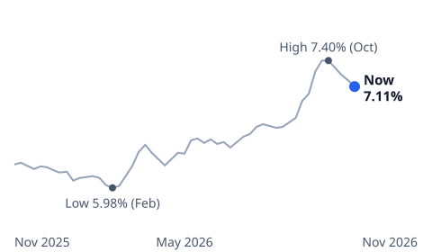
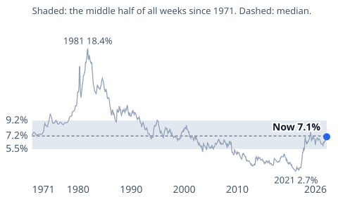
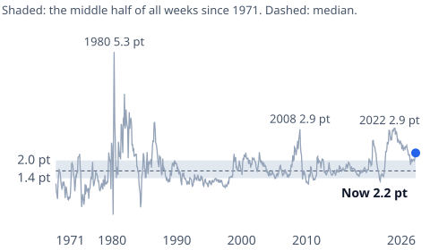

# [Mortgage Rates History Since 1971: Is a 7% Rate High?](https://mkviz.com/mortgage-rates-history/)

## Research note

**Question.** Where does this week's 30-year mortgage rate sit in its history since 1971, and where does its gap over the 10-year Treasury sit?

**Short answer.** The rate, 7.11%, is close to its median week since April 1971 (7.22%), but higher than 93% of weeks since 2000 (median 5.25%): the long-run middle is pulled up by the 1980s. The gap over the 10-year Treasury, 2.22 points points, is wider than in 85% of weeks, and the 2020s have had the widest median gap of any decade in the data.

### Data
- Freddie Mac Primary Mortgage Market Survey, 30-year fixed, weekly since April 2, 1971 (FRED: MORTGAGE30US), through Nov. 12, 2026.
- 10-year Treasury constant-maturity yield, daily (Federal Reserve H.15 via FRED: DGS10), through Nov. 12, 2026.

### Method
- Gap = the weekly mortgage rate minus the 10-year yield averaged over the seven days before the Thursday release, the week Freddie Mac's survey covers (https://www.freddiemac.com/pmms/about-pmms). Changed Nov. 14, 2026 from the release-day close, which counted Treasury moves after the survey closed as changes in the gap; the long-run median was 1.67 points either way.
- Position = the share of all weekly observations since April 1971 (and, separately, since January 2000) below this week's value; median and the 10th and 90th percentiles over the same weeks.
- Decade medians are taken over the weekly gaps in each calendar decade (the 2020s run through Nov. 12, 2026).
- The cost of the gap above its median is the monthly principal and interest on a $400,000, 30-year loan at this week's rate minus the gap's excess over its median (0.55 points points). The loan size is illustrative.

```
./engine/target/release/mkviz-engine position data/macro/fred_MORTGAGE30US.csv --minus data/macro/fred_DGS10.csv --minus-window 7
./engine/target/release/mkviz-engine position data/macro/fred_MORTGAGE30US.csv
./engine/target/release/mkviz-engine figure tracker data/macro/fred_MORTGAGE30US.csv --minus data/macro/fred_DGS10.csv --minus-window 7 --suffix " pt" --years 1980,2008,2022 --mid 0.5 --out mortgage-gap-history.svg
./engine/target/release/mkviz-engine figure tracker data/macro/fred_MORTGAGE30US.csv --suffix % --years 1981,low:2021 --mid 0.5 --out mortgage-rate-history.svg
```

### Results

| Measure | This week | Median since 1971 | Middle 80% of weeks |
|---|---|---|---|
| 30-year mortgage rate | 7.11% | 7.22% | — |
| Gap over the 10-year Treasury | 2.22 points | 1.67 points | 1.24 points to 2.45 points |

Share of weeks below this week: rate 48% since 1971 and 93% since 2000; gap 85% since 1971 and 81% since 2000.

| Decade | Median weekly gap |
|---|---|
| 1970s (from April 1971) | 1.29 points |
| 1980s | 1.92 points |
| 1990s | 1.41 points |
| 2000s | 1.79 points |
| 2010s | 1.69 points |
| 2020s (to Nov. 2026) | 2.33 points |

On a $400,000 loan, this week's rate means $2,691 a month in principal and interest; at the median gap it would be $2,544, a difference of $147.

The 10-year minus 2-year Treasury spread (FRED: T10Y2Y, daily since 1976) has had a median of 0.37 points point in the 2020s, the lowest of any decade in that series (2010s: 1.45; 2000s: 1.38).

### Limits
- Freddie Mac's rate is a weekly survey average for borrowers with strong credit and 20% down, not a quote; points and fees vary.
- The 10-year yield is a convention: mortgages are repaid or refinanced well before 30 years, so lenders price them off medium-term yields. The gap therefore also moves with the shape of the yield curve.
- The cost example holds the 10-year yield fixed and changes only the gap.

### Sources
- Freddie Mac via FRED, 30-Year Fixed Rate Mortgage Average (MORTGAGE30US): https://fred.stlouisfed.org/series/MORTGAGE30US
- Federal Reserve via FRED, 10-Year Treasury Constant Maturity (DGS10): https://fred.stlouisfed.org/series/DGS10
- Federal Reserve via FRED, 10-Year minus 2-Year Treasury spread (T10Y2Y): https://fred.stlouisfed.org/series/T10Y2Y
- Federal Reserve Bank of Boston, Why Mortgage Rates Exceed Treasury Yields (May 2026): https://www.bostonfed.org/publications/current-policy-perspectives/2026/why-mortgage-rates-exceed-treasury-yields.aspx

### Builds on and leads to
- Builds on [the mortgage gap note](https://mkviz.com/mortgage-rates-treasury-gap/), which splits this fall's rise into Treasury and gap and lists every stretch of wide gaps since 1971.
- This page is updated each week after Freddie Mac's Thursday release. Open: add the yield curve's slope as a second explanation of the gap.

### Cite
MKViz (2026). *Mortgage rates history since 1971: the rate and its gap over Treasuries.* https://mkviz.com/mortgage-rates-history/ ; code and data: https://github.com/CertainAmount/mkviz-engine/tree/main/data/mortgage-rates-history

## Charts

Run from the repository root after `cd engine && cargo build --release && cd ..`.

## mortgage-rate-recent

Data: [mortgage-rate-recent.csv](mortgage-rate-recent.csv) · settings: [mortgage-rate-recent.json](mortgage-rate-recent.json)



```
./engine/target/release/mkviz-engine figure recent data/series/fred_MORTGAGE30US.csv --suffix '%' --weeks 53 --out mortgage-rate-recent.svg
```

## mortgage-rate-history

Data: [mortgage-rate-history.csv](mortgage-rate-history.csv) · settings: [mortgage-rate-history.json](mortgage-rate-history.json)



```
./engine/target/release/mkviz-engine figure tracker data/series/fred_MORTGAGE30US.csv --mid 0.5 --note 'Shaded: the middle half of all weeks since 1971. Dashed: median.' --suffix '%' --years 1981,low:2021 --out mortgage-rate-history.svg
```

## mortgage-gap-history

Data: [mortgage-gap-history.csv](mortgage-gap-history.csv) · settings: [mortgage-gap-history.json](mortgage-gap-history.json)



```
./engine/target/release/mkviz-engine figure tracker data/series/fred_MORTGAGE30US.csv --mid 0.5 --minus data/series/fred_DGS10.csv --minus-window 7 --note 'Shaded: the middle half of all weeks since 1971. Dashed: median.' --suffix ' pt' --years 1980,2008,2022 --out mortgage-gap-history.svg
```
