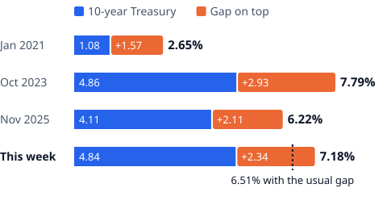
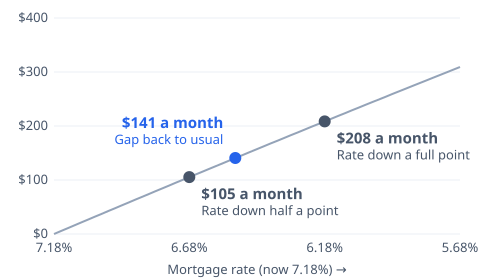

# [Why Are Mortgage Rates So High? Treasury Yields, Plus a Wider Gap](https://mkviz.com/mortgage-rates-treasury-gap/)

## Research note

**Question.** Why is the 30-year mortgage rate this high: how much of it is the 10-year Treasury yield and how much is the gap lenders and investors add on top, and what did that gap do this fall?

**Short answer.** Most of it is the Treasury yield. Of the 4.46 points rise since January 2021, 3.92 points came from the 10-year yield (88%), and over the past year about 90%. The gap on top widened from 1.96 points in early September to about 2.20 points by late October and has held there; at 2.22 points in the week of Nov. 12 it is wider than in 85% of weeks since 1971.

### Data
- Freddie Mac Primary Mortgage Market Survey, 30-year fixed, weekly since April 2, 1971 (FRED: MORTGAGE30US), through Nov. 12, 2026.
- 10-year Treasury constant-maturity yield, daily (Federal Reserve H.15 via FRED: DGS10), through Nov. 12, 2026.
- Freddie Mac's survey timing: each Thursday's rate averages applications from the prior Thursday through Wednesday (https://www.freddiemac.com/pmms/about-pmms).
- 10-year minus 2-year Treasury spread (FRED: T10Y2Y).
- Median sales price of houses sold (FRED: MSPUS), for the loan size.

### Method
- Gap = the weekly mortgage rate minus the average 10-year yield over the seven days before the Thursday release (the survey week). Before Nov. 2022 Freddie Mac surveyed lenders Monday to Wednesday; the seven-day window covers those days too.
- Position = the share of all weeks since April 1971 with a gap at or below this week's; median over the same weeks.
- Decomposition: change in the mortgage rate between two survey weeks = change in the 10-year yield + change in the gap.
- Wide-gap stretches: the 13-week average gap stays above 2.2 points for three months or more.
- Payments: principal and interest on a $314,640, 30-year loan (the median-priced new home sold in the third quarter with 20% down). The usual-gap rate is this week's 10-year yield plus the median gap.

```
mkviz-engine position data/macro/fred_MORTGAGE30US.csv --minus data/macro/fred_DGS10.csv --minus-window 7
mkviz-engine spells data/macro/fred_MORTGAGE30US.csv --minus data/macro/fred_DGS10.csv --minus-window 7 --avg 13 --threshold 2.2
mkviz-engine figure stack data/macro/fred_MORTGAGE30US.csv --base data/macro/fred_DGS10.csv --window 7 --dates 2021-01-07,2023-10-26,2025-11-13,2026-11-12 --typical 1.67 --out mortgage-rate-stack.svg
mkviz-engine figure savings data/macro/fred_MORTGAGE30US.csv --drop 1.5 --loan 314640 --marks "Gap back to usual:0.55,Rate down half a point:0.5,Rate down a full point:1.0" --out mortgage-gap-savings.svg
```

### Results

Where the rise came from:

| Between | 30-year rate | 10-year yield | Gap |
|---|---|---|---|
| Jan. 2021 and Nov. 12, 2026 | 4.46 points | 3.92 points | 0.54 points |
| Nov. 13, 2025 and Nov. 12, 2026 | 0.87 points | 0.78 points | 0.09 points |

This fall, week by week:

| Week | 10-year Treasury | 30-year mortgage | Gap |
|---|---|---|---|
| Sept. 10 | 4.79% | 6.76% | 1.96 points |
| Oct. 22 | 5.12% | 7.32% | 2.20 points |
| Nov. 5 | 4.94% | 7.18% | 2.24 points |
| Nov. 12 | 4.89% | 7.11% | 2.22 points |

The gap's median since 1971 is 1.67 points; this week it is 0.55 points above that. At the usual gap the rate would be about 6.56%: $2,001 a month instead of $2,117, a difference of $115 ($1,385 a year). A half-point lower rate would save $105 a month and a full point $208.

Stretches when the 13-week average gap stayed above 2.20 points points for three months or more:

| Stretch | Months |
|---|---|
| 1980 | four |
| 1981 to 1983 | 26 |
| 1986 | nine |
| 2008 to 2009 | 12 |
| 2020 | six |
| 2022 to 2025 | 41 |

Median length 11 months. The 13-week average through Nov. 12 is 2.09 points, still below the line; a few more weeks near this week's gap would put it above.

### Past test
The first version of this note (Nov. 10) subtracted the 10-year yield on the release day, Thursday. Freddie Mac's rate covers applications from the seven days before, so a Treasury move on Thursday showed up as a swing in the gap that no borrower saw. On Nov. 12 the 10-year closed at 5.10% after averaging 4.89% over the survey week; the release-day method put the gap at 2.01 points and read it as a sharp narrowing, while the survey-week method shows it flat near 2.22 points. Corrected on Nov. 14: every number here now uses the survey week. The long-run median barely moved (1.67 points either way).

### Limits
- Freddie Mac's rate is a weekly survey average for borrowers with strong credit and 20% down, not a quote.
- The seven-day window is an approximation of each era's survey days.
- The 10-year yield is a convention; mortgages are priced off medium-term yields because few run their full term.
- Payment figures hold the loan size fixed and leave out taxes and insurance.

### Sources
- Freddie Mac via FRED, 30-Year Fixed Rate Mortgage Average (MORTGAGE30US): https://fred.stlouisfed.org/series/MORTGAGE30US
- Federal Reserve via FRED, 10-Year Treasury Constant Maturity (DGS10): https://fred.stlouisfed.org/series/DGS10
- Federal Reserve via FRED, 10-Year minus 2-Year Treasury (T10Y2Y): https://fred.stlouisfed.org/series/T10Y2Y
- Census and HUD via FRED, Median Sales Price of Houses Sold (MSPUS): https://fred.stlouisfed.org/series/MSPUS
- Paul S. Willen, Federal Reserve Bank of Boston, Why Mortgage Rates Exceed Treasury Yields (May 2026): https://www.bostonfed.org/publications/current-policy-perspectives/2026/why-mortgage-rates-exceed-treasury-yields.aspx
- Freddie Mac, When rates are higher, borrowers who shop around save more (Feb. 2023): https://www.freddiemac.com/research/insight/20230216-when-rates-are-higher-borrowers-who-shop-around-save

### Builds on and leads to
- Feeds [the mortgage rates history page](https://mkviz.com/mortgage-rates-history/), which tracks the rate and the gap every week since 1971.
- The [mortgage rates history page](https://mkviz.com/mortgage-rates-history/) moves to the same survey-week method.

### Cite
MKViz (2026). *Why mortgage rates are high: the Treasury yield and the gap on top.* https://mkviz.com/mortgage-rates-treasury-gap/ ; code and data: https://github.com/CertainAmount/mkviz-engine/tree/main/data/mortgage-rates-treasury-gap

## Charts

Run from the repository root after `cd engine && cargo build --release && cd ..`.

## mortgage-rate-stack

Data: [mortgage-rate-stack.csv](mortgage-rate-stack.csv) · settings: [mortgage-rate-stack.json](mortgage-rate-stack.json)



```
./engine/target/release/mkviz-engine figure stack data/series/fred_MORTGAGE30US.csv --base data/series/fred_DGS10.csv --dates 2021-01-07,2023-10-26,2025-11-13,2026-11-12 --labels 'Jan 2021,Oct 2023,Nov 2025,This week' --names '10-year Treasury,Gap on top' --title 'What a 30-year mortgage rate is made of: the 10-year Treasury yield during the survey week plus the gap lenders and investors add' --typical 1.67 --window 7 --out mortgage-rate-stack.svg
```

## mortgage-gap-savings

Data: [mortgage-gap-savings.csv](mortgage-gap-savings.csv) · settings: [mortgage-gap-savings.json](mortgage-gap-savings.json)



```
./engine/target/release/mkviz-engine figure savings data/series/fred_MORTGAGE30US.csv --drop 1.5 --loan 314640 --marks 'Gap back to usual:0.55,Rate down half a point:0.5,Rate down a full point:1.0' --title 'Monthly saving on a 314,640 dollar loan as the 30-year rate falls from 7.11%; the gap returning to its usual size is worth about as much as a half-point drop' --out mortgage-gap-savings.svg
```
