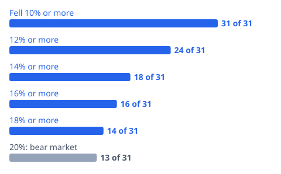

# [Nasdaq Correction: 31 Since 1971, and How They Ended](https://mkviz.com/nasdaq-correction-history/)

## Research note

**Question.** When the Nasdaq Composite closes 10% or more below its record, how often does the fall stop short of a bear market (20%), how long do the two kinds take to recover, and does getting back above the 10% line mean the fall is over?

**Short answer.** Of the 31 completed Nasdaq drops of 10% or more since 1971, 18 stopped before 20% and 13 became bear markets. Of the 26 that closed back above the 10% line before reaching 20%, eight still became bear markets. The current drop: 11.9% below the Oct. 6 record at the Nov. 5 close, back above the line on Nov. 9, 11.2% below on Nov. 16.

### Data
- Nasdaq Composite daily closes from February 1971: FRED (NASDAQCOM) through Nov. 13, 2026, and Yahoo Finance (^IXIC) through Nov. 16, 2026; the two agree on every close checked in November 2026.
- NBER recession months (USREC) via FRED.

### Method
A drop starts on the first close at least 10% below the prior record close and ends at the next record. Depth is the lowest close in between. "Back above the line" is the first later close within 10% of the record, before any new record. Medians are across completed drops; the current drop is not counted.

```
./engine/target/release/mkviz-engine drawdowns data/series/index_ixic_long.csv --threshold 0.10 --deep 0.20 --flag data/series/fred_USREC.csv
```
(The `back`, `low_at_back`, `back_before_deep` and `back_then_deep` fields were added to `drawdowns` for this update.)

### Results

| | Count |
|---|---|
| Completed drops of 10% or more since 1971 | 31 |
| Stopped before 20% | 18 |
| Became bear markets | 13 |
| Bear markets without a US recession | 7 |
| Got back above the 10% line before 20% | 26 |
| ... and still became bear markets | 8 |

- Corrections that stopped short bottomed a median of 5.5 days after the first 10% close and got back to a record a median of 116 days after the peak. Bear markets took a median of 524 days.
- The first close back above the line came a median of two days after the first 10% close.
- The eight that got back above the line and still fell 20% or more started in 1983, 1989, 1998, 2000, 2018, 2020, 2021 (bottom 2022) and 2024 (bottom 2025).

By depth reached (finished drops, `figure ladder --depths 0.10,0.12,0.14,0.16,0.18,0.20`, nasdaq-depth-ladder.csv): 10% or more 31, 12% 24, 14% 18, 16% 16, 18% 14, 20% 13. Of the 14 that reached 18%, 13 went on to 20%; the exception bottomed at 18.2% in February 2016. Of the 18 that stopped short of 20%, 17 turned before 18%. Because 18% is close to 20%, this mostly says that stops came early, not that 18% predicts a bear market on its own.

The drop under way (2026-11-24 update): record close Oct. 6, 2026 (27,599.79); lowest close Nov. 20 (22,617.73, -18.1%); Nov. 23 close up +6.5% on the day, -12.7% from the record. S&P 500 on Nov. 23: -7.4% from its Oct. 6 record.

Moved here from the post (2026-11-24, scope check): $10,000 at the Oct. 6 record was worth about $8,880 on Nov. 16; at the median correction bottom $8,690, the median bear-market bottom $6,990, the 2000-02 bottom $2,210, and the 2000 record took 15.1 years to regain. Of the 13 bear markets, seven came without a US recession (including 1987, 2022 and 2025). The Nov. 5 fall followed the midterm results, led by chip and AI stocks (Quartz, CNN).

### Limits
- Price index, no dividends; closes only, not intraday.
- The 10% and 20% lines are conventions, not turning points the market knows about.
- 31 drops is a small sample, and the 1970s Nasdaq was a much smaller, different index.

### Correction
- 2026-11-17: the Nov. 5 fall was first given as 4.9% and the close as 11.4% below the record, from a figure before the official close. The final close (24,315.00) makes it 5.5% and 11.9%.

### Sources
- FRED, NASDAQ Composite Index (NASDAQCOM): https://fred.stlouisfed.org/series/NASDAQCOM
- Yahoo Finance, Nasdaq Composite (^IXIC) history: https://finance.yahoo.com/quote/%5EIXIC/history/
- FRED, USREC: https://fred.stlouisfed.org/series/USREC

### Builds on and leads to
- [Stock market corrections since 1950](https://mkviz.com/stock-market-corrections-history/): the same count for the S&P 500, from 5% dips.

### Cite
MKViz (2026). *Nasdaq correction history.* https://mkviz.com/nasdaq-correction-history/ ; code and data: https://github.com/CertainAmount/mkviz-engine/tree/main/data/nasdaq-correction-history

## Charts

Run from the repository root after `cd engine && cargo build --release && cd ..`.

## nasdaq-drops-dots

Data: [nasdaq-drops-dots.csv](nasdaq-drops-dots.csv) · settings: [nasdaq-drops-dots.json](nasdaq-drops-dots.json)


```
./engine/target/release/mkviz-engine figure dots ../../macro/index_ixic_long.csv --deep 0.20 --threshold 0.10 --title 'Nasdaq drops of 10% or more since 1971' --out nasdaq-drops-dots.svg
```

## nasdaq-depth-ladder

Data: [nasdaq-depth-ladder.csv](nasdaq-depth-ladder.csv) · settings: [nasdaq-depth-ladder.json](nasdaq-depth-ladder.json)



```
./engine/target/release/mkviz-engine figure ladder ../../macro/index_ixic_long.csv --depths 0.10,0.12,0.14,0.16,0.18,0.20 --labels 'Fell 10% or more,12% or more,14% or more,16% or more,18% or more,20%: bear market' --title 'Nasdaq corrections since 1971 by how deep they went' --out nasdaq-depth-ladder.svg
```
