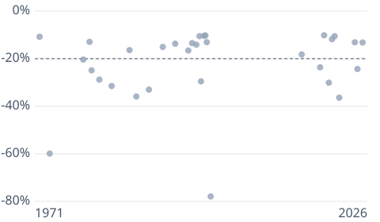

# [Nasdaq Correction: 31 Since 1971, and How They Ended](https://mkviz.com/nasdaq-correction-history/)

Run from the repository root after `cd engine && cargo build --release && cd ..`.

## nasdaq-drops-dots

Data: [nasdaq-drops-dots.csv](nasdaq-drops-dots.csv) · settings: [nasdaq-drops-dots.json](nasdaq-drops-dots.json)

