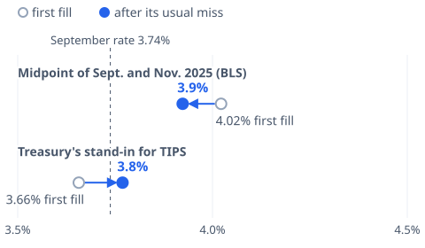

# [October Inflation Rate: The Number BLS Couldn't Publish](https://mkviz.com/october-inflation-rate/)

## Research note

**Question.** The Bureau of Labor Statistics (BLS) could not publish a 12-month change for October 2026 because no prices were collected in October 2025. What was the annual inflation rate in October 2026, and how much does the answer depend on how the missing month is filled?

**Short answer.** About 3.8% to 3.9% for all items and about 2.4% to 2.7% for core (all items less food and energy). The two usual ways to fill October 2025 give 3.66% and 4.02%; each has a known October bias, and removing it brings them within a few tenths of each other. These are estimates, not BLS figures.

### Data
- CPI-U, all items and all items less food and energy, U.S. city average, not seasonally adjusted (BLS series CUUR0000SA0, CUUR0000SA0L1E), monthly, 1957 to October 2026. This is the series behind published 12-month rates and the one BLS recommends for escalation clauses. October 2025 is missing.
- October 2026 all-items index: 337.51.

### Methods
1. **Midpoint (geometric mean).** October 2025 = √(September 2025 × November 2025), the approximation BLS describes for a missing month "if all parties agree."
2. **Prior 12-month trend.** October 2025 = September 2025 × (September 2025 ÷ September 2024)^(1/12), Treasury's fallback rule for inflation-protected securities (31 CFR 356, Appendix B). This reproduces Treasury's published TIPS index for October 2025, 325.604, to three decimals.
3. **Test.** For every October from 1985 to 2023 (39 years; October 2024 cannot be tested because its 12-month comparison would need October 2025), we treated the month as missing, filled it each way, and compared the resulting 12-month change ending the next October with the actual one. Error = filled-based change minus actual change, in percentage points.
4. **Correction.** Corrected estimate = this year's filled-based change minus the method's mean October error; range = minus the largest and smallest errors.

Reproduce from the repository root:
```
./engine/target/release/mkviz-engine gapfill data/series/bls_CUUR0000SA0.csv --missing 2025-10 --from 1985-01-01
./engine/target/release/mkviz-engine gapfill data/series/bls_CUUR0000SA0L1E.csv --missing 2025-10 --from 1985-01-01
```

### Results
Errors are in percentage points; "ran high" counts Octobers with a positive error.

| Index | Method | Oct. 2025 stand-in | Oct. 2026 change | Mean error | Median abs. error | Error range | Ran high | Corrected | Range after past errors |
|---|---|---|---|---|---|---|---|---|---|
| All items | Midpoint of Sept. and Nov. (BLS fact sheet) | 324.461 | 4.02% | 0.10 | 0.11 | -0.20 to 0.51 | 31 of 39 | 3.92% | 3.51% to 4.23% |
| All items | Prior 12-month trend (Treasury's TIPS rule) | 325.604 | 3.66% | -0.11 | 0.12 | -1.40 to 0.42 | 16 of 39 | 3.76% | 3.24% to 5.06% |
| Core | Midpoint of Sept. and Nov. (BLS fact sheet) | 330.614 | 2.81% | 0.13 | 0.12 | 0.00 to 0.29 | 39 of 39 | 2.69% | 2.53% to 2.81% |
| Core | Prior 12-month trend (Treasury's TIPS rule) | 331.625 | 2.50% | 0.12 | 0.13 | -0.25 to 0.36 | 33 of 39 | 2.39% | 2.14% to 2.75% |

September 2026 for comparison: all items 3.74%, core 2.56%.

**Why the midpoint runs high in October.** Before seasonal adjustment, October usually sits above the midpoint of September and November: from 1985 to 2024 it did so in 32 of 40 years, with September to October averaging +0.12% and October to November -0.07%. A stand-in below the real October makes the next year's rise look bigger.

**Why the two fills differ this year.** Unadjusted prices fell 0.21% from September to November 2025, while the trend rule assumed a rise of about 0.25% in October.

### Errors by year
| October | Headline, midpoint | Headline, trend | Core, midpoint | Core, trend |
|---|---|---|---|---|
| 1985 | +0.05 | +0.11 | +0.10 | +0.32 |
| 1986 | +0.00 | -0.06 | +0.14 | +0.20 |
| 1987 | +0.09 | -0.10 | +0.13 | +0.25 |
| 1988 | +0.13 | -0.01 | +0.21 | +0.29 |
| 1989 | +0.13 | +0.13 | +0.20 | +0.36 |
| 1990 | +0.19 | +0.11 | +0.08 | -0.01 |
| 1991 | -0.07 | -0.14 | +0.00 | -0.02 |
| 1992 | +0.11 | +0.11 | +0.21 | +0.35 |
| 1993 | +0.18 | +0.20 | +0.07 | +0.13 |
| 1994 | -0.03 | -0.18 | +0.10 | +0.07 |
| 1995 | +0.20 | +0.12 | +0.16 | +0.20 |
| 1996 | +0.06 | +0.07 | +0.12 | +0.15 |
| 1997 | +0.16 | +0.07 | +0.24 | +0.30 |
| 1998 | +0.13 | +0.12 | +0.12 | +0.08 |
| 1999 | +0.06 | -0.04 | +0.14 | +0.18 |
| 2000 | +0.06 | -0.11 | +0.08 | +0.06 |
| 2001 | -0.09 | -0.56 | +0.00 | +0.05 |
| 2002 | +0.08 | +0.04 | +0.13 | +0.08 |
| 2003 | +0.08 | -0.31 | +0.29 | +0.27 |
| 2004 | +0.25 | +0.33 | +0.23 | +0.25 |
| 2005 | +0.51 | -0.18 | +0.25 | +0.34 |
| 2006 | -0.20 | -0.74 | +0.20 | +0.05 |
| 2007 | -0.20 | -0.01 | +0.14 | +0.15 |
| 2008 | +0.46 | -1.40 | +0.12 | -0.13 |
| 2009 | +0.01 | +0.21 | +0.21 | +0.15 |
| 2010 | +0.04 | +0.03 | +0.04 | +0.01 |
| 2011 | -0.06 | -0.53 | +0.08 | +0.04 |
| 2012 | +0.22 | -0.21 | +0.11 | +0.05 |
| 2013 | -0.03 | -0.36 | +0.06 | +0.02 |
| 2014 | +0.15 | -0.39 | +0.16 | +0.10 |
| 2015 | +0.08 | -0.04 | +0.11 | +0.10 |
| 2016 | +0.14 | +0.00 | +0.10 | +0.01 |
| 2017 | -0.03 | -0.25 | +0.17 | +0.14 |
| 2018 | +0.26 | -0.01 | +0.12 | +0.07 |
| 2019 | +0.14 | +0.09 | +0.09 | +0.01 |
| 2020 | +0.05 | -0.08 | +0.03 | -0.04 |
| 2021 | +0.18 | +0.42 | +0.11 | +0.31 |
| 2022 | +0.26 | -0.26 | +0.10 | -0.25 |
| 2023 | +0.08 | -0.35 | +0.06 | -0.16 |

### Limits
- With no rent survey in October 2025, BLS held rent and owners' equivalent rent flat from September, which kept their levels low until April 2026 (Monthly Labor Review, May 2026). That leaves the November 2025 index a little low and pushes the midpoint estimate up by an amount BLS has not estimated for all items; the higher end of the range is the less likely one.
- The trend rule's errors are wider and two-sided (largest miss: October 2008, 1.4 points, when energy prices collapsed).
- Bias correction assumes this October behaves like past ones. 2025 had an unusual shutdown and an energy shock in 2026.
- For contracts, BLS allows an approximation only by agreement; Treasury's index is final for TIPS only.

### Sources
- BLS, Consumer Price Index Summary, October 2026: https://www.bls.gov/news.release/cpi.nr0.htm
- BLS, Approximating missing data: https://www.bls.gov/cpi/factsheets/approximating-missing-data.htm
- BLS, Monthly Labor Review, Counterfactual imputation approaches for the housing component of the October 2025 CPI (May 2026): https://www.bls.gov/opub/mlr/2026/article/counterfactual-imputation-approaches-for-the-housing-component-of-the-october-2025-cpi.htm
- Tipswatch, Synthetic calculation results in 0.25% inflation for October (Nov. 26, 2025), quoting Treasury's index: https://tipswatch.com/2025/11/26/synthetic-calculation-results-in-0-25-inflation-for-october/

### Builds on and leads to
- Used in [Core inflation vs headline](https://mkviz.com/core-inflation/) for core's yearly rate in October 2026.
- Open: an all-items estimate of the rent-hold effect on November 2025; the same test for CPI-W, which many pay and pension clauses use; repeating the test when November 2026 data arrive.

### Cite
MKViz (2026). *October 2026 inflation rate: filling the missing October 2025 CPI.* https://mkviz.com/october-inflation-rate/ ; code and data: https://github.com/CertainAmount/mkviz-engine/tree/main/data/october-inflation-rate

## Charts

Run from the repository root after `cd engine && cargo build --release && cd ..`.

## october-inflation-shift

Data: [october-inflation-shift.csv](october-inflation-shift.csv) · settings: [october-inflation-shift.json](october-inflation-shift.json)



```
./engine/target/release/mkviz-engine figure shift data/series/bls_CUUR0000SA0.csv --from 1985-01-01 --missing 2025-10 --names 'Midpoint of Sept. and Nov. 2025 (BLS),Treasury'\''s stand-in for TIPS' --ref-label 'September rate' --title 'October'\''s annual inflation rate, two ways' --out october-inflation-shift.svg
```
