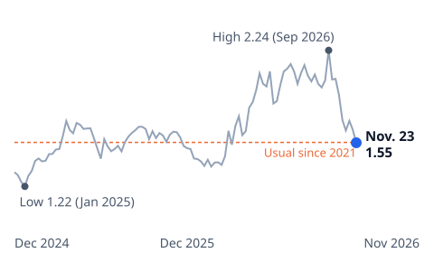

# [Oil Prices Are Falling. Gas Has Already Caught Up](https://mkviz.com/oil-prices-falling/)

## Research note

**Question.** Crude oil has fallen a lot since its April 2026 high. Has the price of gas caught up, or is there more to come?

**Short answer.** WTI fell 28% from its April 7 high to Nov. 24, 2026; regular gas fell 19% from its May 11 high to Nov. 23. The part of a gallon's price that isn't crude (refining, shipping, taxes and station margin, measured as gas minus WTI per gallon) widened to $2.24 in late September, the widest since June 2022, and was back to $1.55 on Nov. 23, the same as its median since 2021 ($1.55). In big oil moves since 1990 the pump followed falls at least as fully as rises.

### Definitions
- Gas: EIA weekly US regular retail price, all formulations (FRED GASREGW), Monday readings.
- Crude in a gallon: WTI spot (FRED DCOILWTICO) divided by 42 gallons a barrel, averaged over the seven days before each Monday reading, because stations price off crude bought days earlier. This is why the Nov. 23 gap is $1.55 and not the about $1.69 you get from Nov. 24's $82 WTI (the author's own check): WTI averaged about $88 over the week before ($2.10 a gallon).
- Gap: gas minus crude in a gallon. It is a rough stand-in for everything else in the price; it is not a refiner's margin (that uses wholesale gasoline) and is not adjusted for inflation, so it is compared with recent years (since 2021), when taxes and costs were similar.
- Wide gap: $1.90 or more a gallon.
- Re-scan: every week from 2000 to Nov. 23, 2026 was scanned with this definition; two stretches reached the wide line for more than a few weeks (May to July 2022, and June to October 2026), plus one-to-two-week touches in 2023. None was dropped.

### Data
- EIA via FRED, GASREGW (weekly, from Aug. 1990) and DCOILWTICO (daily, from 1986), to Nov. 23-24, 2026.

### Method

```
./engine/target/release/mkviz-engine position data/macro/fred_GASREGW.csv --minus data/macro/fred_DCOILWTICO.csv --minus-scale 0.0238095 --minus-window 7 --from 2021-01-01
./engine/target/release/mkviz-engine spells data/macro/fred_GASREGW.csv --minus data/macro/fred_DCOILWTICO.csv --minus-scale 0.0238095 --minus-window 7 --threshold 1.9
./engine/target/release/mkviz-engine figure recent data/macro/fred_GASREGW.csv --minus data/macro/fred_DCOILWTICO.csv --minus-scale 0.0238095 --minus-window 7 --weeks 100 --decimals 2 --line "1.55|Usual since 2021" --out gas-margin.svg
./engine/target/release/mkviz-engine passthrough data/macro/fred_DCOILWTICO.csv --follower data/macro/fred_GASREGW.csv --threshold 0.20 --window 63 --forward 14,28,56,91
```
(`--minus-scale` was added to the engine on Nov. 26, 2026.)

### Results

| Measure | Value |
|---|---|
| Gap, week of Nov. 23, 2026 | $1.55 |
| Median gap since 2021 | $1.55 |
| Widest since 2021 outside 2022 (week of Sept. 28, 2026) | $2.24 |
| Widest since 2000 (week of June 27, 2022) | $2.30 |
| Weeks in a row at $1.90 or more, June 22 to Oct. 19, 2026 | 18 |
| Crude per gallon fell / gas fell, Apr. 13 to Nov. 23 survey | 39 cents / 48 cents |
| Share of weeks since 2000 at or below the Nov. 23 gap | +87% |

Big oil moves since 1990 (from the Nov. 2 version, `passthrough`, 20% or more within about three months): 45 falls and 79 rises. While oil moved about 22%, gas fell about 7% in the falls and rose about 4% in the rises; after falls it kept sliding another 3% or so over eight weeks.

### Limits
- National average; states and stations differ by more than the gap moves.
- Not adjusted for inflation; the median since 2021 is the yardstick, not the 2000s.
- Two wide stretches since 2000 are too few to say how fast a wide gap closes.

### Sources
- EIA via FRED, US Regular All Formulations Gas Price (GASREGW): https://fred.stlouisfed.org/series/GASREGW
- EIA via FRED, WTI crude oil spot price (DCOILWTICO): https://fred.stlouisfed.org/series/DCOILWTICO
- EIA, Gasoline explained: factors affecting gasoline prices: https://www.eia.gov/energyexplained/gasoline/factors-affecting-gasoline-prices.php
- Federal Reserve Bank of St. Louis, When oil prices drop, why do gasoline prices stay elevated? (August 2026): https://www.stlouisfed.org/on-the-economy/2026/aug/when-oil-prices-drop-why-do-gasoline-prices-stay-elevated

### Builds on and leads to
- Leads to [When are gas prices cheapest?](https://mkviz.com/fuel-prices/) (what gas did after fast drops) and [Is inflation going down?](https://mkviz.com/is-inflation-going-down/) (energy in this year's inflation).
- Open: a gas-price data page (C2.2) with the gap as a tracker.

### Cite
MKViz (2026). *Oil prices are falling: has gas caught up?* https://mkviz.com/oil-prices-falling/ ; code and data: https://github.com/CertainAmount/mkviz-engine/tree/main/data/oil-prices-falling

## Charts

Run from the repository root after `cd engine && cargo build --release && cd ..`.

## gas-margin

Data: [gas-margin.csv](gas-margin.csv) · settings: [gas-margin.json](gas-margin.json)



```
./engine/target/release/mkviz-engine figure recent data/series/fred_GASREGW.csv --decimals 2 --line '1.55|Usual since 2021' --minus data/series/fred_DCOILWTICO.csv --minus-scale 0.0238095 --minus-window 7 --now 'Nov. 23' --title 'Gas price minus the crude oil in it, dollars a gallon' --weeks 100 --out gas-margin.svg
```
