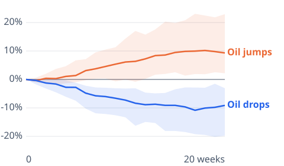

# [oil-prices-falling](https://mkviz.com/oil-prices-falling/)

Run from the repository root after `cd engine && cargo build --release && cd ..`.

## gas-after-oil-moves

Data: [gas-after-oil-moves.csv](gas-after-oil-moves.csv) · settings: [gas-after-oil-moves.json](gas-after-oil-moves.json)

