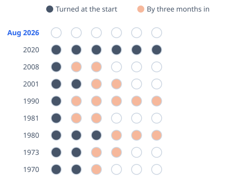

# [Recession Indicators: Are We in a Recession Right Now?](https://mkviz.com/recession-indicators/)

## Research note

**Question.** Is the US in a recession now, judged by the numbers the National Bureau of Economic Research (NBER) uses to date recessions? And how many of those numbers had turned down when past recessions began?

**Short answer.** As of August 2026, the last month all six are published, zero of the six monthly indicators the NBER's dating committee watches were 0.5% or more below their own high of the past six months. In each of the eight recessions since 1970, at least one already was in the month the recession began (a median of two), and a median of four three months in. In months outside recessions, one or more was off its high about 45% of the time, three or more only 4% of the time. The three early warnings we track (Sahm rule, weekly jobless claims, the yield curve) were also off.

### Data
- The six monthly series the NBER names in its business-cycle dating procedure, via FRED: payroll employment (PAYEMS), household employment (CE16OV), real personal income less transfers (W875RX1), real personal consumption expenditures (DPCERA3M086SBEA, the index form, monthly since 1959), real manufacturing and trade sales (CMRMTSPL, since 1967) and industrial production (INDPRO).
- NBER recession months (USREC). Real-time Sahm rule (SAHMREALTIME), unemployment rate (UNRATE), initial jobless claims (ICSA, weekly), 10-year minus 3-month Treasury spread (T10Y3M, daily).
- The common sample starts in January 1967 (manufacturing and trade sales), so the test covers the eight recessions from 1970 to 2020.

### Method
For every month in which all six series have a value, each series is compared with its own highest value of the last six months (that month included). A series counts as "turned down" if it is at least 0.5% below that high. The count (0 to 6) is compared with the count in the month each NBER recession began and three months later, and with how often months outside recessions reached each count.

```
./engine/target/release/mkviz-engine breadth data/macro/fred_USREC.csv --series data/macro/fred_PAYEMS.csv,data/macro/fred_CE16OV.csv,data/macro/fred_W875RX1.csv,data/macro/fred_DPCERA3M086SBEA.csv,data/macro/fred_CMRMTSPL.csv,data/macro/fred_INDPRO.csv --window 6 --drop 0.005
```
(`breadth` and the `figure breadth` frame were added to the engine for this page.)

### Results

| Recession began | Turned down that month | Three months later |
|---|---|---|
| January 1970 | 2 | 3 |
| December 1973 | 2 | 4 |
| February 1980 | 3 | 6 |
| August 1981 | 1 | 3 |
| August 1990 | 1 | 6 |
| April 2001 | 2 | 4 |
| January 2008 | 1 | 3 |
| March 2020 | 6 | 6 |
| **Now (August 2026)** | **0** | |

Months outside recessions since 1967 with at least k of the six turned down: one or more 45%; two or more 18%; three or more 4%; four or more 2%.

Each series against its six-month high, latest month: payroll jobs 0.0% (October), household employment 0.0% (October), real income less transfers -0.3% (September), real consumer spending 0.0% (September), real manufacturing and trade sales 0.0% (August), industrial production 0.0% (September).

### Early warnings, November 2026
- Sahm rule, real time: zero in October (signals at 0.5); unemployment 4.1%.
- Initial jobless claims, 4-week average: 195,250 in the week to Nov. 7, 0% above its low of the past year (our warning line is 20%).
- Yield-curve model: a 9% chance of recession within 12 months, from a probit on the monthly 10-year minus 3-month spread fitted on 1982-2025 (`recession-prob`, spread 0.71 points so far in November).
- How often each warning has been right before: see the [Recession Watch note](https://mkviz.com/recession-watch/).

### Limits
- These series are revised, sometimes a lot; the counts use today's revised data, not what was known at the time.
- The 0.5% and six-month settings are our choices. A smaller drop counts more noise; a longer window counts slow declines.
- Eight recessions is a small sample, and 2020 was a sudden shutdown, not a typical slide.
- The NBER weighs these series by judgment and also looks at quarterly GDP and other data; this count is not its method, only a way to see what it sees.

### Sources
- NBER, Business Cycle Dating Procedure: Frequently Asked Questions: https://www.nber.org/research/business-cycle-dating/business-cycle-dating-procedure-frequently-asked-questions
- NBER, Business Cycle Dating Committee Announcements (announcement lags): https://www.nber.org/research/business-cycle-dating/business-cycle-dating-committee-announcements
- FRED series listed above: https://fred.stlouisfed.org/

### Builds on and leads to
- Early-warning history: [Recession Watch](https://mkviz.com/recession-watch/) and [yield curve inversion](https://mkviz.com/yield-curve-inversion/).
- Open: a real-time version using first-print data (ALFRED), to see what the count showed when each recession was actually under way.

### Cite
MKViz (2026). *Recession indicators tracker.* https://mkviz.com/recession-indicators/ ; code and data: https://github.com/CertainAmount/mkviz-engine/tree/main/data/recession-indicators

## Charts

Run from the repository root after `cd engine && cargo build --release && cd ..`.

## recession-breadth

Data: [recession-breadth.csv](recession-breadth.csv) · settings: [recession-breadth.json](recession-breadth.json)



```
./engine/target/release/mkviz-engine figure breadth data/series/fred_USREC.csv --drop 0.005 --legend 'Turned at the start,By three months in' --names 'Payroll jobs,Household employment,Real income less transfers,Real consumer spending,Real factory and trade sales,Industrial production' --now 'Aug 2026' --series data/series/fred_PAYEMS.csv,data/series/fred_CE16OV.csv,data/series/fred_W875RX1.csv,data/series/fred_DPCERA3M086SBEA.csv,data/series/fred_CMRMTSPL.csv,data/series/fred_INDPRO.csv --title 'How many of the six had turned down' --window 6 --out recession-breadth.svg
```
