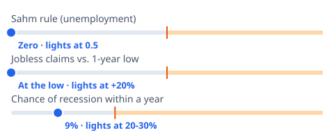
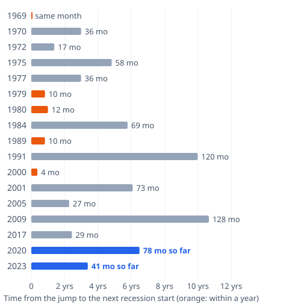
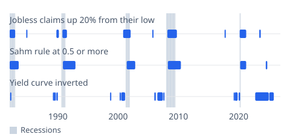

# [Is a Recession Coming? Not Yet, Say Our 3 Warning Lights](https://mkviz.com/recession-watch/)

## Research note

**Question.** Do three early recession warnings (the Sahm rule, a 20% rise in the 4-week average of jobless claims from its one-year low, an inverted 10-year minus 3-month yield curve) say a recession is coming, how often has each been right, and do two lit together mean more?

**Short answer.** As of mid-November 2026 none is on: Sahm zero, claims average 195,250 near its low, model 9%. Since 1968 the claims warning lit 17 times and a recession began within a year five times. Since 1982, outside recessions and the year after each, two of the three were on together four times; two came before a recession, and the yield curve was in every pair. Claims and the Sahm rule were never on together outside that aftermath since 1968.

### Data
FRED: SAHMREALTIME, ICSA (weekly), T10Y3M (daily), UNRATE, USREC (NBER recession months).

### Method
A signal is on in a month if any reading that month crossed its line (Sahm 0.5 or more; claims 4-week average 20% or more above its 52-week low; spread below zero). Pairs are runs of months with at least two on, starting outside a recession and outside the 12 months after one ended. Lead is months from the first month of a run to the next recession start; for each recession start, whether a pair was on in the 12 months before.

```
./engine/target/release/mkviz-engine together data/series/fred_USREC.csv --signals "data/series/fred_ICSA.csv threshold=0.2 avg=4 from-low=52;data/series/fred_SAHMREALTIME.csv threshold=0.5;data/series/fred_T10Y3M.csv threshold=0 below" --k 2 --settle 12 --window 12
./engine/target/release/mkviz-engine lead data/series/fred_ICSA.csv --avg 4 --from-low 52 --threshold 0.2 --event data/series/fred_USREC.csv
```
(`together`, and the `events_checked`/`events_caught` fields of `lead`, were added to the engine for this update.)

### Results

| Two on together | Which two | Recession within a year |
|---|---|---|
| Oct. 1989 | Claims, yield curve | Aug. 1990 (10 months) |
| Nov. 2000 | Claims, yield curve | Apr. 2001 (5 months) |
| June 2023 | Claims, yield curve | None so far |
| July 2024 | Sahm rule, yield curve | None so far |

- Recessions without a pair in the 12 months before: 2008, 2020.
- Single lights, caught within 12 months before to 3 months after each recession start: claims 8 of 8 (since 1970), Sahm 7 of 8 (in 1990 it reached 0.5 in November, three months in, just past the window), yield curve 4 of 4 (since 1982).

### Limits
- Four pairs and four recessions since 1982 is a very small sample.
- Revised data, not what was known at the time (except the real-time Sahm series).
- The month rule ("any reading that month") turns daily and weekly series on more easily than a monthly average would. With monthly averages the four pairs stay the same, but the 1989 pair starts in December (8 months before the recession, not 10).

### Sources
- FRED series above: https://fred.stlouisfed.org/
- Claudia Sahm's rule, FRED SAHMREALTIME: https://fred.stlouisfed.org/series/SAHMREALTIME

### Builds on and leads to
- [Recession indicators](https://mkviz.com/recession-indicators/): whether a recession has already started, by the six numbers the NBER names.

### Cite
MKViz (2026). *Recession watch.* https://mkviz.com/recession-watch/ ; code and data: https://github.com/CertainAmount/mkviz-engine/tree/main/data/recession-watch

## Charts

Run from the repository root after `cd engine && cargo build --release && cd ..`.

## rw-board

Data: [rw-board.csv](rw-board.csv) · settings: [rw-board.json](rw-board.json)



```
./engine/target/release/mkviz-engine figure board data/series/fred_UNRATE.csv --rows 'Sahm rule (unemployment):0.0:0.5:1.0:Zero · lights at 0.5;Jobless claims vs. 1-year low:0.0:0.2:0.4:At the low · lights at +20%;Chance of recession within a year:0.09:0.2:0.6:9% · lights at 20-30%' --title 'Three recession warning lights, as of early November 2026' --out rw-board.svg
```

## rw-claims

Data: [rw-claims.csv](rw-claims.csv) · settings: [rw-claims.json](rw-claims.json)



```
./engine/target/release/mkviz-engine figure lead data/series/fred_ICSA.csv --avg 4 --axis 'Time from the jump to the next recession start (orange: within a year)' --event data/series/fred_USREC.csv --from-low 52 --mark 12 --threshold 0.2 --title 'Each jump in jobless claims since 1968: months until the next recession began' --zero-label 'same month' --out rw-claims.svg
```

## rw-lights

Data: [rw-lights.csv](rw-lights.csv) · settings: [rw-lights.json](rw-lights.json)



```
./engine/target/release/mkviz-engine figure lights data/series/fred_USREC.csv --from 1982-01 --labels 'Jobless claims up 20% from their low,Sahm rule at 0.5 or more,Yield curve inverted' --signals 'data/series/fred_ICSA.csv threshold=0.2 avg=4 from-low=52;data/series/fred_SAHMREALTIME.csv threshold=0.5;data/series/fred_T10Y3M.csv threshold=0 below' --title 'When each warning light was on, 1982-2026' --out rw-lights.svg
```
