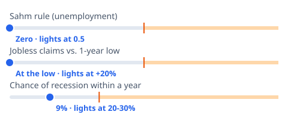
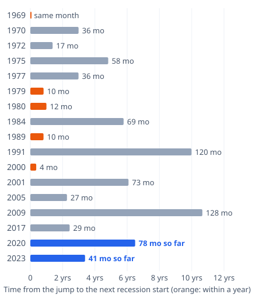

# [Is a Recession Coming? Not Yet, Say Our 3 Warning Lights](https://mkviz.com/recession-watch/)

Run from the repository root after `cd engine && cargo build --release && cd ..`.

## rw-board

Data: [rw-board.csv](rw-board.csv) · settings: [rw-board.json](rw-board.json)



```
./engine/target/release/mkviz-engine figure board data/series/fred_UNRATE.csv --rows 'Sahm rule (unemployment):0.0:0.5:1.0:Zero · lights at 0.5;Jobless claims vs. 1-year low:0.0:0.2:0.4:At the low · lights at +20%;Chance of recession within a year:0.09:0.2:0.6:9% · lights at 20-30%' --title 'Three recession warning lights, as of early November 2026' --out rw-board.svg
```

## rw-claims

Data: [rw-claims.csv](rw-claims.csv) · settings: [rw-claims.json](rw-claims.json)



```
./engine/target/release/mkviz-engine figure lead data/series/fred_ICSA.csv --avg 4 --axis 'Time from the jump to the next recession start (orange: within a year)' --event data/series/fred_USREC.csv --from-low 52 --mark 12 --threshold 0.2 --title 'Each jump in jobless claims since 1968: months until the next recession began' --zero-label 'same month' --out rw-claims.svg
```
