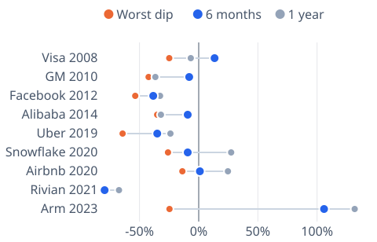

# [spacex-stock](https://mkviz.com/spacex-stock/)

Run from the repository root after `cd engine && cargo build --release && cd ..`.

## ipo-cases

Data: [ipo-cases.csv](ipo-cases.csv) · settings: [ipo-cases.json](ipo-cases.json)

