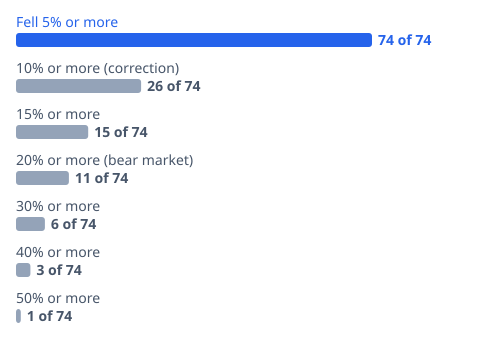
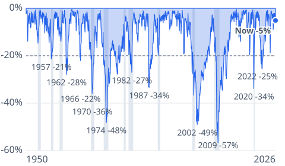

# [Stock Market Corrections Since 1950: How Often a Dip Goes Deeper](https://mkviz.com/stock-market-corrections-history/)

## Research note

**Question.** When the S&P 500 is 5% below its record, how often has the decline gone on to a 10% correction or a 20% bear market, and how long did it take to get back to the record at each depth?

**Short answer.** On Nov. 16, 2026 the S&P 500 closed 5.1% below its record close of Oct. 6 (its lowest close so far was 5.9% below, on Nov. 5). Of the 74 completed declines of 5% or more since 1950, 26 reached 10% (35%) and 11 reached 20% (15%). Declines that stopped between 5% and 10% took a median of 2.4 months from record to new record; between 10% and 20%, seven months; 20% or more, 24.5 months.

### Data
- S&P 500 index daily closes, Jan. 3, 1950 to Nov. 16, 2026 (77 years), from Yahoo Finance (^GSPC). This is the price index: it leaves out dividends.
- NBER recession months (USREC) via FRED.

### Method
A decline starts on the first close at least 5% below the prior record close and ends at the next record close. Its depth is the lowest close in between. Each depth row counts the completed declines whose low reached it. Recovery time is calendar days from the record before the decline to the next record, for declines whose low fell between that depth and the next. The decline still under way is not counted.

```
./engine/target/release/mkviz-engine ladder data/series/index_gspc_long.csv --depths 0.05,0.10,0.15,0.20,0.30,0.40,0.50
./engine/target/release/mkviz-engine drawdowns data/series/index_gspc_long.csv --threshold 0.10 --deep 0.20 --flag data/series/fred_USREC.csv
```
(`ladder` and `figure ladder` were added to the engine for this page; `figure underwater` now samples each month's deepest close against the daily record.)

### Results

| Depth reached | Declines (of 74) | Median months to a new record, for declines that stopped in this band |
|---|---|---|
| 5% | 74 | 2.4 (stopped before 10%) |
| 10% | 26 | 7 (stopped before 20%) |
| 15% | 15 | |
| 20% | 11 | 24.5 (all 20%+) |
| 30% | 6 | |
| 40% | 3 | |
| 50% | 1 | |

- Of the 26 corrections, 42% went on to 20%.
- Corrections that stopped short of 20% hit bottom a median of 18 days after first closing 10% down.
- Of the 11 declines of 20% or more, seven overlapped an NBER recession.
- Longest waits for a new record: 1973 (7.5 years), 2000 (7.2 years), 2007 (5.5 years, after a 56.8% fall). The 2025 decline (18.9%) took 4.2 months.

### Limits
- Price index only. With dividends reinvested, records come back sooner, most of all in the long 1970s and 2000s declines.
- No adjustment for inflation.
- The 5% start line and record-to-record timing are our choices; other studies measure corrections from 10% or time them to the bottom.
- Recovery times only exist after a decline ends: at 5% down, nobody knows which row this one will end in.

### Sources
- Yahoo Finance, S&P 500 (^GSPC) history: https://finance.yahoo.com/quote/%5EGSPC/history/
- FRED, NBER based Recession Indicators for the United States (USREC): https://fred.stlouisfed.org/series/USREC

### Builds on and leads to
- [Nasdaq correction history](https://mkviz.com/nasdaq-correction-history/): the same count on the Nasdaq since 1971.
- [Recession indicators](https://mkviz.com/recession-indicators/): most 20% declines came with a recession.
- Open: the same ladder on total return (with dividends), and on the real (inflation-adjusted) index.

### Cite
MKViz (2026). *Stock market corrections since 1950.* https://mkviz.com/stock-market-corrections-history/ ; code and data: https://github.com/CertainAmount/mkviz-engine/tree/main/data/stock-market-corrections-history

## Charts

Run from the repository root after `cd engine && cargo build --release && cd ..`.

## sp500-dip-ladder

Data: [sp500-dip-ladder.csv](sp500-dip-ladder.csv) · settings: [sp500-dip-ladder.json](sp500-dip-ladder.json)



Drawn from market prices we don't redistribute; the chart data is in the CSV.

## sp500-underwater

Data: [sp500-underwater.csv](sp500-underwater.csv) · settings: [sp500-underwater.json](sp500-underwater.json)



Drawn from market prices we don't redistribute; the chart data is in the CSV.
