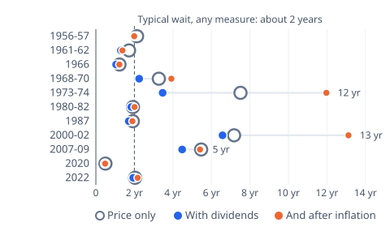

# [Stock Market Recovery Time: Usually 2 Years, Up to 13 After Inflation](https://mkviz.com/stock-market-recovery-time/)

## Research note

**Question.** After the S&P 500 falls 20% or more from a record, how long until it is back, and does the answer change once dividends and inflation are counted?

**Short answer.** The 11 bear markets since 1950 took a median of two years from the record to a new record by the price index. With dividends reinvested the median is 1.9 years, and with dividends after inflation two. The medians agree; the long cases do not. The January 1973 record took 7.5 years by price, 3.5 with dividends and 12 with dividends after inflation (back in 1,985). The March 2000 record took 7.2, 6.6 and 13.1 years (back in 2,013). Declines that stopped between 10% and 20% took a median of seven months to a new record; 11 of the 26 declines that reached 10% went on to 20%.

### Definitions
- Bear market: a decline of 20% or more in the S&P 500 daily close from a record close, ending at the next record close (engine `drawdowns --threshold 0.20` on Yahoo's ^GSPC daily closes since Jan. 3, 1950). The start date for every measure below is the price record's date.
- Price only: years from the price record to the first close at or above it after the bear market's low.
- With dividends: a total return index (dividends reinvested). Before 1988 it is built monthly from Robert Shiller's S&P Composite data, TR_t = TR_{t-1} × (P_t + D_t/12) / P_{t-1}, where P is the monthly average price and D the yearly dividend; from 1988 it is the S&P 500 total return index (^SP500TR) daily, chained to the monthly index at its first month. The start value is the highest value of that index from the price record to the price low (in 2000 the total return index set its own record in September, after the price record in March), and recovery is the first date after the price low at or above it.
- Dividends after inflation: the same index divided by the consumer price index (BLS CPI-U, not seasonally adjusted, FRED CPIAUCNS), same rule.
- Other definitions: many articles count from the bottom to the old high, or use monthly closes; counting from the record (the investor who bought at the top) gives longer times. Before 1988 the two dividend measures are monthly averages, so their start values sit a little below the daily record and recover a little sooner; the price-only column is daily throughout.
- Re-scan: every run of 20%+ declines in the daily S&P 500 since 1950 was listed; 11 completed and none was dropped. The decline under way since Oct. 6, 2026 (11.6% at the Nov. 20 close) has not reached 20% and is not counted.

### Data
- S&P 500 daily close (Yahoo Finance ^GSPC), Jan. 3, 1950 to Nov. 20, 2026.
- S&P 500 total return index (Yahoo Finance ^SP500TR), daily, Jan. 4, 1988 to Nov. 20, 2026.
- Robert Shiller, U.S. stock market data (monthly S&P Composite price and dividends), 1871 to 2024.
- BLS consumer price index, CPI-U, not seasonally adjusted (FRED CPIAUCNS), through October 2026.

### Method

```
python -m msci.cli shiller
./engine/target/release/mkviz-engine drawdowns data/macro/index_gspc_long.csv --threshold 0.20
./engine/target/release/mkviz-engine regain data/macro/index_gspc_long.csv --dates <11 peaks> --lows <11 lows>
./engine/target/release/mkviz-engine regain data/macro/index_sp500tr.csv --splice data/macro/shiller_tr.csv --dates <peaks> --lows <lows>
./engine/target/release/mkviz-engine regain data/macro/index_sp500tr.csv --splice data/macro/shiller_tr.csv --deflate data/macro/fred_CPIAUCNS.csv --dates <peaks> --lows <lows>
./engine/target/release/mkviz-engine dca data/macro/index_sp500tr.csv --splice data/macro/shiller_tr.csv --deflate data/macro/fred_CPIAUCNS.csv --dates <peaks> --lows <lows>
./engine/target/release/mkviz-engine figure rowdots <any csv> --unit yr --rows "<bear>:<price>,<dividends>,<real>;…" --marks "Price only,With dividends,Dividends after inflation" --out bear-market-recovery-years.svg
```
(`regain`, `dca` and `rowdots --unit yr` were added to the engine for this note; the Shiller adapter is new.)

### Results

Years from the price record to getting it back:

| Bear market (record → low) | Fall, price | Price only | With dividends | Dividends after inflation |
|---|---|---|---|---|
| Aug. 1956 → Oct. 1957 | 21.5% | 2.1 | 2.0 | 2.0 |
| Dec. 1961 → June 1962 | 28.0% | 1.7 | 1.3 | 1.4 |
| Feb. 1966 → Oct. 1966 | 22.2% | 1.2 | 1.1 | 1.2 |
| Nov. 1968 → May 1970 | 36.1% | 3.3 | 2.3 | 3.9 |
| Jan. 1973 → Oct. 1974 | 48.2% | 7.5 | 3.5 | 12.0 |
| Nov. 1980 → Aug. 1982 | 27.1% | 1.9 | 1.8 | 2.0 |
| Aug. 1987 → Dec. 1987 | 33.5% | 1.9 | 1.7 | 1.9 |
| March 2000 → Oct. 2002 | 49.1% | 7.2 | 6.6 | 13.1 |
| Oct. 2007 → March 2009 | 56.8% | 5.5 | 4.5 | 5.4 |
| Feb. 2020 → March 2020 | 33.9% | 0.5 | 0.5 | 0.5 |
| Jan. 2022 → Oct. 2022 | 25.4% | 2.0 | 1.9 | 2.2 |
| Median | | 2 | 1.9 | 2 |

- Inflation averaged 7.8% a year from January 1973 to January 1985, against 2.0% from October 2007 to March 2013. The 2007 fall was the deepest of the eleven but, after inflation, took less than half as long as 1973.
- 2000 is long by every measure because a second bear market (2007-09) began before the first was made up after inflation.
- Depth alone does not set the wait: the 2020 fall (34%) was made up in about half a year, the 1968 fall (36%) took three to four years.
- three of the eleven took more than five years by price; after inflation the same three did, and two took twelve or more.

Monthly investing (engine `dca`): someone puts the same amount, raised with inflation, into the total return index every month from the month of the record, buying at each month's last value. Months until the account is worth at least everything paid in, after inflation, counted only after the month of the price low:

| Bear market | Months | Deepest shortfall vs money paid in |
|---|---|---|
| 1956-57 | 22 | 10.3% |
| 1961-62 | 12 | 15.8% |
| 1966 | 11 | 9.5% |
| 1968-70 | 26 | 21.1% |
| 1973-74 | 36 | 33.4% |
| 1980-82 | 23 | 12.6% |
| 1987 | 10 | 15.3% |
| 2000-02 | 45 | 31.7% |
| 2007-09 | 25 | 34.9% |
| 2020 | 2 | 6.1% |
| 2022 | 15 | 13.8% |
| Median | 22 | |

Against one sum at the record (median 24 months after inflation), monthly buying barely changed a typical case and cut the three long ones from 5 to 13 years to 25 to 45 months. Without the inflation adjustment the median is 21 months.

### Limits
- Eleven cases. Three of them carry the long tail.
- Dividends are reinvested without tax or fees; a taxable account and fund costs make every dividend column a little longer.
- Before 1988 the dividend measures are monthly averages (see Definitions).
- The monthly-investing test buys at each month's last value, with no fees or taxes, and raises the amount with inflation.

### Sources
- Yahoo Finance, S&P 500 (^GSPC) history: https://finance.yahoo.com/quote/%5EGSPC/history/
- Yahoo Finance, S&P 500 total return (^SP500TR): https://finance.yahoo.com/quote/%5ESP500TR/history/
- Robert Shiller, U.S. stock market data: https://shillerdata.com/
- BLS via FRED, CPI-U not seasonally adjusted (CPIAUCNS): https://fred.stlouisfed.org/series/CPIAUCNS

### Builds on and leads to
- Builds on [Stock market corrections since 1950](https://mkviz.com/stock-market-corrections-history/) (every decline of 5% or more, price only) and [How often do corrections happen?](https://mkviz.com/how-long-do-corrections-last/).
- Open: the same with taxes on dividends; monthly investing that starts at the low instead of the record.

### Cite
MKViz (2026). *Stock market recovery time.* https://mkviz.com/stock-market-recovery-time/ ; code and data: https://github.com/CertainAmount/mkviz-engine/tree/main/data/stock-market-recovery-time

## Charts

Run from the repository root after `cd engine && cargo build --release && cd ..`.

## bear-market-recovery-years

Data: [bear-market-recovery-years.csv](bear-market-recovery-years.csv) · settings: [bear-market-recovery-years.json](bear-market-recovery-years.json)



```
./engine/target/release/mkviz-engine figure rowdots data/series/fred_USREC.csv --line '2|Typical wait, any measure: about 2 years' --marks 'Price only,With dividends,And after inflation' --rows '1956-57:2.14,1.99,1.99;1961-62:1.72,1.3,1.38;1966:1.23,1.05,1.22;1968-70:3.27,2.25,3.92;1973-74:7.51,3.47,11.97;1980-82:1.93,1.84,2.01;1987:1.92,1.71,1.9;2000-02:7.18,6.58,13.12;2007-09:5.47,4.48,5.41;2020:0.5,0.47,0.48;2022:2.04,1.94,2.17' --title 'Years from the record to getting it back, 11 bear markets' --unit yr --out bear-market-recovery-years.svg
```
