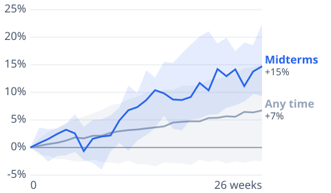
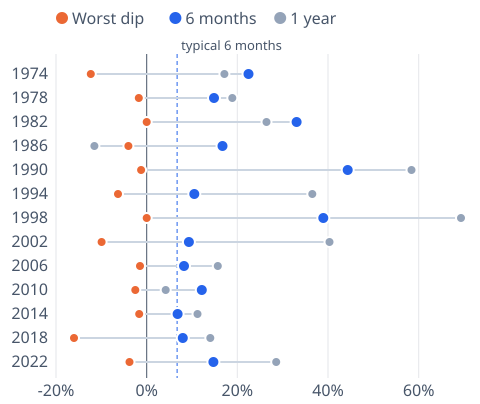
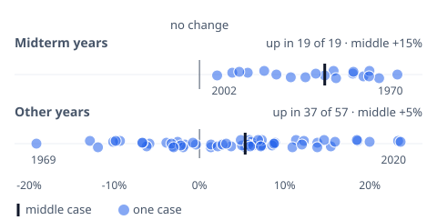

# [Stocks After Midterm Elections Beat the Same Months of Other Years](https://mkviz.com/stocks-after-midterm-elections/)

## Research note

**Question.** What do stocks do in the six months and year after a US midterm election, and is the usual explanation, that November to May is a strong season anyway, enough to account for it?

**Short answer.** In all 13 midterms since 1974 the Nasdaq was higher six months later (median 14.7%), and in all 19 since 1950 the S&P 500 was too (median 14.7%). The same early-November-to-May stretch in the other years did not do that: the S&P 500 rose in 37 of 57 (median 5.4%) and the Nasdaq in 26 of 41 (median 8.0%), close to any six months. The season does not explain the midterm record. Since the Nov. 3, 2026 vote the Nasdaq was down 5.1% to Nov. 23.

### Definitions
- Election day: the Tuesday after the first Monday in November. Same calendar date in non-midterm years for the comparison set.
- Change: index close on the trading day at or before the date, to the close 182 days (six months) or 365 days later (engine `events`, price only, no dividends).
- Baseline: (1) any 182-day window since the index starts (engine `base_median`, `base_up_share`); (2) the same early-November start in every non-midterm year, which holds the season fixed.
- Indexes: Nasdaq Composite (the long file index_ixic_long for the other-years count, 26 of 41; FRED NASDAQCOM gives 27 of 41 because of small date differences) and S&P 500 (Yahoo ^GSPC, from 1950).
- Other definitions: the Motley Fool's S&P 500 study (1874-) uses 12 months and averages; Stock Trader's Almanac's "presidential cycle" uses calendar years. Our six-month window from election day is the question people ask in November.
- Re-scan: every midterm from 1950 (S&P 500) and 1974 (Nasdaq; the index starts in 1971, so 1974 is the first full midterm) to 2022 is in; none dropped. Non-midterm years: 1950-2025 for the S&P 500 (57), 1972-2025 for the Nasdaq (41).

### Data
- Nasdaq Composite: FRED NASDAQCOM to Nov. 23, 2026. S&P 500: Yahoo Finance ^GSPC daily from Jan. 3, 1950 to Nov. 23, 2026.

### Method

```
./engine/target/release/mkviz-engine events data/macro/index_ixic_long.csv --dates <13 midterm election days 1974-2022> --forward 91,182,365
./engine/target/release/mkviz-engine events data/macro/index_ixic_long.csv --dates <41 non-midterm early-November dates 1972-2025> --forward 182,365
./engine/target/release/mkviz-engine events data/macro/index_gspc_long.csv --dates <19 midterm election days 1950-2022> --forward 182,365
./engine/target/release/mkviz-engine events data/macro/index_gspc_long.csv --dates <57 non-midterm dates 1950-2025> --forward 182,365
./engine/target/release/mkviz-engine figure strips data/macro/index_gspc_long.csv --sets "Midterm years=…;Other years=…" --days 182 --out midterm-vs-other-years.svg
./engine/target/release/mkviz-engine figure fan data/macro/fred_NASDAQCOM.csv --dates <13 midterms> --weeks 26 --base --out nasdaq-after-midterms.svg
./engine/target/release/mkviz-engine figure cases data/macro/fred_NASDAQCOM.csv --dates <13 midterms> --forward 182,365 --out midterm-cases.svg
```

### Results

| Six months after early November | Up | Median |
|---|---|---|
| Nasdaq, midterm years 1974-2022 | 13 of 13 | +14.7% |
| Nasdaq, other years 1972-2025 | 26 of 41 | +8.0% |
| Nasdaq, any six months since 1971 | +70% | +6.7% |
| S&P 500, midterm years 1950-2022 | 19 of 19 | +14.7% |
| S&P 500, other years 1950-2025 | 37 of 57 | +5.4% |

A year after: Nasdaq higher in 12 of 13 midterms (1986 the exception, -11.5%); S&P 500 higher in 19 of 19; S&P 500 other years 39 of 57 (median 9.3%). 2026 so far (Nov. 3 to Nov. 23): Nasdaq -5.1%, S&P 500 -4.4%.

**Two splits (added Nov. 28, 2026).** S&P 500 six-month change from election day (engine `events`, per-event values), sorted two ways:

| Midterms since 1950 | Cases | Higher | Median |
|---|---|---|---|
| President's party lost control of the House or Senate (1954, 1986, 1994, 2006, 2010, 2014, 2018, 2022) | 8 | 8 | +10.7% |
| President's party lost no chamber | 11 | 11 | +18.0% |
| S&P 500 10% or more below its one-year high on election day (1962, 1966, 1970, 1974, 1978, 1990, 2002, 2022) | 8 | 8 | +16.4% |
| Within 10% of its one-year high | 11 | 11 | +13.7% |

Party control from the House and Senate party-division records; "lost a chamber" counts only losses by the president's party (2002, when Republicans regained the Senate under a Republican president, is in the second row). The one-year high is the highest daily close in the 365 days to election day. Four of the six weakest runs, including the last three (2014, 2018, 2022), fall in the lost-a-chamber row; the weakest, 2002, is in the other, so the gap between rows is partly a gap between eras. Without the three largest gains (1970, 1990, 1986) the median of the remaining 16 is +13.0%. S&P 500 dips of more than 10% below the election-day level within six months: three (1974, 2002, 2018).

### Limits
- Midterms come every four years, so their six-month windows sit at the same point in the presidential term; 19 cases are fewer independent observations than they look.
- Several post-election gains began from fall lows (1974, 1990, 2002) that came weeks before the vote.
- A pattern this well known may be traded away; no data here can show whether it will hold.

### Sources
- FRED, NASDAQCOM: https://fred.stlouisfed.org/series/NASDAQCOM
- Yahoo Finance, S&P 500 (^GSPC) history: https://finance.yahoo.com/quote/%5EGSPC/history/
- The Motley Fool, Midterm election year stock market history: https://www.fool.com/research/midterm-election-year-stock-market-history/
- Brookings, What history tells us about the 2026 midterm elections: https://www.brookings.edu/articles/what-history-tells-us-about-the-2026-midterm-elections
- US House, Party Divisions: https://history.house.gov/Institution/Party-Divisions/Party-Divisions/
- US Senate, Party Division: https://www.senate.gov/history/partydiv.htm

### Builds on and leads to
- [How long do stock market corrections last?](https://mkviz.com/how-long-do-corrections-last/) (what a fall after the vote looked like before).

### Cite
MKViz (2026). *Stocks after midterm elections, against the same months in other years.* https://mkviz.com/stocks-after-midterm-elections/ ; code and data: https://github.com/CertainAmount/mkviz-engine/tree/main/data/stocks-after-midterm-elections

## Charts

Run from the repository root after `cd engine && cargo build --release && cd ..`.

## nasdaq-after-midterms

Data: [nasdaq-after-midterms.csv](nasdaq-after-midterms.csv) · settings: [nasdaq-after-midterms.json](nasdaq-after-midterms.json)



```
./engine/target/release/mkviz-engine figure fan data/series/fred_NASDAQCOM.csv --base --base-label 'Any time' --dates 1974-11-05,1978-11-07,1982-11-02,1986-11-04,1990-11-06,1994-11-08,1998-11-03,2002-11-05,2006-11-07,2010-11-02,2014-11-04,2018-11-06,2022-11-08 --label Midterms --title 'Nasdaq in the 26 weeks after each midterm election since 1974, versus any 26 weeks' --weeks 26 --out nasdaq-after-midterms.svg
```

## midterm-cases

Data: [midterm-cases.csv](midterm-cases.csv) · settings: [midterm-cases.json](midterm-cases.json)



```
./engine/target/release/mkviz-engine figure cases data/series/fred_CPIAUCSL.csv --dates 1974-11-05,1978-11-07,1982-11-02,1986-11-04,1990-11-06,1994-11-08,1998-11-03,2002-11-05,2006-11-07,2010-11-02,2014-11-04,2018-11-06,2022-11-08 --forward 182,365 --title 'In every midterm since 1974 the Nasdaq ended six months higher, though 1974 and 2018 dipped more than 10% first' --out midterm-cases.svg
```

## midterm-vs-other-years

Data: [midterm-vs-other-years.csv](midterm-vs-other-years.csv) · settings: [midterm-vs-other-years.json](midterm-vs-other-years.json)



Drawn from market prices we don't redistribute; the chart data is in the CSV.
